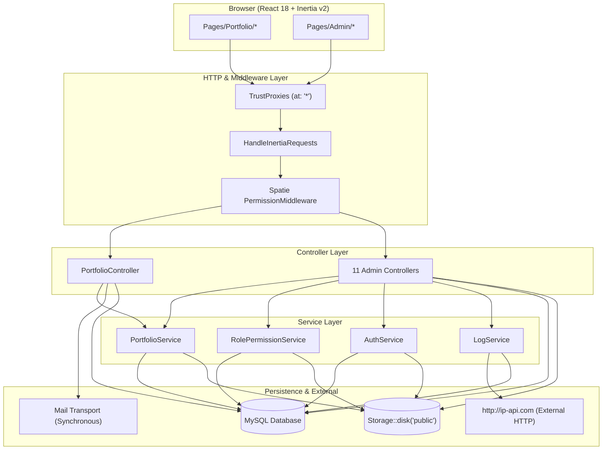

# Laravel Application Audit Report

## 1. Executive Summary

### Project Overview
**ZeeFolio** is a multi-user developer portfolio and content management platform that enables registered users to build, customize, and publish personal portfolios under custom URL slugs (`/{slug}`, `/{slug}/projects`, `/{slug}/projects/{projectSlug}`). It includes an administrative and member dashboard (`/admin/*`) featuring portfolio view analytics, content management (Hero/Home profile, Skills, Custom Tech Stacks, Work/Education Experiences, Projects with multi-image showcases, and Contact channels), member account management, and dynamic Role-Based Access Control (RBAC).

### Technology Stack & Versions
| Component | Version / Implementation | Source Reference |
|---|---|---|
| **PHP Requirement** | `^8.3` (Runtime CLI detected: `8.4.27`) | `composer.json#L12` |
| **Laravel Framework** | `^13.0` (Locked: `v13.42.0`) | `composer.json#L14`, `composer.lock` |
| **Frontend Stack** | React `^18.3.1`, Inertia.js `^2.0.0` (`inertia-laravel` `v2.0.28`), Vite `^7.0.7` | `package.json#L11-L37`, `composer.json#L13` |
| **Styling & Animation** | Tailwind CSS `^3.2.1` (with unused `@tailwindcss/vite` `^4.0.0`), GSAP `^3.13.0`, Framer Motion `^12.23.23`, OGL `^1.0.11` | `package.json#L12-L36` |
| **Authentication** | Stateful Web Session Guard (`web`), Laravel Sanctum `^4.0` (`v4.4.0`, installed but unused) | `config/auth.php#L38-L43`, `app/Services/AuthService.php` |
| **Authorization (RBAC)** | `spatie/laravel-permission` `^8.5` (`8.5.0`) + Custom `role` column on `users` | `composer.json#L17`, `app/Services/RolePermissionService.php` |
| **Database Engine** | MySQL / MariaDB (`DB_CONNECTION=mysql` in `.env.example`; SQLite `:memory:` in PHPUnit) | `.env.example#L23-L28`, `config/database.php` |
| **Cache / Session / Queue** | `database` driver configured by default for Cache, Session, and Queue | `.env.example#L30-L40` |

### Architecture Overview
The application follows a **Monolithic Server-Driven SPA** architecture powered by **Laravel + Inertia.js + React**:
- **Routing Layer**: Split modularly across `routes/web.php`, `routes/web/auth.php`, `routes/web/portfolio.php`, and `routes/web/dashboard/{overview,content,administration}.php`.
- **Controller Layer**: Divided into `App\Http\Controllers\Portfolio\PortfolioController` (public portfolio rendering and contact form handling) and `App\Http\Controllers\Admin\*` (11 controllers handling authentication, account management, dashboard analytics, portfolio content CRUD, member management, RBAC, and global settings).
- **Service Layer**: Contains 4 services (`PortfolioService`, `AuthService`, `RolePermissionService`, `LogService`) encapsulating partial business logic, file storage transactions, RBAC auto-bootstrapping, and activity logging.
- **Data Layer**: 16 Eloquent models (`app/Models/*`) interacting with MySQL tables defined across 12 migration files.

### Overall Audit Assessment
ZeeFolio demonstrates several positive engineering practices, including a clean modular React component hierarchy (`resources/js/Components/*`), transactional file-cleanup patterns (`DB::beginTransaction()` before deleting replaced files from storage), and Spatie permission middleware integration.

However, deep code inspection revealed **critical and high-severity security vulnerabilities**, **architectural anti-patterns**, and **significant performance bottlenecks** that make the application **unsafe for production deployment in its current state**:

1. **Arbitrary Public Storage File Deletion (Critical Security)**: `ProjectController::syncProjectShowcases()` trusts unvalidated user-supplied strings in `showcases.*.existing_images.*` and persists them to `project_images.image_path`. Because public registration (`/admin/register`) is open and grants `projects.manage`, any user can reference another user's or superadmin's files (CVs, avatars, project images) and then delete their own project/showcase to trigger `Storage::disk('public')->delete()`, wiping victim files from disk.
2. **Production Seeder Execution & Hardcoded Admin Creation on HTTP GET (Critical Security / Architecture)**: `MemberPortfolioController::index()` (`GET /admin/members`) checks if `alex.admin@zeefolio.dev` exists and, if absent, executes `DummyMemberPortfolioSeeder::run()` in live runtime—creating an active `admin` account (`alex.admin@zeefolio.dev`) and member accounts with the hardcoded password `'password'`.
3. **Synchronous Blocking External HTTP Calls on Every Logged Action (Critical Performance / Security)**: `LogService::getLocationFromIp()` makes a synchronous HTTP GET request to `http://ip-api.com/json/{$ip}` (3-second timeout, unencrypted HTTP) during the web request lifecycle on every login, failed login, registration, logout, and admin CRUD action.
4. **Stored XSS Vectors (High Security)**: `HomeController::update()` allows uploading `.svg` files (`mimes:...,svg`) to public storage (`portfolios/logos`) and accepts arbitrary strings (including `javascript:` URIs) in `social_media_links.*`, which are rendered directly into `<a href={...}>` on public portfolio pages.
5. **Broken Eloquent Cast & Double JSON-Encoding Bug (High Reliability / Performance)**: `Project` casts `image_path` (`VARCHAR(255)`) as `'array'`, while `ProjectController` and `PortfolioService` read `$project->getRawOriginal('image_path')`. Updating a project without replacing its cover image feeds the raw JSON string back into `$project->update()`, double-encoding it and breaking cover image URLs and file deletions.
6. **Cache Invalidation & Bypass Flaws (High Performance)**: `PortfolioService::hydrateExperienceTechStacks()` runs 3 uncached database queries (including `TechStack::all()`) on *every* public portfolio request outside `Cache::remember()`, while `MemberPortfolioController::promoteSkill()` calls `Cache::flush()`, wiping the entire application cache store.

---

## 2. Overall Scores

| Audit Dimension | Score | Rating |
|---|---:|---|
| **Performance Score** | **59 / 100** | **Poor** (Borderline *Needs Improvement*) |
| **Security Score** | **62 / 100** | **Needs Improvement** |
| **Overall Assessment** | **60.5 / 100** | **Needs Improvement — Not Production Ready Without Remediation** |

> **Audit Basis Note**: Scores are derived from comprehensive static source code, configuration, schema, and test suite inspection of the entire repository. Runtime load testing against a live production database and infrastructure-level server inspection (Nginx/Apache/OS firewall) are outside static workspace scope and are noted accordingly.

### Performance Score Breakdown

| Evaluation Category | Weight | Category Score (0–100) | Weighted Points | Scoring Rationale |
|---|---:|---:|---:|---|
| **Database & Query Optimization** | 25% | 60 | 15.00 | `hydrateExperienceTechStacks()` runs 3 uncached queries (`TechStack::all()`, `PortfolioUser::whereKey()`, `TechStackCategory::whereIn()`) on every public view; `DashboardController` loads up to 1 year of `PortfolioView` rows into memory; synchronous `PortfolioView::create()` on every page load; missing composite indexes on `logs`, `projects`, and `experiences`. |
| **Application Execution Efficiency** | 20% | 55 | 11.00 | Synchronous external HTTP request (`http://ip-api.com/json/{$ip}`) in `LogService` blocks every admin action; `HandleInertiaRequests` and `Gate::before` perform redundant RBAC/database checks on every request; runtime `Schema::hasColumn` / `Schema::hasTable` DDL checks run during HTTP requests. |
| **Caching Strategy** | 15% | 58 | 8.70 | `Cache::flush()` in `promoteSkill()` wipes the entire cache store; `SettingController` clears only the acting admin's portfolio cache when modifying global data; `hydrateExperienceTechStacks()` bypasses the portfolio cache; no `Cache::lock` / `Cache::flexible` stampede protection. |
| **Queue & Background Processing** | 10% | 35 | 3.50 | Neither `SendMailToMe` nor `VerifyEmailLink` implements `ShouldQueue`; emails and third-party IP geolocation lookups execute synchronously in HTTP requests; `app/Jobs/expired_token.php` is an empty no-op stub. |
| **API / Inertia Response Performance** | 10% | 68 | 6.80 | Public landing page (`PortfolioController::index`) serializes the entire `PortfolioUser` Eloquent graph (including all projects, inactive projects, and showcase galleries) without API Resources/DTO projection; `@routes` injects all admin routes into public HTML pages. |
| **Memory & Resource Management** | 10% | 65 | 6.50 | Unbounded `get()` queries in `DashboardController` (`portfolio_views`), `MemberPortfolioController` (`users` with 6 nested relations), and `RolePermissionService::syncExistingUsers()`; raw image uploads up to 4MB without server-side compression/WebP conversion. |
| **Laravel Optimization Practices** | 10% | 72 | 7.20 | Good use of `Vite::prefetch(concurrency: 3)` and post-commit file cleanup; penalized by `Project::$casts['image_path'] = 'array'` vs `getRawOriginal()` bug, case-mismatched asset paths (`Images/web_icon.png`), and leftover `public/hot` artifact. |
| **Total Performance Score** | **100%** | — | **58.70 → 59 / 100** | **Poor** |

### Security Score Breakdown

| Evaluation Category | Weight | Category Score (0–100) | Weighted Points | Scoring Rationale |
|---|---:|---:|---:|---|
| **Authentication & Authorization** | 20% | 52 | 10.40 | Arbitrary public file deletion via `showcases.*.existing_images` (SEC-01); production seeder execution creating hardcoded `admin` credentials on `GET /admin/members` (SEC-02); banned users not checked in middleware (SEC-03); hardcoded superadmin email/ID auto-promotion (SEC-04); IDOR on `tech_stack_ids` in `ProjectController` and global skill routes in `SettingController` (SEC-05). |
| **Input Validation & Data Protection** | 20% | 58 | 11.60 | Stored XSS via `.svg` upload in `HomeController` (SEC-06); unvalidated `javascript:` URIs in `social_media_links.*` (SEC-07); `getClientOriginalExtension()` used in `AuthService::register()` (SEC-08); inconsistent password/username rules in `RegisterRequest`. |
| **OWASP Vulnerability Prevention** | 20% | 65 | 13.00 | Unconditional `trustProxies(at: '*')` enables IP spoofing to bypass rate limits and inject into `ip-api.com` URLs (SEC-09); unthrottled `/messageMe` contact endpoints enable email spam/DoS (SEC-10); state-mutating `GET` endpoints (SEC-11). Parameterized SQL bindings are properly used. |
| **Session, Token & API Security** | 15% | 68 | 10.20 | `HandleInertiaRequests` exposes full `$user->toArray()` (including `ip_address`, `location`); inactive projects (`is_active = false`) are exposed publicly in `PortfolioController` (SEC-13); `SESSION_ENCRYPT=false` by default; `AccountController::updatePassword` does not invalidate other sessions. |
| **Infrastructure & Configuration** | 10% | 62 | 6.20 | Missing HTTP security headers (`CSP`, `X-Frame-Options`, `X-Content-Type-Options`, `HSTS`) and HTTPS scheme enforcement (SEC-14); unpinned `@latest` external CDN stylesheet without SRI (SEC-15); `database/seeders/` listed in `.gitignore` while imported by production controller. |
| **Dependency Security** | 10% | 80 | 8.00 | Up-to-date Laravel 13.42 / PHP 8.3+ / Spatie Permission 8.5; penalized by unused `laravel/sanctum` and `CookieTokenMiddleware`, duplicate Tailwind v3/v4 packages, and unpinned CDN dependency. |
| **Logging & Error Handling** | 5% | 55 | 2.75 | Cleartext HTTP transmission of user IP addresses to `http://ip-api.com` (SEC-16); PII logged on contact messages; no log retention/pruning for `logs` or `portfolio_views` tables. |
| **Total Security Score** | **100%** | — | **62.15 → 62 / 100** | **Needs Improvement** |

---

## 3. Project Architecture Analysis

### Existing Architecture & Application Layers


1. **Routing & Middleware Layer (`bootstrap/app.php`, `routes/web/*.php`)**:
   - All routes are web routes using session state and Inertia responses.
   - `HandleInertiaRequests` runs on every web request, sharing `auth.user`, `flash`, and `notifications`.
   - Admin routes under `/admin/*` are protected by `auth` and Spatie `permission:*` middleware aliases.
2. **Controller Layer (`app/Http/Controllers/*`)**:
   - Controllers are organized by feature domain (`HomeController`, `ProjectController`, `SkillController`, `TechStackController`, `ExperienceController`, `ContactController`, `AccountController`, `DashboardController`, `MemberPortfolioController`, `RolePermissionController`, `SettingController`).
   - However, **separation of concerns is inconsistent**: while `HomeController` and `ContactController` delegate persistence to `PortfolioService`, `ProjectController` (549 lines), `AccountController` (283 lines), `MemberPortfolioController` (330 lines), `RolePermissionController` (311 lines), `SettingController` (244 lines), and `SkillController` (219 lines) perform inline validation, complex database queries, file storage operations, and cache invalidation directly inside controller actions.
3. **Service Layer (`app/Services/*`)**:
   - `PortfolioService`: Manages portfolio caching, public retrieval, `Home`/`Contact` updates, and portfolio deletion.
   - `RolePermissionService`: Manages runtime table creation (`Schema::create`), default role/permission seeding, and user role synchronization.
   - `AuthService`: Handles session login, registration, and logout.
   - `LogService`: Writes activity logs to Laravel's log channel and the `logs` database table while querying `ip-api.com` for IP geolocation.
4. **Model & Database Layer (`app/Models/*`, `database/migrations/*`)**:
   - Uses Eloquent ORM with relationships connecting `User` → `PortfolioUser` → `{Home, Contact, Project, Experience, UserSkills, PortfolioView}`.

### Strengths
- **Modular Frontend Architecture**: React components are cleanly separated into thin route containers (`resources/js/Pages/*`), domain-scoped feature components (`resources/js/Components/Admin/*`, `resources/js/Components/Portfolio/*`), and reusable UI primitives (`resources/js/Components/UI/*`).
- **Post-Commit File Cleanup Pattern**: In `PortfolioService::editHomeSection()`, `AccountController::updateProfile()`, and `ProjectController::store()`, database transactions are committed before deleting old files from disk, and newly uploaded files are rolled back (deleted) if the SQL transaction fails.
- **Granular Permission Matrix**: Admin routes use logical Spatie permission names (`profile.manage`, `projects.manage`, `members.view`, `roles.manage`, etc.) rather than hardcoded role checks in routes.

### Architectural Weaknesses & Technical Debt
1. **Dual-State Role Architecture (`users.role` column vs. Spatie `model_has_roles`)**:
   - The application maintains both a legacy `users.role` string column (`superadmin`, `admin`, `member`) and Spatie's `roles`/`model_has_roles` tables. Keeping them synchronized requires defensive glue code scattered across `User::isSuperAdmin()`, `User::syncUserRole()`, `HandleInertiaRequests::share()`, `RolePermissionService::syncExistingUsers()`, `MemberPortfolioController::index()`, and `RolePermissionController::updateRole()`.
2. **Runtime Schema Mutations & Seeding in HTTP Lifecycle**:
   - `RolePermissionService::ensureTablesExist()` and `SkillController::ensureSkillCategoriesColumn()` execute `Schema::hasTable()`, `Schema::hasColumn()`, `Schema::create()`, and `Schema::table()` during web requests.
   - `MemberPortfolioController::index()` executes `DummyMemberPortfolioSeeder` during a `GET` request, and `PortfolioService::getPublicPortfolioBySlug()` creates database records during a public `GET` request.
3. **Dead Code, Orphaned Models, and Unused Tables**:
   - `app/Models/About.php`: References a non-existent `about` table (merged into `home`).
   - `app/Models/BalanceTrack.php`, `database/migrations/2026_01_02_000001_create_balance_track_table.php`, `database/factories/BalanceTrackFactory.php`, and `database/seeders/BalanceTrackSeeder.php` (called in `DatabaseSeeder.php#L58`, inserting 1,000 unrelated personal finance rows into `balance_track`!).
   - `app/Models/Settings.php` and `app/Models/PortfolioSetting.php`: Duplicate models both targeting the unused `settings` table (`2025_11_15_000001_create_settings_table.php`).
   - `app/Jobs/expired_token.php`: Empty job class with non-PSR-4 `snake_case` class name.
   - `app/Http/Middleware/CookieTokenMiddleware.php` & `app/Helpers/ResponseHelper.php`: Unused remnants of a token-based API.
   - `Contact` model (`app/Models/Contact.php#L20-L22,#L36-L43`): Defines `$fillable` attributes (`linkedin_url`, `github_url`, `website_url`) and `getSocialLinksAttribute()` for columns that do not exist in the `contacts` table.
   - `experiences.certificate_path` (`database/migrations/2025_10_16_000001_create_portfolio_tables.php#L54`): Exists in the database schema and frontend (`Experience.jsx#L133`), with a sample PDF in `storage/app/public/portfolios/cert/Magang Telkom.pdf`, but is omitted from `Experience::$fillable` and `ExperienceController`.
4. **Broken Test Suite (`tests/Feature/*`)**:
   - 8 of the 9 Feature test files (`ProfileTest.php`, `ExampleTest.php`, and all 6 files in `tests/Feature/Auth/*`) are unmodified Laravel Breeze scaffolding tests targeting routes (`/login`, `/register`, `/profile`, `/forgot-password`, `/confirm-password`) that do not exist in ZeeFolio (where auth lives under `/admin/login` and `/admin/register` and password reset routes are not registered).

---

## 4. Performance Audit

### Summary of Performance Findings

| ID | Title | Category | Severity | Classification |
|---|---|---|---|---|
| **PERF-01** | Uncached Queries & Full Table Scan Inside `hydrateExperienceTechStacks()` on Every Public View | Caching / Database | **High** | Confirmed Issue |
| **PERF-02** | In-Memory Time-Series Aggregation of Unbounded `PortfolioView` Rows in `DashboardController` | Database / Memory | **High** | Confirmed Issue |
| **PERF-03** | Synchronous Unbuffered `PortfolioView::create()` Write on Every Public Page Load | Database / Execution | **High** | Optimization Opportunity |
| **PERF-04** | Unbounded Eager Loading & Missing Pagination in `MemberPortfolioController` and `PortfolioService` | Database / Scalability | **Medium** | Optimization Opportunity |
| **PERF-05** | Missing Database Indexes on Frequently Filtered & Ordered Columns (`logs`, `projects`, `experiences`, `users`) | Database Schema | **Medium** | Confirmed Issue |
| **PERF-06** | Synchronous Blocking External HTTP Request (`ip-api.com`) in `LogService` on Every Admin Action | Application Execution | **Critical** | Confirmed Issue |
| **PERF-07** | Redundant Per-Request Database Queries in `HandleInertiaRequests` and `Gate::before` | Middleware / Execution | **High** | Confirmed Issue |
| **PERF-08** | Runtime DDL Schema Checks (`Schema::hasColumn` / `Schema::hasTable`) During HTTP Requests | Application Execution | **High** | Confirmed Issue |
| **PERF-09** | Full Cache Store Wipe (`Cache::flush()`) When Promoting a Member Skill | Caching Strategy | **High** | Confirmed Issue |
| **PERF-10** | Incorrect Cache Invalidation Scope When Updating Global Settings & Dead Cache Keys | Caching Strategy | **Medium** | Confirmed Issue |
| **PERF-11** | Synchronous Email Dispatching (`Mail::send`) Blocking Contact Form & Email Verification Requests | Queue & Background Jobs | **High** | Confirmed Issue |
| **PERF-12** | Over-Fetching & Unfiltered Serialization of Eloquent Graph on Public Portfolio Landing Page | Response Optimization | **Medium** | Optimization Opportunity |
| **PERF-13** | Global `@routes` (Ziggy) Payload Injected into Public Portfolio Pages & Case-Mismatched Asset Paths | Frontend / Laravel Optimization | **Low** | Best-Practice Recommendation |
| **PERF-14** | `Project::$casts['image_path'] = 'array'` vs `getRawOriginal()` Double JSON-Encoding & Orphaned Files | Eloquent / Storage | **High** | Confirmed Issue |

---

### Detailed Performance Findings

#### PERF-06: Synchronous Blocking External HTTP Request (`ip-api.com`) in `LogService` on Every Admin Action
- **Category**: Application Execution / Queue & Background Processing
- **Severity**: **Critical**
- **Classification**: Confirmed Issue
- **Affected File**: `app/Services/LogService.php` (Lines 12–44, 46–73)
- **Current Implementation**:
  ```php
  private function getLocationFromIp($ip)
  {
      if ($ip === '127.0.0.1' || $ip === '::1' || str_starts_with($ip, '192.168.')) {
          return 'Local';
      }

      try {
          $response = Http::timeout(3)->get("http://ip-api.com/json/{$ip}");
          // ...
  ```
- **Technical Explanation**:
  Every controller in `App\Http\Controllers\Admin\*` calls `$this->logService->infoLog(...)`, `warningLog(...)`, or `errorLog(...)` synchronously before returning an HTTP redirect response. In local development (`127.0.0.1`), `getLocationFromIp()` returns `'Local'` immediately, masking the bottleneck. In production (where client IPs are public), **every single logged action** (login, failed login, registration, logout, profile edit, project/skill/experience/category/role/member CRUD) makes a synchronous external HTTP GET request to `http://ip-api.com/json/{$ip}` with a 3-second timeout and no caching per IP.
- **Technical Impact & Consequences**:
  - Adds 150ms–3,000ms of synchronous network latency to every authenticated state change and every login attempt.
  - Under burst traffic or when `ip-api.com` throttles requests (free tier limits to 45 requests/minute per server IP), PHP-FPM workers block waiting on network I/O, leading to worker pool exhaustion and application-wide DoS.
- **Recommended Solution**:
  1. Remove synchronous external HTTP calls from the request cycle.
  2. Either resolve geolocation asynchronously via a queued job (`ShouldQueue`), use a local MaxMind GeoLite2 `.mmdb` database (zero network latency), or cache IP lookups (`Cache::remember("geoip:{$ip}", now()->addDays(7), ...)`) inside a queued listener.
- **Improved Implementation Example**:
  ```php
  // In LogService.php: record the log immediately without blocking on external HTTP,
  // or cache + dispatch a background update job if geolocation is required.
  private function getLocationFromIp(?string $ip): string
  {
      if (! $ip || $ip === '127.0.0.1' || $ip === '::1' || filter_var($ip, FILTER_VALIDATE_IP, FILTER_FLAG_NO_PRIV_RANGE | FILTER_FLAG_NO_RES_RANGE) === false) {
          return 'Local';
      }

      return Cache::get("geoip:{$ip}", 'Pending');
  }
  ```
- **Trade-offs & Side Effects**: Using a local GeoLite2 database requires periodic `.mmdb` file updates; dispatching a queued job requires an active queue worker (`php artisan queue:work`).
- **Implementation Complexity**: Low
- **Priority**: Priority 1 – Critical

---

#### PERF-01: Uncached Queries & Full Table Scan Inside `hydrateExperienceTechStacks()` on Every Public View
- **Category**: Caching Strategy / Database & Eloquent
- **Severity**: **High**
- **Classification**: Confirmed Issue
- **Affected File**: `app/Services/PortfolioService.php` (Lines 24–132)
- **Current Implementation**:
  ```php
  public function getPublicPortfolioBySlug(string $slug): ?PortfolioUser
  {
      $portfolioRecord = PortfolioUser::where('slug', $slug)->first(); // Query 1
      // ...
      return $this->getPublicPortfolio($portfolioRecord->user_id);
  }

  public function getPublicPortfolio(int $userId = 1): ?PortfolioUser
  {
      $user = User::findOrFail($userId); // Query 2
      $portfolio = $this->getPortfolio($user); // Cached by user_id

      return $this->hydrateExperienceTechStacks($portfolio); // Runs OUTSIDE cache!
  }

  protected function hydrateExperienceTechStacks(?PortfolioUser $portfolio): ?PortfolioUser
  {
      if ($portfolio && $portfolio->experiences) {
          $allTechStacks = TechStack::all()->keyBy( // Query 3: Full table scan of ALL tech_stacks!
              fn (TechStack $item) => Str::lower(trim($item->name))
          );
          // ...
      }
      if ($portfolio) {
          $rawCategories = PortfolioUser::whereKey($portfolio->id)->value('skill_categories') // Query 4!
              ?? $portfolio->skill_categories;
          // ...
          if (! empty($savedCategoryIds)) {
              $categoriesById = TechStackCategory::whereIn('id', $savedCategoryIds)->get()->keyBy('id'); // Query 5!
  ```
- **Technical Explanation**:
  Although `getPortfolio()` caches the `PortfolioUser` model under `portfolio:user:{$user->id}` for 3,600 seconds, `getPublicPortfolioBySlug()` and `hydrateExperienceTechStacks()` execute **5 database queries outside the cache on every single cache hit**:
  1. `PortfolioUser::where('slug', $slug)->first()` to resolve the slug to `user_id`.
  2. `User::findOrFail($userId)` in `getPublicPortfolio()`.
  3. `TechStack::all()` in `hydrateExperienceTechStacks()`, which loads **every global and custom tech stack across all users** into memory on every request.
  4. `PortfolioUser::whereKey($portfolio->id)->value('skill_categories')`, re-querying `portfolio_users` even though `$portfolio` was just loaded from cache.
  5. `TechStackCategory::whereIn('id', $savedCategoryIds)->get()`.
- **Technical Impact & Consequences**:
  - Defeats the purpose of `Cache::remember("portfolio:user:{$user->id}", 3600, ...)`.
  - As the number of users and custom tech stacks grows, `TechStack::all()` performs an increasingly expensive full-table scan and Eloquent hydration on every public portfolio page view.
- **Recommended Solution**:
  Move `hydrateExperienceTechStacks()` **inside** the `Cache::remember()` closure in `getPortfolio()`, scope `TechStack` lookup only to the tech stack names actually referenced by the user's experiences (and/or `availableFor($user)`), and remove the redundant `PortfolioUser::whereKey($portfolio->id)->value('skill_categories')` query. Cache a lightweight `portfolio:slug:{$slug}` → `user_id` mapping (invalidated when `slug` changes).
- **Improved Implementation Example**:
  ```php
  public function getPortfolio(User $user): ?PortfolioUser
  {
      $cacheKey = "portfolio:user:{$user->id}";

      return Cache::remember($cacheKey, 3600, function () use ($user) {
          $portfolio = $user->portfolioUser()
              ->with([
                  'home',
                  'userSkills.techStack.category',
                  'projects' => fn ($q) => $q->where('is_active', true)->orderBy('sort_order')->orderByDesc('id'),
                  'projects.techStacks',
                  'projects.images',
                  'contacts',
                  'experiences',
              ])
              ->first();

          return $this->hydrateExperienceTechStacks($portfolio, $user);
      });
  }
  ```
- **Trade-offs & Side Effects**: When a global `TechStack` icon or `TechStackCategory` name is updated in Admin Settings, portfolio caches must be invalidated (see PERF-10).
- **Implementation Complexity**: Low
- **Priority**: Priority 2 – High

---

#### PERF-02: In-Memory Time-Series Aggregation of Unbounded `PortfolioView` Rows in `DashboardController`
- **Category**: Database & Eloquent / Memory Management
- **Severity**: **High**
- **Classification**: Confirmed Issue
- **Affected File**: `app/Http/Controllers/Admin/DashboardController.php` (Lines 97–122)
- **Current Implementation**:
  ```php
  $totalViews = PortfolioView::query()
      ->where('portfolio_user_id', $portfolioUserId)
      ->count();

  $rows = PortfolioView::query()
      ->where('portfolio_user_id', $portfolioUserId)
      ->where('viewed_at', '>=', $startAt)
      ->get(['viewed_at', 'ip_hash']);

  $counts = array_fill(0, count($buckets), 0);
  $uniqueHashes = [];

  foreach ($rows as $row) {
      if ($row->ip_hash) {
          $uniqueHashes[$row->ip_hash] = true;
      }

      $timestamp = $row->viewed_at->getTimestamp();
      foreach ($buckets as $index => $bucket) {
          if ($timestamp >= $bucket['startTs'] && $timestamp < $bucket['endTs']) {
              $counts[$index]++;
              break;
          }
      }
  }
  ```
- **Technical Explanation**:
  When a user views `/admin/dashboard?range=1y` (or `6m`, `3m`, `1m`), `buildViewAnalytics()` fetches **every individual `PortfolioView` Eloquent model** for the entire year into PHP memory, casts `viewed_at` to Carbon instances on each model, and iterates over `$rows × $buckets` in PHP.
- **Technical Impact & Consequences**:
  - If a portfolio receives 100,000 views in a year, opening the dashboard hydrates 100,000 `PortfolioView` Eloquent objects in RAM (consuming tens of megabytes per request) and performs up to 2.6 million loop iterations (`100,000 × 26` buckets for `6m`), causing severe dashboard latency or `Allowed memory size exhausted` fatal errors.
- **Recommended Solution**:
  Perform aggregation (`COUNT(*)` and `COUNT(DISTINCT ip_hash)`) directly in SQL using `GROUP BY` time intervals (or `toBase()` cursor/aggregate queries), and cache dashboard analytics briefly (e.g., 60–300 seconds) per `(portfolioUserId, range)`.
- **Improved Implementation Example**:
  ```php
  $summary = PortfolioView::query()
      ->where('portfolio_user_id', $portfolioUserId)
      ->where('viewed_at', '>=', $startAt)
      ->selectRaw('COUNT(*) as range_views, COUNT(DISTINCT ip_hash) as unique_visitors')
      ->first();
  ```
  And group bucket counts in SQL (e.g., `FLOOR(UNIX_TIMESTAMP(viewed_at) / $stepSeconds)`) or iterate with `toBase()->cursor()` if database-agnostic bucket mapping is required.
- **Trade-offs & Side Effects**: SQL date grouping functions (`UNIX_TIMESTAMP`, `DATE_FORMAT`) are MySQL-specific and may differ if tests run on SQLite `:memory:`, so using `toBase()` or conditional driver expressions preserves SQLite test compatibility.
- **Implementation Complexity**: Medium
- **Priority**: Priority 2 – High

---

#### PERF-03: Synchronous Unbuffered `PortfolioView::create()` Write on Every Public Page Load
- **Category**: Database & Eloquent / Application Performance
- **Severity**: **High**
- **Classification**: Optimization Opportunity
- **Affected File**: `app/Http/Controllers/Portfolio/PortfolioController.php` (Lines 27, 41, 59, 111–128)
- **Current Implementation**:
  ```php
  protected function recordView(Request $request, int $portfolioUserId, string $page, ?int $projectId = null): void
  {
      try {
          $ip = $request->ip() ?? 'unknown';
          $userAgent = substr((string) $request->userAgent(), 0, 255);

          PortfolioView::create([
              'portfolio_user_id' => $portfolioUserId,
              'page' => $page,
              'project_id' => $projectId,
              'ip_hash' => hash('sha256', $ip . '|' . config('app.key')),
              'user_agent' => $userAgent ?: null,
              'viewed_at' => now(),
          ]);
      } catch (\Throwable $e) { ... }
  }
  ```
- **Technical Explanation**:
  Every `GET /{slug}`, `GET /{slug}/projects`, and `GET /{slug}/projects/{projectSlug}` request performs a synchronous `INSERT INTO portfolio_views` query—even when the same visitor refreshes the page 50 times in 10 seconds, or when `Vite::prefetch(concurrency: 3)` (`AppServiceProvider.php#L26`) prefetches links on hover!
- **Technical Impact & Consequences**:
  - Because `Vite::prefetch(concurrency: 3)` is enabled globally in `AppServiceProvider`, hovering over project links prefetches the Inertia pages in the background, artificially inflating view counts and triggering synchronous database `INSERT`s on every hover.
  - High read traffic converts into high write contention on the `portfolio_views` table (and its two B-tree indexes), rapid table bloat, and degraded read latency.
- **Recommended Solution**:
  1. Skip recording views on prefetch requests (`if ($request->headers->has('Purpose') || $request->header('X-Purpose') === 'prefetch' || $request->header('Sec-Purpose') === 'prefetch') return;`).
  2. Deduplicate views per `(portfolio_user_id, page, project_id, ip_hash)` within a short window (e.g., 5–15 minutes via `Cache::add(...)`) or dispatch view recording via `defer()` / queue.
- **Improved Implementation Example**:
  ```php
  protected function recordView(Request $request, int $portfolioUserId, string $page, ?int $projectId = null): void
  {
      if (
          str_contains((string) $request->header('Purpose'), 'prefetch') ||
          str_contains((string) $request->header('Sec-Purpose'), 'prefetch') ||
          $request->header('X-Moz') === 'prefetch'
      ) {
          return;
      }

      $ip = $request->ip() ?? 'unknown';
      $ipHash = hash('sha256', $ip . '|' . config('app.key'));
      $dedupeKey = "view_dedupe:{$portfolioUserId}:{$page}:{$projectId}:{$ipHash}";

      if (! Cache::add($dedupeKey, 1, now()->addMinutes(10))) {
          return;
      }

      defer(fn () => PortfolioView::create([
          'portfolio_user_id' => $portfolioUserId,
          'page' => $page,
          'project_id' => $projectId,
          'ip_hash' => $ipHash,
          'user_agent' => substr((string) $request->userAgent(), 0, 255) ?: null,
          'viewed_at' => now(),
      ]));
  }
  ```
- **Trade-offs & Side Effects**: Deduplicating within a 10-minute window changes the metric from raw page reloads to throttled session page views, which is much more accurate for analytics and prevents prefetch/refresh inflation. Using `defer()` executes after the HTTP response is sent to the browser.
- **Implementation Complexity**: Low
- **Priority**: Priority 2 – High

---

#### PERF-04: Unbounded Eager Loading & Missing Pagination in `MemberPortfolioController` and `PortfolioService`
- **Category**: Database & Eloquent
- **Severity**: **Medium**
- **Classification**: Optimization Opportunity
- **Affected Files**:
  - `app/Http/Controllers/Admin/MemberPortfolioController.php` (Lines 44–61)
  - `app/Services/PortfolioService.php` (Lines 137–148)
- **Current Implementation**:
  ```php
  // MemberPortfolioController.php#L44-L54
  $users = User::with([
      'roles:id,name',
      'portfolioUser.home',
      'portfolioUser.contacts',
      'portfolioUser.projects.techStacks',
      'portfolioUser.experiences',
      'portfolioUser.userSkills.techStack.category',
  ])
      ->orderByRaw("CASE role WHEN 'superadmin' THEN 1 WHEN 'admin' THEN 2 ELSE 3 END")
      ->orderByDesc('created_at')
      ->get();
  ```
- **Technical Explanation**:
  `MemberPortfolioController::index()` loads **every user in the database** along with their entire portfolio graph (`home`, `contacts`, all `projects` + `techStacks`, all `experiences`, all `userSkills` + `techStack.category`, plus all custom `TechStack` items) in a single unpaginated response so the frontend can filter and display a slide-over detail drawer client-side.
- **Technical Impact & Consequences**:
  - Works for 5–20 users, but scales poorly (`O(N)` memory and payload size). With 500+ registered members, a single visit to `/admin/members` hydrates thousands of Eloquent models across 10+ eager-loaded queries and sends a multi-megabyte JSON payload to the browser.
- **Recommended Solution**:
  Paginate the members list (`->paginate(20)->withQueryString()`) with lightweight summary counts (`withCount(['projects', 'experiences', 'userSkills'])`), and load full portfolio details lazily when an admin clicks to inspect a specific member (e.g., via Inertia partial reloads or a dedicated endpoint).
- **Trade-offs & Side Effects**: Requires updating `Pages/Admin/Members/Index.jsx` to use server-side search/filter query parameters and pagination controls instead of client-side array filtering.
- **Implementation Complexity**: Medium
- **Priority**: Priority 3 – Medium

---

#### PERF-05: Missing Database Indexes on Frequently Filtered & Ordered Columns
- **Category**: Database & Eloquent
- **Severity**: **Medium**
- **Classification**: Confirmed Issue
- **Affected Files**:
  - `database/migrations/2026_01_13_000001_create_logs_table.php` (Lines 14–26)
  - `database/migrations/2025_10_16_000002_create_projects_tables.php` (Lines 33–49)
  - `database/migrations/2025_10_16_000001_create_portfolio_tables.php` (Lines 47–59)
  - `database/migrations/0001_01_01_000000_create_users_table.php` (Lines 14–30)
- **Technical Explanation**:
  1. `logs` table only has `$table->index('user_id')`. Yet `HandleInertiaRequests::share()` (`#L84-L91`) runs on **every authenticated request**:
     ```sql
     SELECT id, user_id, module, type, message, created_at FROM logs
     WHERE module IN ('Skills', 'Portfolio', 'Users') [AND user_id = ?]
     ORDER BY created_at DESC LIMIT 8
     ```
     For admins (`isAdminOrAbove()`), the `user_id` filter is omitted, forcing MySQL to scan the `logs` table and filesort by `created_at`. For members, filtering by `(user_id, module)` and sorting by `created_at` also requires a filesort as the user's log history grows.
  2. `projects` table has no composite index on `(portfolio_user_id, sort_order, id)` or `(portfolio_user_id, is_active, sort_order)`.
  3. `experiences` table has no composite index on `(portfolio_user_id, sort_order, start_date)`.
  4. `users` table has no index on `role`, despite `User::where('role', ...)` and `GROUP BY role` queries in `RolePermissionController`, `MemberPortfolioController`, and `AccountController`.
- **Recommended Solution**:
  Add a new migration creating composite indexes:
  - `logs`: `index(['module', 'created_at'])` and `index(['user_id', 'created_at'])`
  - `projects`: `index(['portfolio_user_id', 'is_active', 'sort_order'])`
  - `experiences`: `index(['portfolio_user_id', 'sort_order'])`
  - `users`: `index('role')`
- **Trade-offs & Side Effects**: Negligible additional storage and index-maintenance overhead on writes, with major speedup on every Inertia request and portfolio query.
- **Implementation Complexity**: Low
- **Priority**: Priority 3 – Medium

---

#### PERF-07: Redundant Per-Request Database Queries in `HandleInertiaRequests` and `Gate::before`
- **Category**: Application Execution Efficiency / Middleware
- **Severity**: **High**
- **Classification**: Confirmed Issue
- **Affected Files**:
  - `app/Http/Middleware/HandleInertiaRequests.php` (Lines 37–72, 84–91)
  - `app/Providers/AppServiceProvider.php` (Lines 29–37)
- **Current Implementation**:
  ```php
  // HandleInertiaRequests.php#L44-L64
  if (($user->id === 1 || $user->email === 'brianyudhistira1@gmail.com') && $user->role !== 'superadmin') {
      $user->syncUserRole('superadmin');
  } elseif ($user->role === 'user') {
      $user->syncUserRole('member');
  } elseif ($user->roles()->count() === 0) { // Query 1: SELECT COUNT(*) FROM roles INNER JOIN model_has_roles...
      $user->syncUserRole($user->role ?: 'member');
  }

  $roleNames = $user->getRoleNames()->values()->all(); // Query 2: Loads $user->roles relation
  $permissionNames = $user->getAllPermissions()->pluck('name')->values()->all(); // Query 3: Loads $user->permissions + role permissions
  $portfolioSlug = $user->portfolioUser()->value('slug') ?: ($user->username ?: 'brian-yudhistira'); // Query 4: Uncached slug lookup
  ```
- **Technical Explanation**:
  On **every single Inertia request** by an authenticated user:
  1. `$user->roles()->count()` executes a database `COUNT(*)` query instead of checking the eager-loaded `roles` collection (`$user->roles->isEmpty()`).
  2. `$user->getRoleNames()` then queries `model_has_roles` again to hydrate `$user->roles`.
  3. `$user->portfolioUser()->value('slug')` executes an uncached `SELECT slug FROM portfolio_users WHERE user_id = ? LIMIT 1` query even when `portfolio:user:{id}` is already cached.
  4. `Gate::before` (`AppServiceProvider.php#L31`) and `HandleInertiaRequests` (`#L39`) both call `app(RolePermissionService::class)->ensureBootstrapped()`, which queries the `cache` table for `zeefolio_spatie_rbac_initialized_v1`.
- **Technical Impact & Consequences**:
  - Adds 4–6 unnecessary SQL queries to **every page navigation and form submission** in the Admin panel.
- **Recommended Solution**:
  - Remove runtime role-repair logic from `HandleInertiaRequests` (handle role assignment only on user creation/update/seeding).
  - Load `roles.permissions` via Spatie's cached permission registrar, check `$user->roles->isEmpty()` instead of `$user->roles()->count()`, and read `portfolio_slug` from the cached portfolio or cache it alongside the user.
- **Improved Implementation Example**:
  ```php
  $roleNames = $user->getRoleNames()->values()->all();
  $permissionNames = $user->getAllPermissions()->pluck('name')->values()->all();
  $cachedPortfolio = Cache::get("portfolio:user:{$user->id}");
  $portfolioSlug = $cachedPortfolio?->slug
      ?? $user->portfolioUser()->value('slug')
      ?? ($user->username ?: 'brian-yudhistira');
  ```
- **Trade-offs & Side Effects**: None; reduces per-request query overhead across the entire dashboard.
- **Implementation Complexity**: Low
- **Priority**: Priority 2 – High

---

#### PERF-08: Runtime DDL Schema Checks (`Schema::hasColumn` / `Schema::hasTable`) During HTTP Requests
- **Category**: Application Execution Efficiency / Architecture
- **Severity**: **High**
- **Classification**: Confirmed Issue
- **Affected Files**:
  - `app/Http/Controllers/Admin/SkillController.php` (Lines 31, 80, 111–118)
  - `app/Services/RolePermissionService.php` (Lines 111–236)
- **Current Implementation**:
  ```php
  // SkillController.php#L111-L118
  protected function ensureSkillCategoriesColumn(): void
  {
      if (! Schema::hasColumn('portfolio_users', 'skill_categories')) {
          Schema::table('portfolio_users', function (Blueprint $table) {
              $table->json('skill_categories')->nullable()->after('sections');
          });
      }
  }
  ```
- **Technical Explanation**:
  `SkillController::index()` and `SkillController::updateCategories()` call `$this->ensureSkillCategoriesColumn()` on **every request** to `/admin/skills` and `PUT /admin/skills/categories`. `Schema::hasColumn()` queries `information_schema.columns` in MySQL on every single visit. Similarly, whenever `RolePermissionService::clearCache()` is called (on every role or permission create/update/delete in `RolePermissionController`), the next request executes `RolePermissionService::ensureTablesExist()` (8 `information_schema` queries) and `syncExistingUsers()` (loading and looping over every user in `users`).
- **Technical Impact & Consequences**:
  - Querying `information_schema` during web requests is slow in MySQL and completely redundant because migrations `2026_05_17_000001_create_permission_tables.php` and `2026_05_18_000001_add_skill_categories_to_portfolio_users_table.php` already exist in `database/migrations/`.
  - Running DDL (`ALTER TABLE` / `CREATE TABLE`) from web application DB credentials violates the principle of least privilege and causes metadata lock contention under concurrency.
- **Recommended Solution**:
  - Delete `ensureSkillCategoriesColumn()` from `SkillController` (the migration `2026_05_18_000001_add_skill_categories_to_portfolio_users_table.php` already handles this).
  - Move `RolePermissionService` table creation to migrations and role/permission seeding to a dedicated `RolePermissionSeeder` (or Artisan command run at deploy time), rather than running DDL and full-user loops during HTTP requests.
- **Trade-offs & Side Effects**: Requires running `php artisan migrate --seed` during deployment/test setup (which is standard Laravel practice and already configured in `composer.json` setup scripts).
- **Implementation Complexity**: Low
- **Priority**: Priority 2 – High

---

#### PERF-09: Full Cache Store Wipe (`Cache::flush()`) When Promoting a Member Skill
- **Category**: Caching Strategy
- **Severity**: **High**
- **Classification**: Confirmed Issue
- **Affected File**: `app/Http/Controllers/Admin/MemberPortfolioController.php` (Lines 318–329)
- **Current Implementation**:
  ```php
  public function promoteSkill(Request $request, TechStack $techStack): RedirectResponse
  {
      $techStack->update([
          'is_global' => true,
          'user_id' => null,
      ]);

      Cache::flush();
      $this->logService->infoLog('Portfolio', "Promoted custom skill '{$techStack->name}' to global default");
  ```
- **Technical Explanation**:
  Promoting a single skill calls `Cache::flush()`, which truncates the entire cache store (`DELETE FROM cache`).
- **Technical Impact & Consequences**:
  - Wipes **all** cached entries across the application:
    1. Every user's cached portfolio (`portfolio:user:*`), causing a cache stampede on subsequent public traffic.
    2. Spatie's permission cache (`spatie.permission.cache`).
    3. `zeefolio_spatie_rbac_initialized_v1`, forcing the next HTTP request to run `RolePermissionService::ensureTablesExist()`, `seedDefaults()`, and `syncExistingUsers()` across all users!
    4. Active login/registration rate-limiting counters (`throttle:10,1`), resetting brute-force protection!
    5. If `SESSION_DRIVER=redis` or `memcached` shares the cache store in production, `Cache::flush()` will also **log out every user in the application**.
- **Recommended Solution**:
  Invalidate only the affected user's portfolio cache (`Cache::forget("portfolio:user:{$originalOwnerId}")`) before setting `user_id = null`, or use a versioned cache key / cache tags for global tech stacks.
- **Improved Implementation Example**:
  ```php
  public function promoteSkill(Request $request, TechStack $techStack): RedirectResponse
  {
      $previousUserId = $techStack->user_id;

      $techStack->update([
          'is_global' => true,
          'user_id' => null,
      ]);

      if ($previousUserId) {
          Cache::forget("portfolio:user:{$previousUserId}");
      }

      $this->logService->infoLog('Portfolio', "Promoted custom skill '{$techStack->name}' to global default");

      return redirect()->back()->with('success', "Skill \"{$techStack->name}\" promoted to Global Default.");
  }
  ```
- **Trade-offs & Side Effects**: Preserves rate limiters, RBAC caches, and unrelated user caches.
- **Implementation Complexity**: Low
- **Priority**: Priority 2 – High

---

#### PERF-10: Incorrect Cache Invalidation Scope When Updating Global Settings & Dead Cache Keys
- **Category**: Caching Strategy
- **Severity**: **Medium**
- **Classification**: Confirmed Issue
- **Affected Files**:
  - `app/Http/Controllers/Admin/SettingController.php` (Lines 78, 100, 111, 127, 148, 159, 186, 222, 238)
  - `app/Http/Controllers/Admin/Concerns/ResolvesAdminPortfolio.php` (Lines 19–24)
- **Current Implementation**:
  ```php
  // ResolvesAdminPortfolio.php#L19-L24
  protected function clearPortfolioCache(Request $request): void
  {
      $userId = $request->user()->id;
      Cache::forget("portfolio:user:{$userId}");
      Cache::forget("user:{$userId}");
  }
  ```
- **Technical Explanation**:
  1. When an admin updates or deletes a **Global Skill**, **Skill Category**, or **Global Project Category** in `SettingController`, it calls `$this->clearPortfolioCache($request)`. That method only clears `portfolio:user:{$request->user()->id}` (the admin's own portfolio cache!). All other users whose cached portfolios reference that global skill, icon, or category retain stale cached data for up to 1 hour.
  2. `Cache::forget("user:{$userId}")` is called in `ResolvesAdminPortfolio` and `MemberPortfolioController` (`#L238`, `#L300`), but `user:{$userId}` is never written anywhere in the codebase.
- **Recommended Solution**:
  When modifying a global `TechStack` or `TechStackCategory`, either query the affected `portfolio_user_id`s (`UserSkills::where('tech_stack_id', $techStack->id)->pluck('portfolio_user_id')` → `user_id`) and forget their specific `portfolio:user:{userId}` keys, or include a global catalog version number (`Cache::increment('portfolio:catalog_version')`) in the portfolio cache key (`"portfolio:v{$version}:user:{$user->id}"`).
- **Trade-offs & Side Effects**: Using a catalog version counter in the cache key provides `O(1)` atomic invalidation of all portfolio caches without touching rate-limiter or RBAC keys in the shared `database` cache store.
- **Implementation Complexity**: Low
- **Priority**: Priority 3 – Medium

---

#### PERF-11: Synchronous Email Dispatching (`Mail::send`) Blocking Contact Form & Email Verification Requests
- **Category**: Queue & Background Processing
- **Severity**: **High**
- **Classification**: Confirmed Issue
- **Affected Files**:
  - `app/Mail/SendMailToMe.php` (Line 12)
  - `app/Mail/VerifyEmailLink.php` (Line 9)
  - `app/Http/Controllers/Portfolio/PortfolioController.php` (Lines 149–151)
  - `app/Http/Controllers/Admin/AccountController.php` (Line 180)
- **Current Implementation**:
  ```php
  // SendMailToMe.php#L12 (Imports ShouldQueue on Line 6, but does NOT implement it!)
  use Illuminate\Contracts\Queue\ShouldQueue;
  class SendMailToMe extends Mailable
  {
      use Queueable, SerializesModels;
  ```
  ```php
  // PortfolioController.php#L149-L151
  Mail::to($recipientEmail)->send(
      new SendMailToMe($validated['name'], $validated['email'], $validated['message'])
  );
  ```
- **Technical Explanation**:
  `SendMailToMe` imports `Illuminate\Contracts\Queue\ShouldQueue` on line 6, but the class declaration on line 12 omits `implements ShouldQueue`. Similarly, `VerifyEmailLink` does not implement `ShouldQueue`. Both `PortfolioController::sendMessage()` and `AccountController::sendVerification()` invoke `Mail::to(...)->send(...)` synchronously.
- **Technical Impact & Consequences**:
  - When an external SMTP server (`MAIL_MAILER=smtp`) is configured in production, every contact form submission and email verification request blocks the PHP worker for 1–5 seconds during the SMTP handshake and TLS negotiation.
- **Recommended Solution**:
  Implement `ShouldQueue` on both `SendMailToMe` and `VerifyEmailLink` (or use `Mail::to(...)->queue(...)`), and set `$tries = 3` and `$backoff = [10, 30, 60]`.
- **Improved Implementation Example**:
  ```php
  class SendMailToMe extends Mailable implements ShouldQueue
  {
      use Queueable, SerializesModels;

      public int $tries = 3;
      public array $backoff = [10, 30, 60];
  ```
- **Trade-offs & Side Effects**: Requires a running queue worker (`php artisan queue:work`) in production; errors during SMTP delivery will be logged in `failed_jobs` rather than caught synchronously in the controller's `try/catch`.
- **Implementation Complexity**: Low
- **Priority**: Priority 2 – High

---

#### PERF-12: Over-Fetching & Unfiltered Serialization of Eloquent Graph on Public Portfolio Landing Page
- **Category**: API / Inertia Response Optimization
- **Severity**: **Medium**
- **Classification**: Optimization Opportunity
- **Affected Files**:
  - `app/Http/Controllers/Portfolio/PortfolioController.php` (Lines 23–34)
  - `app/Services/PortfolioService.php` (Lines 28–39)
- **Current Implementation**:
  ```php
  return Inertia::render('Portfolio/Portfolio', [
      'portfolio' => $portfolio,
      'portfolioSlug' => $portfolio->slug,
      'selectedSkillCategories' => $portfolio->selected_skill_categories ?? [],
  ]);
  ```
- **Technical Explanation**:
  `PortfolioController::index()` passes the raw `$portfolio` Eloquent model directly to Inertia. Because `PortfolioService::getPortfolio()` eager-loads `projects.images` (all multi-image showcase galleries and long descriptions for every project) and `userSkills.techStack.category`, the landing page HTML `<div id="app" data-page="...">` embeds the entire database graph—even though `Components/Portfolio/Sections/Project.jsx` (`#L71`) only renders `projectList.slice(0, 6)` and only needs 1 cover image per featured project! Furthermore, `PortfolioService::getPortfolio()` does not order `projects` by `sort_order`, so `Portfolio.jsx` displays projects in arbitrary ID order while `/{slug}/projects` orders them by `sort_order`.
- **Recommended Solution**:
  Order `projects` deterministically in `PortfolioUser::projects()` (`orderBy('sort_order')->orderByDesc('id')`), filter `where('is_active', true)`, and transform the public Inertia payload via an Eloquent Resource or DTO method so that full showcase gallery arrays (`images`) are only sent on the project detail page (`/{slug}/projects/{projectSlug}`).
- **Trade-offs & Side Effects**: Significantly reduces initial HTML/JSON payload size on `GET /{slug}` and fixes project ordering consistency between `/{slug}` and `/{slug}/projects`.
- **Implementation Complexity**: Low
- **Priority**: Priority 3 – Medium

---

#### PERF-13: Global `@routes` (Ziggy) Payload Injected into Public Portfolio Pages & Case-Mismatched Asset Paths
- **Category**: Frontend / Laravel Optimization Practices
- **Severity**: **Low**
- **Classification**: Best-Practice Recommendation
- **Affected Files**:
  - `resources/views/app.blade.php` (Lines 12, 18)
  - `resources/views/emails/contact.blade.php` (Line 77)
  - `resources/views/emails/verify.blade.php` (Line 106)
  - `database/seeders/PortfolioSeeder.php` (Line 47) & `database/seeders/DummyMemberPortfolioSeeder.php` (Line 369)
- **Technical Explanation**:
  1. `@routes` in `resources/views/app.blade.php#L18` outputs all 40+ named routes (including all `/admin/*` management and RBAC routes) into the HTML `<head>` of every public portfolio page, even though public portfolio components (`Portfolio.jsx`, `ListProject.jsx`, `DetailProject.jsx`, `Contact.jsx`) use path strings rather than Ziggy's `route()` helper.
  2. **Case-Sensitivity Bug on Linux Production**:
     - `resources/views/emails/contact.blade.php#L77` calls `$message->embed(public_path('Images/web_icon.png'))`, `app.blade.php#L12` uses `/Images/web_icon.png`, and `verify.blade.php#L106` uses `asset('Images/web_icon.png')`, whereas the actual directory on disk is lowercase `public/images/web_icon.png`. On Linux (case-sensitive filesystem), `public_path('Images/web_icon.png')` throws a file-not-found exception and **breaks all contact form emails** (`PortfolioController::sendMessage`).
     - Similarly, `PortfolioSeeder.php#L47` and `DummyMemberPortfolioSeeder.php#L369` store `'logo_path' => 'images/portfolio/Hero.svg'`, whereas the directory on disk is `public/images/Portfolio/Hero.svg` (uppercase `P`).
  3. `public/hot` is present on disk (`public/hot`), which forces Laravel to point asset URLs to the local Vite dev server if accidentally deployed or left running.
- **Recommended Solution**:
  - Fix asset path casing to match disk (`public_path('images/web_icon.png')`, `/images/web_icon.png`, `images/Portfolio/Hero.svg`).
  - Configure `config/ziggy.php` groups (or only render `@routes` when needed) so admin routes are not serialized on public guest pages.
- **Implementation Complexity**: Low
- **Priority**: Priority 2 – High (for the Linux case-sensitivity email crash) / Priority 4 – Low (for Ziggy route filtering)

---

#### PERF-14: `Project::$casts['image_path'] = 'array'` vs `getRawOriginal()` Double JSON-Encoding & Orphaned Files
- **Category**: Eloquent / File & Storage Handling
- **Severity**: **High**
- **Classification**: Confirmed Issue
- **Affected Files**:
  - `app/Models/Project.php` (Lines 31–36, 66–87)
  - `app/Http/Controllers/Admin/ProjectController.php` (Lines 261, 338–352, 375, 420–423)
  - `app/Services/PortfolioService.php` (Lines 329–334)
  - `database/migrations/2025_10_16_000002_create_projects_tables.php` (Line 39)
- **Current Implementation**:
  ```php
  // app/Models/Project.php#L31-L36
  protected $casts = [
      'image_path' => 'array',
      'tech_stack' => 'array',
      'is_featured' => 'boolean',
      'sort_order' => 'integer',
  ];
  ```
  ```php
  // app/Http/Controllers/Admin/ProjectController.php#L338-L352, #L375
  $oldImagePath = $project->getRawOriginal('image_path');
  $imagePath = $oldImagePath;
  if ($request->hasFile('image')) {
      // ...
      if ($oldImagePath && is_string($oldImagePath) && ! str_starts_with($oldImagePath, 'http')) {
          $oldFilesToDelete[] = $oldImagePath;
      }
      $imagePath = $uploadedCover;
  }
  // ...
  $project->update([
      // ...
      'image_path' => $imagePath,
  ]);
  ```
- **Technical Explanation**:
  1. In migration `2025_10_16_000002_create_projects_tables.php#L39`, `projects.image_path` is a `VARCHAR(255)` string column (`$table->string('image_path')->nullable()`), and `ProjectController::store()` assigns a single string path (`$imagePath = 'portfolios/projects/xyz.png'`).
  2. However, `Project.php#L32` casts `'image_path' => 'array'`. When `Project::create()` runs, Eloquent's `array` cast JSON-encodes the string into `'"portfolios\/projects\/xyz.png"'` (with literal quotes and escaped slashes) in the database!
  3. When `ProjectController::update()` runs:
     - Line 338 reads `$oldImagePath = $project->getRawOriginal('image_path')`, which returns the raw JSON string `'"portfolios\/projects\/xyz.png"'`.
     - If the user updates the project **without** uploading a new cover image, `$imagePath` remains `'"portfolios\/projects\/xyz.png"'` and is passed to `$project->update(['image_path' => $imagePath])`. Eloquent's `'array'` cast **JSON-encodes it a second time** into `"\"\\\"portfolios\\\\\/projects\\\\\/xyz.png\\\"\""`!
     - On subsequent read, `$project->image_path` decodes once to the string `'"portfolios/projects/xyz.png"'` (with literal quotes), causing `getImageUrlAttribute()` to output `http://.../storage/"portfolios/projects/xyz.png"` (a broken 404 image URL)!
     - If the user **does** upload a new cover image (or deletes the project in `destroy()` at Line 420), `$oldFilesToDelete[] = $oldImagePath` passes `'"portfolios\/projects\/xyz.png"'` (with quotes) to `Storage::disk('public')->delete()`, which silently fails to find the file, leaving orphaned image files on disk forever!
- **Technical Impact & Consequences**:
  - Editing any project created via the dashboard without re-uploading its cover image corrupts `image_path` via double JSON-encoding and breaks its cover image on both the dashboard and public portfolio.
  - Deleting or replacing project cover images fails to delete old files from `storage/app/public/portfolios/projects/`, causing unbounded disk storage leak.
- **Recommended Solution**:
  Remove `'image_path' => 'array'` from `Project::$casts` (since `projects.image_path` is a single cover image `VARCHAR(255)` column, whereas multi-image showcases are stored in `project_images.image_path`), or normalize `$project->image_path` before updating/deleting.
- **Improved Implementation Example**:
  ```php
  // In app/Models/Project.php: remove 'image_path' => 'array' from $casts,
  // and handle legacy JSON-quoted strings gracefully in getImageUrlAttribute():
  public function getCleanImagePathAttribute(): ?string
  {
      $raw = $this->attributes['image_path'] ?? null;
      if (! $raw) {
          return null;
      }
      if (str_starts_with($raw, '"') || str_starts_with($raw, '[')) {
          $decoded = json_decode($raw, true);
          $raw = is_array($decoded) ? ($decoded[0] ?? null) : $decoded;
      }

      return is_string($raw) && $raw !== '' ? $raw : null;
  }
  ```
- **Trade-offs & Side Effects**: Adding a fallback decoder for existing rows that were already JSON-encoded ensures backward compatibility without requiring a destructive data migration.
- **Implementation Complexity**: Low
- **Priority**: Priority 1 – Critical

---

## 5. Security Audit

### Summary of Security Findings

| ID | Title | Category | Severity | Classification |
|---|---|---|---|---|
| **SEC-01** | Arbitrary Public Storage File Deletion via Unvalidated `showcases.*.existing_images` | Broken Access Control / File Handling | **Critical** | **Confirmed Vulnerability** |
| **SEC-02** | Automatic Execution of `DummyMemberPortfolioSeeder` Creating Hardcoded Admin Account on `GET /admin/members` | Authentication / Access Control | **Critical** | **Confirmed Vulnerability** |
| **SEC-03** | Banned Users Retain Active Sessions & Password Updates Do Not Rotate/Invalidate Sessions | Session Management / Auth | **High** | **Confirmed Vulnerability** |
| **SEC-04** | Hardcoded Superadmin Auto-Elevation by Email/ID & Unenforced Email Verification (`MustVerifyEmail`) | Privilege Escalation / Auth | **High** | **Confirmed Vulnerability** |
| **SEC-05** | Cross-User IDOR on Custom `TechStack` Items in `ProjectController` and `SettingController` | Broken Access Control (IDOR) | **Medium** | **Confirmed Vulnerability** |
| **SEC-06** | Stored XSS via Unrestricted `.svg` Upload in `HomeController::update()` | Input Validation / XSS | **High** | **Confirmed Vulnerability** |
| **SEC-07** | Stored XSS via Unvalidated `javascript:` URIs in `social_media_links` (`Home.jsx` & `Contact.jsx`) | Input Validation / XSS | **High** | **Confirmed Vulnerability** |
| **SEC-08** | Unsafe `getClientOriginalExtension()` in Registration Upload & Weak Registration Validation Rules | Input Validation / File Upload | **Medium** | Potential Risk / Hardening |
| **SEC-09** | Unconditional `trustProxies(at: '*')` Enables IP Spoofing, Rate-Limit Bypass, and Log/URL Injection | Infrastructure / OWASP A05 | **High** | **Confirmed Vulnerability** |
| **SEC-10** | Missing Rate Limiting & Unbounded Message Length on Public Contact Mailer Endpoints (`/messageMe`) | Abuse / Resource Exhaustion | **Medium** | **Confirmed Vulnerability** |
| **SEC-11** | State-Mutating Database Operations Executed on HTTP `GET` Requests | Architecture / HTTP Safety | **Medium** | **Confirmed Issue** |
| **SEC-12** | Over-Exposure of User Attributes (`ip_address`, `location`) in Shared Inertia Props | Sensitive Data Exposure | **Low** | **Confirmed Issue** |
| **SEC-13** | Inactive Projects (`is_active = false`) Publicly Exposed Across All Portfolio Endpoints | Broken Access Control / Data Exposure | **Medium** | **Confirmed Vulnerability** |
| **SEC-14** | Missing HTTP Security Headers, Missing HTTPS Scheme Enforcement, and Unencrypted Sessions | Infrastructure & Configuration | **Medium** | Best-Practice Recommendation |
| **SEC-15** | Unpinned Third-Party CDN Stylesheet (`@latest`) Without Subresource Integrity (SRI) | Supply Chain / OWASP A08 | **Low** | Best-Practice Recommendation |
| **SEC-16** | Cleartext HTTP Transmission of Visitor/Admin IPs to Third-Party API (`http://ip-api.com`) | Data Privacy / Logging | **Medium** | **Confirmed Issue** |

---

### Detailed Security Findings — Confirmed Vulnerabilities

#### SEC-01: Arbitrary Public Storage File Deletion via Unvalidated `showcases.*.existing_images`
- **Category**: Broken Access Control / Unsafe Untrusted Data in Filesystem Operations (OWASP A01:2021)
- **Severity**: **Critical**
- **Classification**: **Confirmed Vulnerability**
- **Affected File**: `app/Http/Controllers/Admin/ProjectController.php` (Lines 317–325, 425–431, 449–451, 463–548)
- **Current Implementation**:
  ```php
  // ProjectController.php#L474-L494 (inside syncProjectShowcases)
  foreach ($submittedShowcases as $index => $item) {
      $existingPaths = isset($item['existing_images']) && is_array($item['existing_images'])
          ? array_values(array_filter($item['existing_images'], fn ($p) => is_string($p) && trim($p) !== ''))
          : [];
      // ...
      $finalPaths = array_values(array_merge($existingPaths, $newPaths));
  ```
  ```php
  // ProjectController.php#L524-L528 (persists arbitrary $existingPaths into project_images)
  $created = $project->images()->create([
      'title' => $title ?: null,
      'description' => $description ?: null,
      'image_path' => $finalPaths,
  ]);
  ```
  ```php
  // ProjectController.php#L425-L431, #L449-L451 (inside destroy)
  foreach ($project->images as $showcase) {
      foreach ((array) $showcase->image_path as $path) {
          if ($path && is_string($path) && ! str_starts_with($path, 'http')) {
              $oldFilesToDelete[] = $path;
          }
      }
  }
  // ...
  $disk = Storage::disk('public');
  foreach (array_unique($oldFilesToDelete) as $filePath) {
      $disk->delete($filePath);
  }
  ```
- **Technical Explanation**:
  1. Self-registration at `/admin/register` is publicly open and assigns the `member` role, which includes the `projects.manage` permission.
  2. When a `member` creates or updates a project (`POST /admin/projects` or `POST /admin/projects/{project}`), `syncProjectShowcases()` accepts `showcases[*][existing_images][*]` as arbitrary strings (`'showcases.*.existing_images.*' => ['nullable', 'string']`).
  3. It **never verifies** that the paths in `existing_images` actually belonged to `$existingShowcases` of that project! Instead, it saves any user-supplied string directly into `project_images.image_path`.
  4. When the attacker subsequently deletes their project (`DELETE /admin/projects/{project}`) or updates the showcase with an empty `existing_images` array, `ProjectController` loops over the stored `image_path` entries and calls `Storage::disk('public')->delete($path)`.
  5. Note that all other users' file paths (such as `portfolios/cvs/CV_BrianYudhistira.pdf`, `portfolios/images/...`, `users/photos/...`, `portfolios/projects/...`) are publicly visible in the Inertia `data-page` props of `/{slug}`!
- **Technical Impact & Consequences**:
  - Any registered user can permanently delete **any file on the `public` storage disk** belonging to any other user or superadmin (CVs, profile photos, logos, certificates, and project images).
- **Recommended Solution**:
  Intersect `$item['existing_images']` strictly against the paths already stored on the current project's `$existingShowcases` in the database. Never allow a user to inject a path into `existing_images` that was not already owned by that showcase/project.
- **Improved Implementation Example**:
  ```php
  // Collect all image paths legitimately owned by this project's existing showcases
  $ownedPaths = $existingShowcases
      ->flatMap(fn ($sc) => (array) $sc->image_path)
      ->filter(fn ($p) => is_string($p) && $p !== '')
      ->unique()
      ->values()
      ->all();

  foreach ($submittedShowcases as $index => $item) {
      $requestedExisting = isset($item['existing_images']) && is_array($item['existing_images'])
          ? array_values(array_filter($item['existing_images'], fn ($p) => is_string($p) && trim($p) !== ''))
          : [];

      // Strictly whitelist against paths already owned by this project
      $existingPaths = array_values(array_intersect($requestedExisting, $ownedPaths));
  ```
- **Trade-offs & Side Effects**: None; legitimate showcase edits only retain images that were already uploaded to that project.
- **Implementation Complexity**: Low
- **Priority**: Priority 1 – Critical

---

#### SEC-02: Automatic Execution of `DummyMemberPortfolioSeeder` Creating Hardcoded Admin Account on `GET /admin/members`
- **Category**: Authentication / Security Misconfiguration (OWASP A05:2021 / A07:2021)
- **Severity**: **Critical**
- **Classification**: **Confirmed Vulnerability**
- **Affected Files**:
  - `app/Http/Controllers/Admin/MemberPortfolioController.php` (Lines 35–40)
  - `database/seeders/DummyMemberPortfolioSeeder.php` (Lines 34–42, 338–350)
  - `.gitignore` (Line 28)
- **Current Implementation**:
  ```php
  // MemberPortfolioController.php#L35-L40
  public function index(Request $request): Response
  {
      $this->rolePermissionService->ensureBootstrapped();

      User::where('role', 'user')->update(['role' => User::ROLE_MEMBER]);

      if (! User::where('email', 'alex.admin@zeefolio.dev')->exists()) {
          app(DummyMemberPortfolioSeeder::class)->run();
          $this->rolePermissionService->syncExistingUsers();
      }
  ```
  ```php
  // DummyMemberPortfolioSeeder.php#L339-L350
  $user = User::updateOrCreate(
      ['email' => $accountData['user']['email']],
      [
          'name' => $accountData['user']['name'],
          'username' => $accountData['user']['username'],
          'password' => Hash::make('password'),
          'role' => $accountData['user']['role'], // User::ROLE_ADMIN for alex.admin@zeefolio.dev!
          'status' => $accountData['user']['status'],
  ```
- **Technical Explanation**:
  Every time an admin visits `GET /admin/members`, `MemberPortfolioController::index()` checks if `alex.admin@zeefolio.dev` exists in the `users` table. If that dummy account was deleted by a Superadmin (or on a fresh production database that was migrated without `--seed`), simply opening `/admin/members` **executes `DummyMemberPortfolioSeeder::run()` in production**!
  Even worse:
  1. `DummyMemberPortfolioSeeder` creates `alex.admin@zeefolio.dev` with `'role' => User::ROLE_ADMIN` and password `'password'`, plus `sarah.chen@zeefolio.dev` and `rizky.pratama@zeefolio.dev` with password `'password'`.
  2. If a Superadmin deletes `alex.admin@zeefolio.dev` via `DELETE /admin/members/{id}`, Inertia immediately redirects back to `GET /admin/members`, which **instantly recreates `alex.admin@zeefolio.dev`** with password `'password'`! It is literally impossible to delete `alex.admin@zeefolio.dev` from the system!
  3. Additionally, `.gitignore` line 28 contains `database/seeders/`. If a deployment environment clones the repository without `database/seeders/`, `app(DummyMemberPortfolioSeeder::class)` throws a fatal `Class not found` error (500).
- **Technical Impact & Consequences**:
  - Permanent backdoor `admin` account (`alex.admin@zeefolio.dev` / `password`) that resurrects itself whenever `/admin/members` is visited.
  - Anyone who knows this publicly seeded email and password can log into `/admin/login` with full `Admin` privileges (`members.view`, `members.create`, `members.edit`, `members.delete`, `skills.promote`, `settings.manage`).
- **Recommended Solution**:
  1. Immediately remove lines 35–40 (`User::where('role', 'user')->update(...)` and `if (! User::where('email', 'alex.admin@zeefolio.dev')->exists()) { ... }`) from `MemberPortfolioController::index()`.
  2. Remove `database/seeders/` from `.gitignore`.
  3. Restrict dummy account seeding in `DatabaseSeeder.php` to local/testing environments (`if (app()->environment(['local', 'testing']))`).
- **Improved Implementation Example**:
  ```php
  // In MemberPortfolioController.php:
  public function index(Request $request): Response
  {
      $actor = $request->user();
      // Remove runtime seeder execution and role mutation on GET
  ```
- **Trade-offs & Side Effects**: Dummy accounts will only be created when explicitly running `php artisan db:seed`, and deleting `alex.admin@zeefolio.dev` in the UI will actually delete the account permanently.
- **Implementation Complexity**: Low
- **Priority**: Priority 1 – Critical

---

#### SEC-03: Banned Users Retain Active Sessions & Password Updates Do Not Rotate/Invalidate Sessions
- **Category**: Authentication & Session Management (OWASP A07:2021)
- **Severity**: **High**
- **Classification**: **Confirmed Vulnerability**
- **Affected Files**:
  - `app/Http/Middleware/HandleInertiaRequests.php` (Lines 34–72)
  - `app/Http/Controllers/Admin/MemberPortfolioController.php` (Lines 234–236)
  - `app/Http/Controllers/Admin/AccountController.php` (Lines 138–163)
- **Current Implementation**:
  ```php
  // MemberPortfolioController.php#L234-L236
  if ($validated['status'] === 'banned') {
      DB::table('sessions')->where('user_id', $member->id)->delete();
  }
  ```
- **Technical Explanation**:
  1. `AuthService::attemptLogin()` (`#L32`) checks `$user->status === 'banned'` only at login time. No middleware checks `$request->user()->status === 'banned'` on subsequent authenticated requests.
  2. Although `MemberPortfolioController::update()` runs `DB::table('sessions')->where('user_id', $member->id)->delete()`, if the user logged in with **Remember Me** (`$remember = true` in `AuthController::login#L36`), Laravel's `remember_web_*` cookie automatically re-authenticates the user on their next request without going through `AuthService::attemptLogin()`, creating a brand-new session for the banned user!
  3. Furthermore, if `SESSION_DRIVER` is `array` (in tests), `file`, `cookie`, or `redis` (in production), `DB::table('sessions')->delete()` does nothing at all.
  4. In `AccountController::updatePassword()` (`#L150-L152`), updating the user's password does not rotate the `remember_token`, regenerate the session, or call `Auth::logoutOtherDevices($validated['password'])`.
- **Technical Impact & Consequences**:
  - A banned user with a `remember_me` cookie (valid for 30 days per `config/auth.php#L125`) remains able to access `/admin/*` and modify their portfolio even after being suspended by an Admin.
  - A compromised session remains active even after the legitimate user changes their password.
- **Recommended Solution**:
  1. Enforce active account status in a middleware (or inside `HandleInertiaRequests` / a dedicated `EnsureUserIsNotBanned` middleware appended to the `web` group) that logs out and invalidates the session if `$user->status === 'banned'`.
  2. When banning a user in `MemberPortfolioController::update()`, also clear their `remember_token` (`'remember_token' => Str::random(60)`).
  3. In `AccountController::updatePassword()`, call `Auth::logoutOtherDevices($validated['password'])`.
- **Improved Implementation Example**:
  ```php
  // In a dedicated middleware or HandleInertiaRequests::handle():
  if ($request->user()?->status === 'banned') {
      Auth::guard('web')->logout();
      if ($request->hasSession()) {
          $request->session()->invalidate();
          $request->session()->regenerateToken();
      }

      return redirect()->route('admin.login')->withErrors([
          'email' => 'Your account has been suspended.',
      ]);
  }
  ```
- **Trade-offs & Side Effects**: Immediately revokes access for suspended accounts regardless of session driver or remember-me cookies.
- **Implementation Complexity**: Low
- **Priority**: Priority 2 – High

---

#### SEC-04: Hardcoded Superadmin Auto-Elevation by Email/ID & Unenforced Email Verification (`MustVerifyEmail`)
- **Category**: Authentication & Privilege Escalation (OWASP A01:2021 / A07:2021)
- **Severity**: **High**
- **Classification**: **Confirmed Vulnerability**
- **Affected Files**:
  - `app/Http/Middleware/HandleInertiaRequests.php` (Lines 44–45)
  - `app/Services/RolePermissionService.php` (Lines 315–318)
  - `app/Models/User.php` (Line 13)
  - `routes/web.php` (Lines 20–28) & `routes/web/auth.php` (Lines 13–16)
- **Current Implementation**:
  ```php
  // HandleInertiaRequests.php#L44-L45
  if (($user->id === 1 || $user->email === 'brianyudhistira1@gmail.com') && $user->role !== 'superadmin') {
      $user->syncUserRole('superadmin');
  }
  ```
- **Technical Explanation**:
  1. Both `HandleInertiaRequests` and `RolePermissionService::syncExistingUsers()` contain hardcoded logic that unconditionally promotes any user with `id === 1` OR `email === 'brianyudhistira1@gmail.com'` to `superadmin`.
  2. Public registration (`POST /admin/register`) is open to anyone, does not require email verification before accessing `/admin/*` (even though `User implements MustVerifyEmail`, the `verified` middleware is never used on any route), and immediately logs the user in.
  3. On a fresh database deployment where `migrate` is run before seeding users, the first external person to register via `/admin/register` (or anyone registering `brianyudhistira1@gmail.com` before it exists, since email verification is not required) receives `id === 1` and is **automatically promoted to `superadmin`** on their first page load!
- **Technical Impact & Consequences**:
  - Complete platform takeover (`superadmin`) if an attacker registers first on an unseeded database or registers the hardcoded email address before verification.
  - Hardcoding personal email addresses and auto-promotion rules in request middleware is a severe backdoor anti-pattern.
- **Recommended Solution**:
  1. Remove the hardcoded `$user->id === 1 || $user->email === 'brianyudhistira1@gmail.com'` auto-promotion from `HandleInertiaRequests.php` and `RolePermissionService.php`. Assign initial superadmin roles exclusively in `DatabaseSeeder` (or an Artisan CLI command).
  2. Either apply the `verified` middleware to content-publishing routes or require admin approval / feature-flag public registration (`config('auth.registration_enabled')`).
- **Trade-offs & Side Effects**: Unit/feature tests that rely on `User::factory()->create()` getting `id = 1` and implicitly becoming `superadmin` should explicitly assign roles in test setup where superadmin privileges are being tested.
- **Implementation Complexity**: Low
- **Priority**: Priority 2 – High

---

#### SEC-05: Cross-User IDOR on Custom `TechStack` Items in `ProjectController` and `SettingController`
- **Category**: Broken Access Control / IDOR (OWASP A01:2021)
- **Severity**: **Medium**
- **Classification**: **Confirmed Vulnerability**
- **Affected Files**:
  - `app/Http/Controllers/Admin/ProjectController.php` (Lines 211–212, 240–241, 314–315, 354–355)
  - `app/Http/Controllers/Admin/SettingController.php` (Lines 84–115)
- **Current Implementation**:
  ```php
  // ProjectController.php#L211-L212, #L240-L241
  'tech_stack_ids' => ['nullable', 'array'],
  'tech_stack_ids.*' => ['integer', 'exists:tech_stacks,id'],
  // ...
  $techStackIds = $validated['tech_stack_ids'] ?? [];
  $techStackNames = TechStack::whereIn('id', $techStackIds)->pluck('name')->values()->all();
  ```
  ```php
  // SettingController.php#L84-L115
  public function updateGlobalSkill(Request $request, TechStack $techStack): RedirectResponse
  {
      // Missing check: if (! $techStack->is_global) abort(403);
      $techStack->update([
          'name' => trim($validated['name']),
          // ...
          'is_global' => true,
          'user_id' => null,
      ]);
  }
  ```
- **Technical Explanation**:
  1. In `ProjectController::store()` and `update()`, `tech_stack_ids.*` only checks `exists:tech_stacks,id` without scoping to `TechStack::availableFor($request->user())`. A member can pass arbitrary integer IDs (`1, 2, 3...`) in `tech_stack_ids[]` to attach another user's private custom `TechStack` (`is_global = false, user_id = <other_user_id>`) to their own project and disclose its name in `$project->tech_stack`.
  2. In `SettingController::updateGlobalSkill()` and `destroyGlobalSkill()`, unlike `updateProjectCategory()` (which checks `if (! $projectCategory->is_global) abort(403);`), there is no check that `$techStack->is_global === true`. A user granted `settings.manage` (without `skills.promote` or `members.edit`) can modify, hijack (promote), or delete any member's private custom skill by passing its ID to `PUT /admin/settings/global-skills/{techStack}` or `DELETE /admin/settings/global-skills/{techStack}`.
- **Recommended Solution**:
  - In `ProjectController::store()` and `update()`, filter `$techStackIds` using `TechStack::availableFor($request->user())->whereIn('id', $techStackIds)`.
  - In `SettingController::updateGlobalSkill()` and `destroyGlobalSkill()`, add `if (! $techStack->is_global) { abort(403, 'Only global skills can be managed here.'); }`.
- **Improved Implementation Example**:
  ```php
  // In ProjectController::store() and update():
  $validTechStacks = TechStack::availableFor($request->user())
      ->whereIn('id', $validated['tech_stack_ids'] ?? [])
      ->get(['id', 'name']);

  $techStackIds = $validTechStacks->pluck('id')->all();
  $techStackNames = $validTechStacks->pluck('name')->values()->all();
  ```
- **Trade-offs & Side Effects**: None; enforces proper tenant isolation for custom tech stacks.
- **Implementation Complexity**: Low
- **Priority**: Priority 2 – High

---

#### SEC-06: Stored XSS via Unrestricted `.svg` Upload in `HomeController::update()`
- **Category**: Input Validation & Data Handling / Cross-Site Scripting (OWASP A03:2021)
- **Severity**: **High**
- **Classification**: **Confirmed Vulnerability**
- **Affected Files**:
  - `app/Http/Controllers/Admin/HomeController.php` (Line 72)
  - `app/Services/PortfolioService.php` (Lines 232–251)
- **Current Implementation**:
  ```php
  // HomeController.php#L72
  'logo' => ['nullable', 'image', 'mimes:jpeg,png,jpg,webp,svg', 'max:2048'],
  ```
- **Technical Explanation**:
  `HomeController::update()` allows any user with `profile.manage` (which includes all self-registered `member` accounts) to upload an `.svg` file (`mimes:...,svg`), which `PortfolioService::editHomeSection()` stores directly in `storage/app/public/portfolios/logos/<hash>.svg`.
  Because `public/storage` is symlinked to `storage/app/public` and served directly by the web server under the application's origin (`https://<domain>/storage/portfolios/logos/<hash>.svg`) with `Content-Type: image/svg+xml`, an uploaded SVG containing `<script>` tags or `onload` event handlers will execute arbitrary JavaScript in the context of the application domain whenever any user or admin navigates directly to the logo URL.
- **Technical Impact & Consequences**:
  - Same-origin Stored XSS enabling session hijacking (via CSRF token extraction and authenticated Inertia/Axios requests as a Superadmin) or phishing under the trusted domain.
- **Recommended Solution**:
  Remove `svg` from the allowed MIME types in `HomeController::update()` (restricting to raster formats: `mimes:jpeg,png,jpg,webp`), or sanitize uploaded SVG XML using a dedicated server-side sanitizer (`enshrined/svg-sanitize`).
- **Improved Implementation Example**:
  ```php
  // HomeController.php#L72
  'logo' => ['nullable', 'image', 'mimes:jpeg,png,jpg,webp', 'max:2048'],
  ```
- **Trade-offs & Side Effects**: Users must upload PNG/WebP/JPEG logos instead of raw SVG files (seeded static SVGs in `public/images/Portfolio/Hero.svg` remain unaffected).
- **Implementation Complexity**: Low
- **Priority**: Priority 1 – Critical

---

#### SEC-07: Stored XSS via Unvalidated `javascript:` URIs in `social_media_links` (`Home.jsx` & `Contact.jsx`)
- **Category**: Input Validation / Cross-Site Scripting (OWASP A03:2021)
- **Severity**: **High**
- **Classification**: **Confirmed Vulnerability**
- **Affected Files**:
  - `app/Http/Controllers/Admin/HomeController.php` (Lines 65–69)
  - `app/Http/Controllers/Admin/ProjectController.php` (Lines 206–207, 309–310)
  - `resources/js/Components/Portfolio/Sections/Home.jsx` (Lines 153, 165, 177)
  - `resources/js/Components/Portfolio/Sections/Contact.jsx` (Lines 130, 141, 152)
- **Current Implementation**:
  ```php
  // HomeController.php#L65-L69
  'social_media_links' => ['nullable', 'array'],
  'social_media_links.github' => ['nullable', 'string', 'max:255'],
  'social_media_links.linkedin' => ['nullable', 'string', 'max:255'],
  'social_media_links.instagram' => ['nullable', 'string', 'max:255'],
  'social_media_links.website' => ['nullable', 'string', 'max:255'],
  ```
  ```jsx
  // Home.jsx#L151-L161
  {home.social_media_links?.linkedin && (
      <a
          href={home.social_media_links.linkedin}
          target="_blank"
          rel="noopener noreferrer"
  ```
- **Technical Explanation**:
  `HomeController::update()` validates `social_media_links.github`, `linkedin`, `instagram`, and `website` only as `'nullable', 'string', 'max:255'`—it does **not** validate that they are valid `http`/`https` URLs!
  In React 18 (`"react": "^18.3.1"`), passing a `javascript:...` string to `<a href={...}>` only logs a dev-mode console warning and **does not block execution** when a visitor or admin (previewing a member's portfolio via `GET /admin/members/{member}/preview`) clicks the social link. Similarly, in `ProjectController.php` (`#L206-L207`), `'url'` without protocol restriction (`'url:http,https'`) allows non-HTTP schemes depending on PHP's `FILTER_VALIDATE_URL`.
- **Technical Impact & Consequences**:
  - A malicious member can set `social_media_links.github` to `javascript:fetch('/admin/roles', ...)` and trick an Admin/Superadmin previewing their portfolio into clicking the GitHub icon, executing arbitrary JavaScript in the Admin's authenticated session.
- **Recommended Solution**:
  1. Validate all URL inputs on the backend using Laravel's protocol-restricted rule: `['nullable', 'url:http,https', 'max:255']` in both `HomeController` and `ProjectController`.
  2. Add a defensive helper on the frontend to ensure external `href` attributes start with `https://` or `http://`.
- **Improved Implementation Example**:
  ```php
  // HomeController.php#L65-L69
  'social_media_links' => ['nullable', 'array'],
  'social_media_links.github' => ['nullable', 'url:http,https', 'max:255'],
  'social_media_links.linkedin' => ['nullable', 'url:http,https', 'max:255'],
  'social_media_links.instagram' => ['nullable', 'url:http,https', 'max:255'],
  'social_media_links.website' => ['nullable', 'url:http,https', 'max:255'],
  ```
- **Trade-offs & Side Effects**: Users must include `https://` (or `http://`) in their social media links (which matches the placeholders and seeded data).
- **Implementation Complexity**: Low
- **Priority**: Priority 1 – Critical

---

#### SEC-09: Unconditional `trustProxies(at: '*')` Enables IP Spoofing, Rate-Limit Bypass, and Log/URL Injection
- **Category**: Infrastructure & Configuration / Security Misconfiguration (OWASP A05:2021)
- **Severity**: **High**
- **Classification**: **Confirmed Vulnerability**
- **Affected Files**:
  - `bootstrap/app.php` (Lines 13–15)
  - `routes/web/auth.php` (Lines 10, 15)
  - `app/Services/LogService.php` (Lines 14, 32)
  - `app/Http/Controllers/Portfolio/PortfolioController.php` (Lines 114, 121)
- **Current Implementation**:
  ```php
  // bootstrap/app.php#L13-L15
  ->withMiddleware(function (Middleware $middleware) {
      $middleware->trustProxies(at: '*');
  })
  ```
- **Technical Explanation**:
  Configuring `trustProxies(at: '*')` instructs Symfony/Laravel to unconditionally trust `X-Forwarded-For`, `X-Forwarded-Host`, and `X-Forwarded-Proto` headers from **any** connecting client IP.
  Unless the application is deployed strictly behind a reverse proxy (like Cloudflare or an AWS ALB) that strips incoming `X-Forwarded-*` headers AND blocks direct connections to the origin server, any attacker can send arbitrary `X-Forwarded-For` and `X-Forwarded-Host` headers:
  1. **Rate-Limit Bypass**: `throttle:10,1` on `/admin/login` and `/admin/register` (`routes/web/auth.php#L10,#L15`) keys rate limits by `$request->ip()`. Spoofing a random `X-Forwarded-For` header on each request completely bypasses brute-force login protection and registration throttling!
  2. **Host Header Poisoning in Signed Verification Links**: `AccountController::sendVerification()` (`#L173`) generates a signed email verification URL using `URL::temporarySignedRoute(...)`. With `trustProxies(at: '*')`, an attacker can pass `X-Forwarded-Host: evil.com` to poison the generated verification link host!
  3. **Audit Log & Analytics Spoofing**: Spoofs `ip_address` in `logs` and `ip_hash` in `portfolio_views`.
- **Recommended Solution**:
  Configure trusted proxies via an environment variable (`env('TRUSTED_PROXIES')`) defaulting to empty/null in `bootstrap/app.php`, so `trustProxies` only trusts explicitly configured load balancer/proxy CIDRs in production. Also combine email + IP in the login rate limiter key.
- **Improved Implementation Example**:
  ```php
  // bootstrap/app.php
  ->withMiddleware(function (Middleware $middleware): void {
      if ($proxies = env('TRUSTED_PROXIES')) {
          $middleware->trustProxies(at: $proxies === '*' ? '*' : explode(',', $proxies));
      }
      // ...
  ```
- **Trade-offs & Side Effects**: If deployed behind a reverse proxy (e.g., Nginx, Docker, Cloudflare), `TRUSTED_PROXIES` must be set in `.env` to the proxy's IP/CIDR.
- **Implementation Complexity**: Low
- **Priority**: Priority 2 – High

---

#### SEC-10: Missing Rate Limiting & Unbounded Message Length on Public Contact Mailer Endpoints (`/messageMe`)
- **Category**: API Abuse & Resource Exhaustion (OWASP A04:2021)
- **Severity**: **Medium**
- **Classification**: **Confirmed Vulnerability**
- **Affected Files**:
  - `routes/web/portfolio.php` (Lines 14, 41)
  - `app/Http/Controllers/Portfolio/PortfolioController.php` (Lines 130–167)
- **Current Implementation**:
  ```php
  // routes/web/portfolio.php#L14, #L41
  Route::post('/messageMe', [PortfolioController::class, 'sendMessage'])->name('portfolio.sendMessage');
  // ...
  Route::post('/messageMe', [PortfolioController::class, 'sendMessage'])->name('portfolio.user.sendMessage');
  ```
  ```php
  // PortfolioController.php#L132-L137
  $validated = $request->validate([
      'name' => ['required', 'string', 'max:255'],
      'email' => ['required', 'email', 'max:255'],
      'message' => ['required', 'string'], // No max length!
      'portfolio_slug' => ['nullable', 'string', 'max:100'],
  ]);
  ```
- **Technical Explanation**:
  1. Neither `POST /messageMe` nor `POST /{slug}/messageMe` has a `throttle` middleware applied.
  2. `message` has no `max:` validation rule, allowing multi-megabyte payloads to be emailed and logged.
  3. Because `PortfolioController::sendMessage()` sends emails synchronously (`Mail::to($recipientEmail)->send(...)`), an unauthenticated attacker can flood the endpoint to exhaust the platform's SMTP sending quota, damage domain sender reputation, spam portfolio owners' inboxes, and tie up PHP-FPM workers.
- **Recommended Solution**:
  1. Add `->middleware('throttle:5,1')` to both `/messageMe` routes in `routes/web/portfolio.php`.
  2. Add `'max:5000'` to `'message'` validation in `PortfolioController::sendMessage()`.
- **Improved Implementation Example**:
  ```php
  // routes/web/portfolio.php
  Route::post('/messageMe', [PortfolioController::class, 'sendMessage'])
      ->middleware('throttle:5,1')
      ->name('portfolio.sendMessage');
  ```
  ```php
  // PortfolioController.php#L135
  'message' => ['required', 'string', 'max:5000'],
  ```
- **Trade-offs & Side Effects**: Limits a single IP to 5 contact messages per minute, which is more than sufficient for legitimate human visitors.
- **Implementation Complexity**: Low
- **Priority**: Priority 2 – High

---

#### SEC-11: State-Mutating Database Operations Executed on HTTP `GET` Requests
- **Category**: Application Architecture / HTTP Method Safety
- **Severity**: **Medium**
- **Classification**: **Confirmed Issue**
- **Affected Files**:
  - `app/Services/PortfolioService.php` (Lines 56–69)
  - `app/Http/Controllers/Admin/Concerns/ResolvesAdminPortfolio.php` (Lines 12–17)
  - `app/Http/Controllers/Admin/MemberPortfolioController.php` (Lines 35–40)
  - `app/Http/Controllers/Admin/SkillController.php` (Line 31)
- **Technical Explanation**:
  1. In `PortfolioService::getPublicPortfolioBySlug(string $slug)` (`#L60-L66`), when an unauthenticated visitor requests `GET /{slug}` and no `PortfolioUser` record exists for that slug, it checks `User::where('username', $slug)->first()` and, if found, calls `$this->createDefaultPortfolio($user)`—inserting rows into `portfolio_users`, `home`, and `contacts` during an unauthenticated `GET` request!
  2. Similarly, `ResolvesAdminPortfolio::resolvePortfolio()` creates a default portfolio on `GET /admin/home`, `GET /admin/projects`, etc. (instead of creating the portfolio once during `AuthService::register()`).
- **Recommended Solution**:
  Call `$this->portfolioService->createDefaultPortfolio($user)` inside `AuthService::register()` when a user registers (just as `MemberPortfolioController::store()` already does on line 176), and do not create database records on unauthenticated public `GET /{slug}` requests.
- **Trade-offs & Side Effects**: Ensures every registered user immediately has a portfolio initialized inside the registration transaction, keeping `GET` requests read-only.
- **Implementation Complexity**: Low
- **Priority**: Priority 3 – Medium

---

#### SEC-12: Over-Exposure of User Attributes (`ip_address`, `location`) in Shared Inertia Props
- **Category**: Sensitive Data Exposure (OWASP A01:2021)
- **Severity**: **Low**
- **Classification**: **Confirmed Issue**
- **Affected File**: `app/Http/Middleware/HandleInertiaRequests.php` (Lines 66–71)
- **Current Implementation**:
  ```php
  $sharedUser = [
      ...$user->toArray(),
      'role_names' => $roleNames,
      'permission_names' => $permissionNames,
      'portfolio_slug' => $portfolioSlug,
  ];
  ```
- **Technical Explanation**:
  Spreading `...$user->toArray()` serializes every non-hidden column of the `users` table (`id`, `name`, `username`, `email`, `photo_path`, `bio`, `email_verified_at`, `role`, `status`, `last_login_at`, `ip_address`, `location`, `created_at`, `updated_at`, `photo_url`, plus loaded relations like `roles` and `permissions`) into `page.props.auth.user` on every Inertia response.
- **Recommended Solution**:
  Explicitly whitelist only the user fields needed by the frontend layout (`id`, `name`, `username`, `email`, `role`, `photo_url`, `email_verified_at`, `role_names`, `permission_names`, `portfolio_slug`).
- **Implementation Complexity**: Low
- **Priority**: Priority 3 – Medium

---

#### SEC-13: Inactive Projects (`is_active = false`) Publicly Exposed Across All Portfolio Endpoints
- **Category**: Broken Access Control / Sensitive Data Exposure (OWASP A01:2021)
- **Severity**: **Medium**
- **Classification**: **Confirmed Vulnerability**
- **Affected Files**:
  - `app/Services/PortfolioService.php` (Lines 28–39, 137–162)
  - `app/Http/Controllers/Portfolio/PortfolioController.php` (Lines 23–66)
- **Current Implementation**:
  ```php
  // PortfolioService.php#L137-L162
  public function listProjects(?PortfolioUser $portfolio = null): Collection
  {
      $query = $portfolio ? $portfolio->projects() : Project::query();
      return $query->with(['techStacks', 'images'])
          ->orderBy('sort_order', 'asc')
          ->orderByDesc('created_at')
          ->orderByDesc('id')
          ->get(); // Missing ->where('is_active', true)!
  }

  public function getProjectBySlug(string $slug, ?PortfolioUser $portfolio = null): ?Project
  {
      $query = $portfolio ? $portfolio->projects() : Project::query();
      return $query->with(['techStacks', 'images', 'portfolioUser'])
          ->where('slug', $slug)
          ->first(); // Missing ->where('is_active', true)!
  }
  ```
- **Technical Explanation**:
  The `projects` table and `ProjectController` (`#L210,#L260,#L313,#L374`) allow users to mark individual projects as draft/inactive (`is_active = false`). However:
  1. `PortfolioService::getPortfolio()` eager-loads `'projects.techStacks'` and `'projects.images'` without filtering `where('is_active', true)`.
  2. `PortfolioService::listProjects()` and `getProjectBySlug()` also omit `where('is_active', true)`.
  3. None of the public React components (`Project.jsx`, `ListProject.jsx`, `DetailProject.jsx`) filter by `project.is_active`.
  As a result, any project saved with `is_active = false` is still publicly visible on `/{slug}`, `/{slug}/projects`, and `/{slug}/projects/{projectSlug}`!
- **Technical Impact & Consequences**:
  - Confidential or draft projects that users explicitly deactivated (`is_active = false`) are exposed to the public on the live portfolio and in the Inertia JSON payload.
- **Recommended Solution**:
  Filter projects by `where('is_active', true)` in `PortfolioService::getPortfolio()`, `listProjects()`, and `getProjectBySlug()` (or filter in `PortfolioController` when `$canBypassDraft` is false).
- **Improved Implementation Example**:
  ```php
  // In PortfolioService::listProjects() and getProjectBySlug():
  public function listProjects(?PortfolioUser $portfolio = null, bool $onlyActive = true): Collection
  {
      $query = $portfolio ? $portfolio->projects() : Project::query();

      return $query
          ->when($onlyActive, fn ($q) => $q->where('is_active', true))
          ->with(['techStacks', 'images'])
          ->orderBy('sort_order', 'asc')
          ->orderByDesc('created_at')
          ->orderByDesc('id')
          ->get();
  }
  ```
- **Trade-offs & Side Effects**: Properly honors the `is_active` flag on projects for public visitors while allowing `ProjectController::index()` in the Admin dashboard to continue viewing both active and inactive projects.
- **Implementation Complexity**: Low
- **Priority**: Priority 2 – High

---

### Detailed Security Findings — Potential Risks & Best-Practice Hardening

#### SEC-08: Unsafe `getClientOriginalExtension()` in Registration Upload & Weak Registration Validation Rules
- **Category**: Input Validation & File Upload Security
- **Severity**: **Medium**
- **Classification**: Potential Risk / Best-Practice Recommendation
- **Affected Files**:
  - `app/Services/AuthService.php` (Lines 51–54)
  - `app/Http/Requests/Auth/RegisterRequest.php` (Lines 24–31)
- **Current Implementation**:
  ```php
  // AuthService.php#L51-L54
  if ($photoFile) {
      $filename = Str::uuid()->toString().'.'.$photoFile->getClientOriginalExtension();
      $photoPath = $photoFile->storeAs('users', $filename, 'public');
  }
  ```
  ```php
  // RegisterRequest.php#L26-L30
  'name' => ['required', 'string', 'max:255', 'unique:users,name'],
  'username' => ['sometimes', 'nullable', 'string', 'max:255', 'unique:users,username'],
  'email' => ['required', 'string', 'email', 'max:255', 'unique:users,email'],
  'password' => ['required', 'string', 'min:6'],
  'photo' => ['nullable', 'image', 'mimes:jpeg,png,jpg,gif', 'max:2048'],
  ```
- **Technical Explanation**:
  1. `AuthService::register()` uses `$photoFile->getClientOriginalExtension()`, which extracts the raw extension string from the client-provided filename rather than the server-detected MIME type (`$photoFile->extension()` or `$photoFile->store('users/photos', 'public')` as used in `AccountController::updateProfile#L92`).
  2. `RegisterRequest` enforces `'min:6'` on passwords (whereas `AccountController::updatePassword` and `MemberPortfolioController::store` enforce `min:8`) and omits `'alpha_dash'` and `'max:60'` on `'username'` (whereas `AccountController::updateProfile` requires `'alpha_dash', 'max:60'`). Because `PortfolioService::getPublicPortfolioBySlug()` falls back to `User::where('username', $slug)->first()`, a username registered with spaces or special characters cannot be routed by `$slugPattern` (`[a-zA-Z0-9-_]+`).
  3. `RegisterRequest` also enforces `'unique:users,name'`, preventing two users with the same real name (e.g., two people named "Budi Santoso") from registering, even though `AccountController` and `MemberPortfolioController` allow duplicate display names and rely on unique `username` and `email`.
- **Recommended Solution**:
  - Replace `$photoFile->storeAs('users', ...)` in `AuthService::register()` with `$photoFile->store('users/photos', 'public')` (which uses `hashName()` and MIME-derived extension).
  - Align `RegisterRequest` rules with `AccountController`: require `Password::min(8)->confirmed()`, add `'alpha_dash', 'max:60'` to `username`, and remove `'unique:users,name'`.
- **Implementation Complexity**: Low
- **Priority**: Priority 3 – Medium

---

#### SEC-14: Missing HTTP Security Headers, Missing HTTPS Scheme Enforcement, and Unencrypted Sessions
- **Category**: Infrastructure & Configuration
- **Severity**: **Medium**
- **Classification**: Best-Practice Recommendation
- **Affected Files**:
  - `bootstrap/app.php` (Lines 16–29)
  - `app/Providers/AppServiceProvider.php` (Lines 24–38)
  - `config/session.php` (Lines 50, 172, 202)
  - `.env.example` (Lines 30–35)
- **Technical Explanation**:
  1. The application does not set standard HTTP security headers (`X-Frame-Options: SAMEORIGIN`, `X-Content-Type-Options: nosniff`, `Referrer-Policy: strict-origin-when-cross-origin`, `Permissions-Policy`).
  2. `AppServiceProvider::boot()` does not call `URL::forceScheme('https')` when `app()->isProduction()`, which can cause mixed-content asset/route URLs behind TLS-terminating reverse proxies.
  3. `.env.example` sets `SESSION_ENCRYPT=false` and omits `SESSION_SECURE_COOKIE=true` documentation for production.
- **Recommended Solution**:
  - Add `if ($this->app->isProduction()) { URL::forceScheme('https'); }` in `AppServiceProvider::boot()`.
  - Add a lightweight security headers middleware to the `web` group setting `X-Content-Type-Options: nosniff`, `X-Frame-Options: SAMEORIGIN`, and `Referrer-Policy: strict-origin-when-cross-origin`.
  - Enable `SESSION_ENCRYPT=true` in `.env.example`.
- **Implementation Complexity**: Low
- **Priority**: Priority 3 – Medium

---

#### SEC-15: Unpinned Third-Party CDN Stylesheet (`@latest`) Without Subresource Integrity (SRI)
- **Category**: Supply Chain & Dependency Security (OWASP A08:2021)
- **Severity**: **Low**
- **Classification**: Best-Practice Recommendation
- **Affected File**: `resources/views/app.blade.php` (Line 15)
- **Current Implementation**:
  ```html
  <!-- Devicon - Technology Icons -->
  <link rel="stylesheet" type="text/css" href="https://cdn.jsdelivr.net/gh/devicons/devicon@latest/devicon.min.css" />
  ```
- **Technical Explanation**:
  Loading `devicon@latest` from `cdn.jsdelivr.net` uses a mutable `@latest` tag without Subresource Integrity (`integrity="sha384-..." crossorigin="anonymous"`). This prevents long-term browser caching (since `@latest` has shorter CDN TTLs than immutable version tags) and introduces upstream supply-chain risk.
- **Recommended Solution**:
  Pin to a specific release version (e.g., `devicons/devicon@v2.16.0/devicon.min.css`) with an `integrity` hash and `crossorigin="anonymous"`, or bundle `devicon` locally via NPM (`npm install devicon`) in `resources/css/app.css`.
- **Implementation Complexity**: Low
- **Priority**: Priority 4 – Low

---

#### SEC-16: Cleartext HTTP Transmission of Visitor/Admin IPs to Third-Party API (`http://ip-api.com`)
- **Category**: Logging & Data Privacy
- **Severity**: **Medium**
- **Classification**: **Confirmed Issue**
- **Affected File**: `app/Services/LogService.php` (Line 32)
- **Current Implementation**:
  ```php
  $response = Http::timeout(3)->get("http://ip-api.com/json/{$ip}");
  ```
- **Technical Explanation**:
  `LogService` transmits every non-local user's IP address over unencrypted HTTP (`http://ip-api.com/json/{$ip}`) to a third-party service without user consent or TLS encryption. Under GDPR/privacy regulations, IP addresses are Personal Identifiable Information (PII), and transmitting them in cleartext over public networks exposes user activity to network eavesdropping.
- **Recommended Solution**:
  Eliminate external calls to `http://ip-api.com` (see PERF-06); if IP geolocation is needed, use an offline local database (MaxMind GeoLite2) or trusted reverse-proxy headers (e.g., `CF-IPCountry` when behind Cloudflare).
- **Implementation Complexity**: Low
- **Priority**: Priority 1 – Critical (resolved together with PERF-06)

---

## 6. Database & Query Optimization

### 1. Schema Design & Relationship Integrity
| Table | Issue Identified | Migration File & Line | Concrete Recommendation |
|---|---|---|---|
| `projects` | `slug` has a global `unique()` constraint (`projects_slug_unique`) across all users instead of per-portfolio uniqueness. Additionally, `ProjectController::store` (`#L201,#L221`) validates `unique:projects,slug` on raw input *before* calling `Str::slug()`, which can throw an unhandled SQL 500 error if the slugified string collides. | `2025_10_16_000002_create_projects_tables.php#L40` | Normalize `slug` via `Str::slug()` *before* validation (as `HomeController::update#L44-L48` does), and change uniqueness to composite `unique(['portfolio_user_id', 'slug'])`. |
| `projects` | `image_path` is `VARCHAR(255)` (`$table->string('image_path')`), but `Project.php#L32` casts `'image_path' => 'array'`. Meanwhile, `projects.tech_stack` (JSON array of strings) duplicates the `project_tech_stack` many-to-many pivot table. | `2025_10_16_000002_create_projects_tables.php#L39,#L43` | Remove `'image_path' => 'array'` cast from `Project` model (see PERF-14). Keep `project_tech_stack` as the single source of truth. |
| `portfolio_users`, `home`, `contacts` | `user_id` on `portfolio_users` and `portfolio_user_id` on `home` and `contacts` represent `1:1` (`HasOne`) relationships in Eloquent, but only have non-unique foreign key indexes (`foreignId()->constrained()`). | `2025_10_16_000001_create_portfolio_tables.php#L16,#L26,#L40` | Add `->unique()` constraints to `portfolio_users.user_id`, `home.portfolio_user_id`, and `contacts.portfolio_user_id` to prevent duplicate child rows under concurrent requests. |
| `experiences` | `tech_stack` is stored as a comma-separated `VARCHAR(255)` (`'Go, Kubernetes, Docker'`), requiring `PortfolioService::hydrateExperienceTechStacks()` to load `TechStack::all()` and string-split/match icons on every request. Also `certificate_path` exists in schema (`#L54`) but is missing from `Experience::$fillable`. | `2025_10_16_000001_create_portfolio_tables.php#L54,#L56` | Add `certificate_path` to `Experience::$fillable` (or drop if unused), and resolve experience tech stack icons inside the cached portfolio payload. |
| `balance_track`, `settings` | Completely unused tables (`balance_track` seeded with 1,000 rows in `DatabaseSeeder.php#L58`; `settings` has two unused models `Settings` and `PortfolioSetting`). | `2026_01_02_000001_create_balance_track_table.php`, `2025_11_15_000001_create_settings_table.php` | Remove `BalanceTrackSeeder` from `DatabaseSeeder.php` and deprecate/drop unused tables and models. |

### 2. Missing Indexes & Query Optimization
Create a dedicated indexing migration to optimize the most frequent queries:
```php
Schema::table('logs', function (Blueprint $table) {
    $table->index(['module', 'created_at'], 'logs_module_created_at_idx');
    $table->index(['user_id', 'created_at'], 'logs_user_created_at_idx');
});

Schema::table('projects', function (Blueprint $table) {
    $table->index(['portfolio_user_id', 'is_active', 'sort_order'], 'projects_portfolio_active_sort_idx');
});

Schema::table('experiences', function (Blueprint $table) {
    $table->index(['portfolio_user_id', 'sort_order'], 'experiences_portfolio_sort_idx');
});

Schema::table('users', function (Blueprint $table) {
    $table->index('role', 'users_role_idx');
});
```

### 3. Table Growth & Pruning Strategy
Neither `logs` nor `portfolio_views` has a retention policy or `MassPrunable` implementation:
- `portfolio_views` inserts a row on every page load (`DashboardController` only charts up to `1y`).
- `logs` inserts a row on every admin action and login attempt.
- **Recommendation**: Implement `Illuminate\Database\Eloquent\MassPrunable` on `Log` (e.g., prune records older than 90–180 days) and schedule `model:prune` daily in `routes/console.php`.

---

## 7. Laravel Best Practices

| Area | Current Status | Assessment & Recommendations |
|---|---|---|
| **Eloquent Usage** | Mixed | Relationships and eager loading (`with(...)`) are generally used well, avoiding classic N+1 loops in templates. However, `Project::$casts['image_path'] = 'array'` conflicts with `getRawOriginal()`, `Contact` references non-existent columns (`linkedin_url`, `github_url`, `website_url`), and `About`, `BalanceTrack`, `Settings`, `PortfolioSetting` are dead models. |
| **Form Requests** | Needs Improvement | Only 2 Form Request classes exist (`LoginRequest` and `RegisterRequest` in `app/Http/Requests/Auth/`). All 10 other controllers perform inline `$request->validate([...])` (including 25-line validation blocks duplicated between `ProjectController::store` and `ProjectController::update`). Extract `StoreProjectRequest`, `UpdateProjectRequest`, `UpdateHomeRequest`, `SaveMemberRequest`, and `SaveExperienceRequest`. |
| **API / Inertia Resources** | Missing | No `JsonResource` or DTO transformers exist (`app/Http/Resources` is absent). Controllers pass raw Eloquent models (`PortfolioController`) or 60-line inline `.map(...)` closures (`MemberPortfolioController.php#L62-L130`, `RolePermissionController.php#L38-L71`) directly to `Inertia::render()`. |
| **Middleware** | Needs Improvement | `bootstrap/app.php` calls `->withMiddleware(...)` twice (`#L13` and `#L16`), trusts all proxies (`'*'`), and `HandleInertiaRequests` contains side-effecting role synchronization and uncached queries. `CookieTokenMiddleware` is dead code. |
| **Policies & Gates** | Underutilized | `AppServiceProvider` defines `Gate::before` for `superadmin`, and routes use Spatie `permission:*` middleware. However, resource ownership checks (`if ($project->portfolio_user_id !== $portfolio->id) abort(403);`) are manually repeated across `ProjectController`, `SkillController`, `TechStackController`, `ExperienceController`, and `MemberPortfolioController` instead of using Laravel Model Policies (`ProjectPolicy`, `UserPolicy`, `TechStackPolicy`). |
| **Service Providers** | Needs Improvement | `AppServiceProvider::boot()` calls `app(RolePermissionService::class)->ensureBootstrapped()` inside `Gate::before`, coupling Gate evaluation to schema/seeding checks. |
| **Queues & Jobs** | Poor | Mailables (`SendMailToMe`, `VerifyEmailLink`) and external HTTP calls (`LogService`) run synchronously. `app/Jobs/expired_token.php` is an empty stub with a non-PSR-4 class name. |
| **Events & Listeners** | Unused | Activity logging and cache invalidation are manually called at the end of every controller method instead of using Domain Events / Model Observers. |
| **Exception Handling** | Good (with caveat) | `bootstrap/app.php#L30-L48` cleanly renders `Inertia::render('Error', ['status' => ...])` for `404` and non-local `500` responses. Consider also handling `403` (Forbidden) and `419` (CSRF token expired) in the custom Inertia responder, as `docs/FRONTEND_ARCHITECTURE.md#L144` mentions `Error.jsx` is intended for `403, 404, 500`, yet `Error.jsx#L6-L19` and `bootstrap/app.php#L35-L45` only handle `404` and `500` (falling back to `404` copy if `403` is passed). |
| **Test Suite** | Broken Legacy Tests | `tests/Feature/Admin/AdminAuthDashboardTest.php` passes and tests the actual `/admin/*` routes, but 8 legacy Breeze test files in `tests/Feature/` target non-existent routes (`/login`, `/register`, `/profile`, `/forgot-password`, `/confirm-password`) and should be updated to match `/admin/account` and `/admin/*` routes. |

---

## 8. Dependency & Configuration Audit

### 1. Composer Dependencies (`composer.json` & `composer.lock`)
| Package | Locked Version | Audit Status & Notes |
|---|---|---|
| `laravel/framework` | `v13.42.0` | **Up to date**. No known CVEs in locked version. |
| `inertiajs/inertia-laravel` | `v2.0.28` | **Up to date**. |
| `spatie/laravel-permission` | `8.5.0` | **Up to date**. Used for RBAC. |
| `tightenco/ziggy` | `v2.6.5` | **Active**, but `@routes` exposes all admin routes on public pages without route group filtering. |
| `laravel/sanctum` | `v4.4.0` | **Unused in application**. Installed with `personal_access_tokens` migration and `config/sanctum.php`, but the app uses standard web session authentication via Inertia. Can be removed unless an external mobile/SPA token API is planned. |
| `laravel/breeze` (dev) | `v2.4.2` | Scaffolding dev dependency; left behind 8 broken Feature tests in `tests/Feature/`. |

### 2. NPM Dependencies (`package.json`)
| Package | Version Constraint | Audit Status & Notes |
|---|---|---|
| `tailwindcss` vs `@tailwindcss/vite` | `^3.2.1` vs `^4.0.0` | **Redundant / Conflicting Major Versions**: The project uses Tailwind CSS v3 via `postcss.config.js` and `tailwind.config.js`, but `@tailwindcss/vite` (`^4.0.0`) is also installed in `devDependencies` and unused in `vite.config.js`. Remove `@tailwindcss/vite`. |
| `vite-plugin-mkcert` | `^1.17.9` | **Unused** in `vite.config.js`. |
| `react` vs `react-dom` | `^18.3.1` | `react` is listed in `dependencies` while `react-dom`, `@inertiajs/react`, and `@headlessui/react` are in `devDependencies`. Move runtime UI packages consistently into `dependencies` (or `devDependencies` for Vite bundle builds). |

### 3. Configuration & Environment Management
- **`.gitignore` Misconfiguration (`.gitignore#L28`)**: Contains `database/seeders/`. Because `composer.json` autoloads `Database\Seeders\` from `database/seeders/` and `DatabaseSeeder` is required for initial setup, ignoring `database/seeders/` in Git risks broken deployments when new seeders are added.
- **`public/hot` File Present**: `public/hot` exists in the repository working tree. Ensure `public/hot` is deleted before building/running without `npm run dev`.
- **Database Drivers in Production (`.env.example#L30-L40`)**: `SESSION_DRIVER=database`, `CACHE_STORE=database`, and `QUEUE_CONNECTION=database` are convenient for local development, but for production scalability, switching `CACHE_STORE=redis`, `SESSION_DRIVER=redis`, and `QUEUE_CONNECTION=redis` is strongly recommended to reduce MySQL I/O contention.

---

## 9. Improvement Roadmap

### Priority 1 – Critical (Fix Immediately Before Any Production Deployment)

| # | Action Item | Related Findings | Complexity | Expected Impact | Dependencies |
|---:|---|---|---|---|---|
| **1.1** | **Fix Arbitrary File Deletion in `ProjectController::syncProjectShowcases()`**: Intersect `showcases.*.existing_images` strictly against image paths already owned by `$existingShowcases` of that project. | **SEC-01** | Low | Eliminates critical cross-user file deletion vulnerability on `public` storage disk. | None |
| **1.2** | **Remove Runtime `DummyMemberPortfolioSeeder` Execution from `MemberPortfolioController::index()`**: Delete lines 35–40 in `MemberPortfolioController.php` and remove `database/seeders/` from `.gitignore`. | **SEC-02**, **SEC-11** | Low | Eliminates self-resurrecting `alex.admin@zeefolio.dev` backdoor admin account with hardcoded `'password'`. | None |
| **1.3** | **Fix `HomeController` Stored XSS Vectors**: Remove `svg` from `logo` MIME validation (`mimes:jpeg,png,jpg,webp`) and validate `social_media_links.*` (and `ProjectController` URLs) with `'url:http,https'`. | **SEC-06**, **SEC-07** | Low | Eliminates Stored XSS via malicious SVG uploads and `javascript:` URI injection. | None |
| **1.4** | **Remove Synchronous External HTTP Call (`http://ip-api.com`) from `LogService`**: Stop blocking HTTP requests on cleartext calls to `ip-api.com`; resolve geolocation asynchronously or via local GeoLite2 DB. | **PERF-06**, **SEC-16** | Low | Eliminates up to 3,000ms latency per admin action and stops leaking user IPs over cleartext HTTP. | None |
| **1.5** | **Fix `Project::$casts['image_path']` Double JSON-Encoding Bug**: Remove `'image_path' => 'array'` cast in `Project.php` (with backward-compatible accessor decoding) and stop passing raw JSON strings back into `$project->update()`. | **PERF-14** | Low | Prevents project cover image corruption on edit and fixes orphaned image deletion on disk. | None |

---

### Priority 2 – High (Address in Current Sprint)

| # | Action Item | Related Findings | Complexity | Expected Impact | Dependencies |
|---:|---|---|---|---|---|
| **2.1** | **Enforce Active Account Status & Hardened Session Lifecycle**: Add middleware check for `$user->status === 'banned'`, rotate `remember_token` when banning, and call `Auth::logoutOtherDevices()` on password change. Remove hardcoded superadmin auto-promotion in `HandleInertiaRequests` & `RolePermissionService`. | **SEC-03**, **SEC-04** | Low | Immediately revokes access for banned users and removes hardcoded email/ID privilege escalation. | None |
| **2.2** | **Fix Tenant Isolation (IDOR) & Inactive Project Exposure**: Scope `tech_stack_ids` in `ProjectController` using `TechStack::availableFor($user)`, verify `$techStack->is_global` in `SettingController`, and filter `where('is_active', true)` on public project queries in `PortfolioService`. | **SEC-05**, **SEC-13** | Low | Prevents cross-user custom skill enumeration/modification and stops leaking inactive/draft projects publicly. | None |
| **2.3** | **Restrict `trustProxies` & Rate-Limit Public Contact Endpoints**: Make `trustProxies` configurable via `env('TRUSTED_PROXIES')`, add `throttle:5,1` and `'max:5000'` to `/messageMe` routes, and fix case-mismatched `public_path('images/web_icon.png')` in email templates. | **SEC-09**, **SEC-10**, **PERF-13** | Low | Prevents IP spoofing rate-limit bypass, blocks contact email floods, and prevents Linux `FileNotFoundException` crashes on contact emails. | None |
| **2.4** | **Fix Portfolio Caching & Eliminate `Cache::flush()`**: Move `hydrateExperienceTechStacks()` inside `Cache::remember()`, replace `Cache::flush()` in `promoteSkill()` with targeted/versioned invalidation, and remove runtime `Schema::hasColumn` checks from `SkillController`. | **PERF-01**, **PERF-07**, **PERF-08**, **PERF-09**, **PERF-10** | Medium | Eliminates 5–8 redundant SQL queries on every page load and prevents full-cache stampedes. | None |
| **2.5** | **Queue Mailables & Refactor Dashboard View Analytics**: Add `implements ShouldQueue` to `SendMailToMe` and `VerifyEmailLink`, skip/deduplicate prefetch views in `PortfolioController::recordView()`, and aggregate `PortfolioView` stats in SQL (`GROUP BY` / `COUNT(DISTINCT ip_hash)`) in `DashboardController`. | **PERF-02**, **PERF-03**, **PERF-11** | Medium | Eliminates SMTP blocking on contact/verification forms and prevents `O(N)` memory spikes on `/admin/dashboard`. | Queue worker in prod |

---

### Priority 3 – Medium (Next Milestone)

| # | Action Item | Related Findings | Complexity | Expected Impact | Dependencies |
|---:|---|---|---|---|---|
| **3.1** | **Add Composite Database Indexes & Log Pruning**: Add migration for `logs`, `projects`, `experiences`, and `users` indexes; implement `MassPrunable` on `Log` and `PortfolioView`. | **PERF-05** | Low | Prevents full-table scans and filesorts as activity logs and view records grow. | `php artisan migrate` |
| **3.2** | **Paginate `/admin/members` & Slim Inertia Shared Props**: Paginate `MemberPortfolioController::index()`, whitelist `auth.user` fields in `HandleInertiaRequests`, and use Eloquent Resources for `PortfolioController`. | **PERF-04**, **PERF-12**, **SEC-12** | Medium | Reduces JSON payload sizes and memory consumption on both public and admin pages. | Frontend pagination UI update |
| **3.3** | **Harden Registration, File Uploads & Security Headers**: Use `$photoFile->store()` instead of `getClientOriginalExtension()` in `AuthService`, align `RegisterRequest` rules (`Password::min(8)`, `alpha_dash` on `username`), initialize default portfolio on registration, and add HTTP security headers middleware + `URL::forceScheme('https')`. | **SEC-08**, **SEC-11**, **SEC-14** | Low | Standardizes validation, eliminates `GET` state mutations, and hardens browser security posture. | None |

---

### Priority 4 – Low (Long-Term Maintainability & Technical Debt)

| # | Action Item | Related Findings | Complexity | Expected Impact | Dependencies |
|---:|---|---|---|---|---|
| **4.1** | **Consolidate Role State & Extract Form Requests / Policies**: Standardize on Spatie roles as the single source of truth, extract Form Requests for `ProjectController`/`HomeController`/`MemberPortfolioController`, and introduce Laravel Policies (`ProjectPolicy`, `UserPolicy`). | Architecture / Best Practices | Medium | Greatly improves controller readability, testability, and adherence to SOLID principles. | Priority 2.1 |
| **4.2** | **Clean Up Dead Models, Unused Packages & Legacy Tests**: Remove `About`, `BalanceTrack` (+ seeder/migration), `Settings`/`PortfolioSetting`, `expired_token`, `CookieTokenMiddleware`, `ResponseHelper`, `@tailwindcss/vite`, `vite-plugin-mkcert`, and update the 8 legacy Breeze tests in `tests/Feature/`. Pin Devicon CDN version with SRI. | **PERF-13**, **SEC-15**, Tech Debt | Medium | Reduces maintenance surface, speeds up CI test runs, and ensures 100% green automated test coverage. | None |

---

## 10. Final Assessment

### Final Scores
- **Final Performance Score**: **59 / 100** (*Poor*)
- **Final Security Score**: **62 / 100** (*Needs Improvement*)

### Top 5 Recommended Improvements (Highest ROI)
1. **Whitelist `showcases.*.existing_images` in `ProjectController::syncProjectShowcases()`** and **remove `DummyMemberPortfolioSeeder` from `MemberPortfolioController::index()`** to close the two Critical security vulnerabilities (**SEC-01**, **SEC-02**).
2. **Remove synchronous `http://ip-api.com` calls from `LogService`** and **implement `ShouldQueue` on `SendMailToMe` / `VerifyEmailLink`** to eliminate multi-second external network stalls during web requests (**PERF-06**, **PERF-11**, **SEC-16**).
3. **Remove `svg` from allowed logo uploads and enforce `url:http,https` validation on `social_media_links.*`** to close Stored XSS vectors on public portfolios (**SEC-06**, **SEC-07**).
4. **Fix `Project::$casts['image_path']`** (removing the erroneous `'array'` cast on the `VARCHAR` column) and **filter public project queries by `where('is_active', true)`** (**PERF-14**, **SEC-13**).
5. **Move `hydrateExperienceTechStacks()` inside `Cache::remember()`, replace `Cache::flush()` in `promoteSkill()`, and aggregate `PortfolioView` analytics in SQL** to make public portfolios and the admin dashboard scale under production traffic (**PERF-01**, **PERF-02**, **PERF-09**).

### Overall Code Quality & Production Readiness Assessment
- **Code Quality**: **Moderate (6.5 / 10)**. The frontend React component structure (`resources/js/Components/*`) and database transaction wrapping around file uploads show good attention to UI modularity and transactional safety. However, the backend suffers from fat controllers, runtime schema/seeding mutations inside `GET` endpoints, dual role-tracking state, and leftover dead models/tests from earlier prototypes.
- **Production Readiness**: **Not Ready for Production Deployment** until all **Priority 1 (Critical)** and **Priority 2 (High)** items are remediated. All Priority 1 fixes are surgical, low-complexity changes that can be completed in less than one engineering day.

### Remaining Audit Limitations
- **Static vs. Runtime Infrastructure**: This audit was conducted via full static inspection of the application codebase, configuration files, migrations, seeders, and lockfiles. Live production server configurations (Nginx/Apache virtual host headers, OS-level file permissions, firewall rules around origin ports, and MySQL server buffer pool tuning) must be verified in the target deployment environment.
- **Load & Stress Benchmarking**: Per engineering audit rules, no synthetic benchmark numbers were fabricated; runtime query counts and algorithmic complexities (`O(N)` vs `O(1)`) were derived directly from tracing the Eloquent and PHP execution paths.

