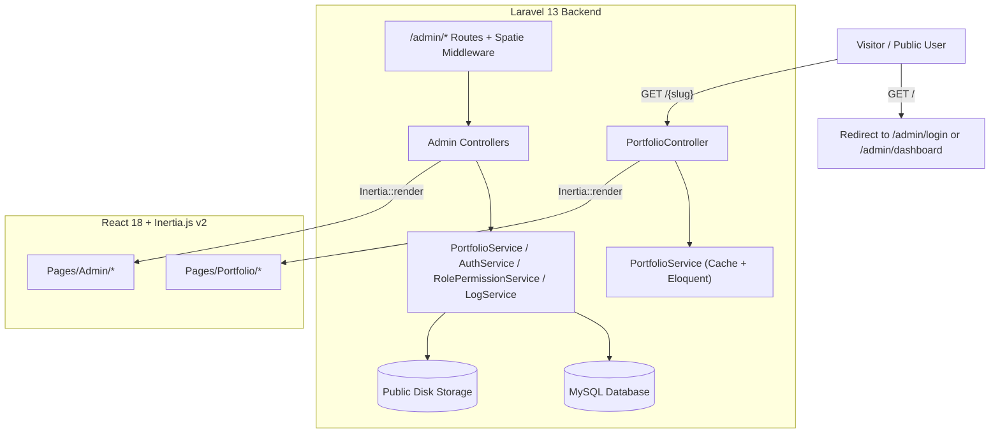

<div align="center">

# ZeeFolio

**Multi-User Developer Portfolio & Content Management Platform**

[](https://laravel.com)
[](https://react.dev)
[](https://inertiajs.com)
[](https://tailwindcss.com)
[](https://spatie.be/docs/laravel-permission)
[](https://vitejs.dev)

*ZeeFolio is a multi-user developer portfolio platform built with **Laravel 13**, **Inertia.js v2**, and **React 18**. It enables each user to manage and publish their own portfolio under a custom slug (`/{slug}`), complete with **Role-Based Access Control (RBAC)** powered by Spatie Permission, portfolio view analytics, and a modular content management dashboard.*

[Key Features](#key-features) •
[Architecture & System Flow](#architecture--system-flow) •
[Directory Structure](#directory-structure) •
[Installation & Setup](#installation--setup) •
[Routes Overview](#routes-overview) •
[Access Control (RBAC)](#access-control-rbac)

</div>

---

## Key Features

### 1. Public Portfolio (`/{slug}`)
- **Dynamic Multi-Tenant URLs**: Each user gets a dedicated public portfolio page by unique slug (e.g., `/brian-yudhistira`), an archive page (`/{slug}/projects`), and project detail pages (`/{slug}/projects/{projectSlug}`).
- **Customizable Skill Display Categories**: Users can select and order **1 to 4 priority skill categories** (`01`–`04`) from the dashboard to dynamically control which categories appear on their public portfolio.
- **Interactive Futuristic UI**: Built with smooth animations powered by **GSAP**, **Framer Motion**, and **OGL (WebGL)** across the Hero, Skills, Experience Timeline, Project Showcase, and Contact sections.
- **Draft & Privacy Control**: Portfolios marked as inactive (`Draft`) are hidden from the public while remaining accessible for preview by the owner and Admin/Superadmin users.
- **Direct Contact Mailer**: Visitors can send messages directly through the contact form, routed to the portfolio owner's configured contact email.

### 2. Admin & Member Dashboard (`/admin/*`)
- **Analytics & Overview Dashboard**: Displays portfolio view statistics (`PortfolioView`), project/skill/experience counts, and recent activity logs.
- **Home & Profile Builder**: Manage the hero section, passions/roles, short bio, profile photo, logo, CV (PDF) upload, and social media links.
- **Project & Showcase Manager**: Full project CRUD with cover image upload, multi-image showcase gallery, tech stack tags, custom sort order, and per-user project categories.
- **Skills & Custom Tech Stack**: Pick from the global skill catalog or create custom skills with **Devicon** icons and proficiency levels (`1`–`5`).
- **Career & Education Experience**: Manage work and education history with certificate uploads, used tech stacks, and ordering (`move up/down`).
- **Personal Account Settings**: Update account profile details, username, profile photo, password, signed email verification, and self-service account deletion.

### 3. Administration & RBAC (`Spatie Laravel Permission`)
- **Role & Permission Management**: Manage roles (`superadmin`, `admin`, `member`, or custom roles) and granular permissions directly from the dashboard, enforced via Spatie's built-in `permission` middleware.
- **Member & Portfolio Management**: Admins can manage member accounts, preview member portfolios, and promote member-created custom skills into the global catalog.
- **Global Platform Settings**: Centralized management for Global Tech Stacks, Skill Categories, and Global Project Categories.
- **Transactional SQL & File Safety**: All file upload and deletion flows run inside `DB::beginTransaction()` — SQL changes are committed first before old files are removed from storage, with automatic rollback and cleanup of newly uploaded files if an error occurs.

---

## Architecture & System Flow



### Core Workflow
1. **Routing & Entry Point**:
   - Visiting `/` checks authentication state: guests are redirected to `/admin/login`, while authenticated users are redirected to `/admin/dashboard`.
   - Public routes under `/{slug}` resolve the target user's portfolio by `portfolio_users.slug` (falling back to `users.username`).
2. **State Sharing (Inertia Middleware)**:
   - `HandleInertiaRequests` shares authenticated user data (`role_names`, `permission_names`, `portfolio_slug`), flash messages, and recent activity notifications as a clean array without mutating the underlying Eloquent `$request->user()` model.
3. **Caching & Performance**:
   - Portfolio data is cached per user (`portfolio:user:{id}`) via `PortfolioService` and automatically invalidated whenever profile, projects, skills, skill categories, experiences, or contacts are updated.
4. **File Management & Database Transactions**:
   - Newly uploaded files are stored on the `public` disk, database updates run inside `DB::beginTransaction()`, and old files are deleted only after `DB::commit()` succeeds.

---

## Directory Structure

```text
zeefolio/
├── app/
│   ├── Http/
│   │   ├── Controllers/
│   │   │   ├── Admin/               # Dashboard, Content, Account, Members, RBAC, Settings controllers
│   │   │   └── Portfolio/           # PortfolioController for public /{slug} routes
│   │   ├── Middleware/              # HandleInertiaRequests & application middleware
│   │   └── Requests/                # FormRequest validation classes
│   ├── Mail/                        # Mailable classes for contact & email verification
│   ├── Models/                      # Eloquent models (User, PortfolioUser, Project, TechStack, etc.)
│   └── Services/                    # Business logic (PortfolioService, AuthService, RolePermissionService, LogService)
├── database/
│   ├── migrations/                  # Database schema migrations
│   └── seeders/                     # Default users, tech stacks, & sample portfolio seeders
├── resources/
│   └── js/
│       ├── Components/
│       │   ├── Admin/               # Modular dashboard components (Skills, Projects, Members, etc.)
│       │   ├── Animations/          # GSAP / WebGL animation components
│       │   ├── Portfolio/           # Public portfolio sections (Home, Skills, Experience, Project, Contact)
│       │   └── Shared/              # Reusable UI components (Modal, SearchInput, EmptyState, DeviconIcon)
│       ├── Layouts/                 # AdminLayout (Sidebar, Topbar, Notification Popover)
│       ├── Pages/
│       │   ├── Admin/               # Inertia dashboard pages (/admin/*)
│       │   └── Portfolio/           # Inertia public portfolio pages (/{slug}/*)
│       └── Utils/                   # Frontend helpers & utilities
└── routes/
    ├── web.php                      # Main route entry point
    └── web/
        ├── auth.php                 # Authentication routes (/admin/login, /admin/register, /admin/logout)
        ├── portfolio.php            # Public portfolio routes (/{slug}, /{slug}/projects, etc.)
        └── dashboard/
            ├── overview.php         # Dashboard & personal account settings routes
            ├── content.php          # Content management routes (home, contacts, projects, skills, experiences)
            └── administration.php   # Administration routes (members, roles, permissions, global settings)
```

---

## Installation & Setup

### Prerequisites
- **PHP** >= 8.3 (with `pdo_mysql`, `mbstring`, `openssl`, `fileinfo`, `gd` extensions)
- **Composer** >= 2.x
- **Node.js** >= 20.x & **NPM**
- **MySQL** / **MariaDB**

### Local Setup

1. **Clone the repository**
   ```bash
   git clone https://github.com/username/zeefolio.git
   cd zeefolio
   ```

2. **Install PHP & JavaScript dependencies**
   ```bash
   composer install
   npm install
   ```

3. **Configure environment variables**
   ```bash
   cp .env.example .env
   php artisan key:generate
   ```
   Update your database and app settings in `.env`:
   ```env
   APP_NAME="ZeeFolio"
   APP_URL=http://127.0.0.1:8000

   DB_CONNECTION=mysql
   DB_HOST=127.0.0.1
   DB_PORT=3306
   DB_DATABASE=zeee_hub
   DB_USERNAME=root
   DB_PASSWORD=
   ```

4. **Run migrations, seeders, and create the storage symlink**
   ```bash
   php artisan migrate --seed
   php artisan storage:link
   ```

5. **Start the development server**
   You can run all services (Laravel server, Vite HMR, Queue listener, and Pail logs) with a single command:
   ```bash
   composer run dev
   ```
   Or run them in separate terminals:
   ```bash
   # Terminal 1 - Vite Dev Server
   npm run dev

   # Terminal 2 - Laravel HTTP Server
   php artisan serve
   ```

6. **Build for production**
   ```bash
   npm run build
   php artisan optimize
   ```

### Default Seeded Accounts
| Role | Email | Password | Portfolio Slug |
| :--- | :--- | :--- | :--- |
| **Superadmin** | `brianyudhistira1@gmail.com` | `password` | `/brian-yudhistira` |
| **Superadmin** | `bagusprasetya028@gmail.com` | `password` | `/bagus_good` |

---

## Routes Overview

### Public Portfolio Routes
| Method | URI | Route Name | Description |
| :--- | :--- | :--- | :--- |
| `GET` | `/` | `root` | Redirects to `/admin/dashboard` or `/admin/login` |
| `GET` | `/{slug}` | `portfolio.index` | User's public portfolio landing page |
| `GET` | `/{slug}/projects` | `portfolio.projects` | User's full projects archive page |
| `GET` | `/{slug}/projects/{projectSlug}` | `portfolio.project` | Project detail & showcase gallery page |
| `POST` | `/{slug}/messageMe` | `portfolio.user.sendMessage` | Sends contact form email to the portfolio owner |

### Admin & Dashboard Routes (`/admin/*`)
| Group | URI Prefix | Permission Middleware | Description |
| :--- | :--- | :--- | :--- |
| **Auth** | `/admin/login`, `/admin/register` | `guest` | Login & member registration |
| **Dashboard** | `/admin/dashboard` | `permission:dashboard.view` | Analytics & portfolio metrics |
| **Account** | `/admin/account/*` | `auth` | Profile, photo, password, & email verification |
| **Home & Contact** | `/admin/home`, `/admin/contacts` | `permission:profile.manage` | Hero section, CV, & contact details |
| **Projects** | `/admin/projects/*` | `permission:projects.manage` | Projects, showcase images, & custom categories |
| **Skills** | `/admin/skills/*`, `/admin/tech-stacks/*` | `permission:skills.manage` | Active skills, 1–4 display categories, & custom tech stacks |
| **Experiences** | `/admin/experiences/*` | `permission:experiences.manage` | Work/education experiences & display ordering |
| **Members** | `/admin/members/*` | `permission:members.view\|create\|edit\|delete` | Member management, portfolio preview, & skill promotion |
| **Roles & RBAC** | `/admin/roles/*`, `/admin/permissions/*` | `permission:roles.manage\|permissions.manage` | Spatie role & permission matrix management |
| **Settings** | `/admin/settings/*` | `permission:settings.manage` | Global skills & platform categories |

---

## Access Control (RBAC)

ZeeFolio uses **Spatie Laravel Permission** with automatic bootstrapping via `RolePermissionService` and a `Gate::before` bypass for `superadmin`.

| Permission | Group | Superadmin | Admin | Member |
| :--- | :--- | :---: | :---: | :---: |
| `dashboard.view` | Portfolio | Yes | Yes | Yes |
| `profile.manage` | Portfolio | Yes | Yes | Yes |
| `projects.manage` | Portfolio | Yes | Yes | Yes |
| `skills.manage` | Portfolio | Yes | Yes | Yes |
| `experiences.manage` | Portfolio | Yes | Yes | Yes |
| `members.view` | Administration | Yes | Yes | — |
| `members.create` | Administration | Yes | Yes | — |
| `members.edit` | Administration | Yes | Yes | — |
| `members.delete` | Administration | Yes | Yes | — |
| `skills.promote` | Administration | Yes | Yes | — |
| `settings.manage` | Administration | Yes | Yes | — |
| `roles.manage` | Access Control | Yes | — | — |
| `permissions.manage` | Access Control | Yes | — | — |

---

## Troubleshooting

- **Images or CV files return `403` / `404` under `/storage/...`**:
  Ensure the storage symlink exists by running `php artisan storage:link` and verify `storage/app/public` has readable permissions.
- **Permission changes do not take effect immediately**:
  Clear Spatie's permission cache and the Laravel application cache:
  ```bash
  php artisan permission:cache-reset
  php artisan optimize:clear
  ```

---

## License

**ZeeFolio** is open-sourced software licensed under the [MIT License](https://opensource.org/licenses/MIT).
