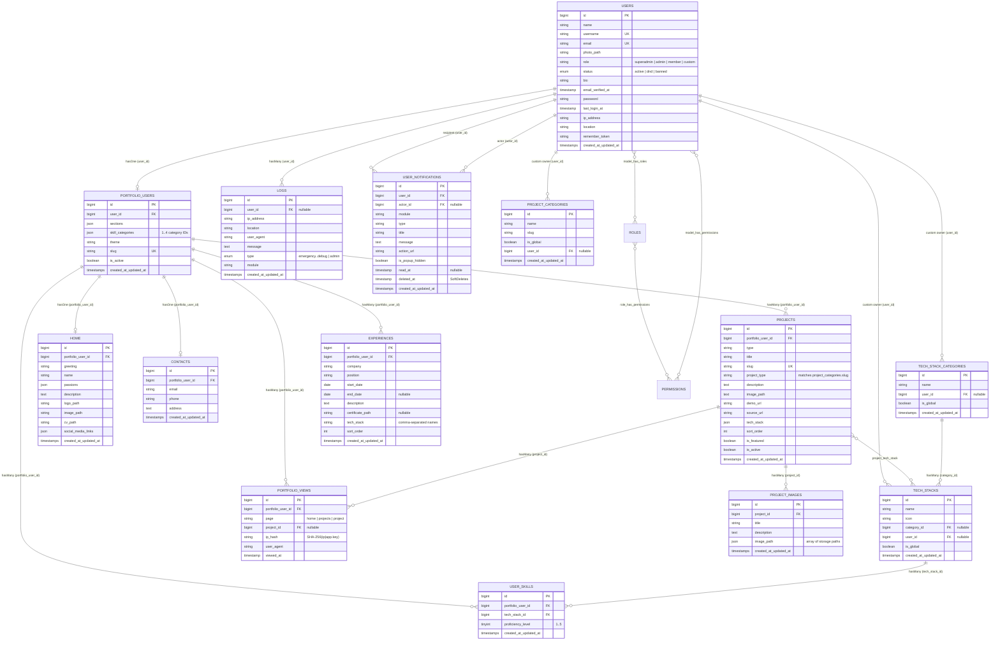

[← Back to Index](./README.md)

# Database Entity Relationship Diagram (ERD) & Model Schema

This document maps all database tables, Eloquent models in `app/Models/`, relationships, cascade/restrict rules, and automated retention policies (*pruning*) based on the migrations in `database/migrations/`.

---

## 1. Mermaid `erDiagram`

---

## 2. Entity & Eloquent Model Specifications

### 2.1. `users` (`App\Models\User`)
- **Business Purpose:** Stores account credentials, profile identity, suspension state (`active`, `dnd`, `banned`), active role name, and last login telemetry.
- **Contracts & Traits:** `Authenticatable`, `MustVerifyEmail`, `HasFactory`, `Notifiable`, `Spatie\Permission\Traits\HasRoles`.
- **Appended Accessor:** `photo_url` (resolves relative `photo_path` into a public `asset('storage/...')` URL).
- **Relationships:**
  - `portfolioUser()` → `HasOne(PortfolioUser::class)` (`cascadeOnDelete`).
  - `logs()` → `HasMany(Log::class)` (`nullOnDelete`).
  - `roles()` & `permissions()` → Spatie polymorphic relations (`model_has_roles`, `model_has_permissions`).
- **Referenced By:** [Authentication](./features/auth.md), [Account Settings](./features/account-settings.md), [Members & Accounts](./features/members.md), [Roles & Permissions](./features/roles-and-permissions.md).

### 2.2. `portfolio_users` (`App\Models\PortfolioUser`)
- **Business Purpose:** Root portfolio record owned by a `User`. Controls public visibility (`is_active`), canonical URL (`slug`), theme, and the selected display skill category IDs (`skill_categories`, max 4).
- **Key Constant:** `RESERVED_SLUGS` (`admin`, `api`, `storage`, `sanctum`, `up`, `_boost`, `verify-email`, `messageMe`, `projects`, `me`, `v2`, `sitemap`, `sitemap.xml`) prevents user slugs from colliding with system routes.
- **Casts:** `sections => array`, `skill_categories => array`, `is_active => boolean`.
- **Relationships:**
  - `user()` → `BelongsTo(User::class)`
  - `home()` → `HasOne(Home::class)`
  - `contacts()` → `HasOne(Contact::class)`
  - `projects()` / `featuredProjects()` → `HasMany(Project::class)`
  - `experiences()` → `HasMany(Experience::class)` (ordered by `orderByDesc('start_date')->orderByDesc('id')`)
  - `userSkills()` → `HasMany(UserSkills::class)`
  - `views()` → `HasMany(PortfolioView::class)`
- **Referenced By:** [Home & Profile](./features/home-profile.md), [Skills](./features/skills.md), [Dashboard & Analytics](./features/dashboard-analytics.md), [Public Portfolio](./features/public-portfolio.md).

### 2.3. `home` (`App\Models\Home`)
- **Business Purpose:** Stores the portfolio Hero & Bio section (unifying the `home` and legacy `about` data).
- **Key Columns:** `greeting`, `name`, `passions` (JSON array), `description` (requires at least 50 characters to pass `HomeController@update` validation and `SeoService` indexability checks), `logo_path`, `image_path`, `cv_path`, `social_media_links` (JSON object: `github`, `linkedin`, `instagram`, `website`).
- **Appended Accessors:** `logo_url`, `image_url`, `cv_url`.
- **Referenced By:** [Home & Profile](./features/home-profile.md), [Public Portfolio & SEO](./features/public-portfolio.md).

### 2.4. `contacts` (`App\Models\Contact`)
- **Business Purpose:** Stores public portfolio contact details (`email`, `phone`, `address`). The `email` column serves as the primary recipient address when visitors submit the public contact form.
- **Referenced By:** [Contacts](./features/contacts.md), [Public Portfolio](./features/public-portfolio.md#public-contact-form-submission).

### 2.5. `projects` (`App\Models\Project`) & `project_tech_stack`
- **Business Purpose:** Stores portfolio projects owned by a `PortfolioUser`.
- **Key Columns:** `title`, `slug` (globally unique), `type` (`personal` default), `project_type` (matches `project_categories.slug`), `description`, `image_path` (cover image with anti-double-encoding normalization via `normalizeImagePath()`), `demo_url`, `source_url`, `tech_stack` (JSON array snapshot of tech stack names), `sort_order`, `is_featured`, `is_active`.
- **Relationships:**
  - `portfolioUser()` → `BelongsTo(PortfolioUser::class)`
  - `techStacks()` → `BelongsToMany(TechStack::class, 'project_tech_stack')->withPivot('sort_order')->orderByPivot('sort_order')`
  - `images()` → `HasMany(ProjectImage::class)`
- **Referenced By:** [Projects & Showcase](./features/projects.md), [Public Portfolio](./features/public-portfolio.md).

### 2.6. `project_images` (`App\Models\ProjectImage`)
- **Business Purpose:** Stores gallery showcase blocks for a project. Each record has a `title`, `description`, and `image_path` (a JSON array holding multiple screenshot storage paths).
- **Appended Accessor:** `image_url` (maps every path in `image_path` to its public URL).
- **Referenced By:** [Projects & Showcase](./features/projects.md#showcase-gallery-synchronization).

### 2.7. `project_categories` (`App\Models\ProjectCategory`)
- **Business Purpose:** Hybrid-scoped project category catalog:
  - **Global Default (`is_global = true`, `user_id = null`):** Managed by Admins in [Platform Settings](./features/platform-settings.md) and shared across all users.
  - **User Custom (`is_global = false`, `user_id = <id>`):** Managed by individual portfolio owners in [Projects](./features/projects.md#per-user-custom-project-categories).
- **Eloquent Scopes:** `scopeGlobal()`, `scopeAvailableFor(?User $user)`.

### 2.8. `tech_stack_categories` (`App\Models\TechStackCategory`)
- **Business Purpose:** Hybrid-scoped skill category catalog (user scoping added in migration `2026_11_17_000001`):
  - **Global Default (`is_global = true`, `user_id = null`):** Managed via [Platform Settings](./features/platform-settings.md) or promoted via [Members](./features/members.md#promoting-member-custom-skills-to-global-catalog).
  - **User Custom (`is_global = false`, `user_id = <id>`):** Managed by portfolio owners via [Skills](./features/skills.md#per-user-custom-skill-categories).
- **Helpers & Scopes:** `scopeGlobal()`, `scopeAvailableFor(?User $user)`, `availableExistsRule(?User $user)`, `findOrCreateForUser()`.

### 2.9. `tech_stacks` (`App\Models\TechStack`)
- **Business Purpose:** Master technology/skill catalog (`name`, Devicon class `icon`, `category_id`, `user_id`, `is_global`).
- **Ownership Rules:**
  - Global skills (`is_global = true`, `user_id = null`) are selectable by all users.
  - Custom skills (`is_global = false`, `user_id = <id>`) are private to their creator until promoted by an Admin via [Members](./features/members.md#promoting-member-custom-skills-to-global-catalog).
  - When a user deletes a custom skill from `user_skills` and it is no longer attached to any project, the underlying custom `TechStack` row is automatically cleaned up (`SkillController@destroy`).

### 2.10. `user_skills` (`App\Models\UserSkills`)
- **Business Purpose:** Links a `PortfolioUser` to an active `TechStack` with a proficiency rating (`proficiency_level` `1` to `5`: *Beginner*, *Elementary*, *Intermediate*, *Advanced*, *Expert*).
- **Constraint:** Composite `(portfolio_user_id, tech_stack_id)` uniqueness is enforced by application validation and composite indexing.
- **Referenced By:** [Skills](./features/skills.md), [Experiences](./features/experiences.md), [Public Portfolio](./features/public-portfolio.md).

### 2.11. `experiences` (`App\Models\Experience`)
- **Business Purpose:** Stores career and work experience entries (`company`, `position`, `start_date`, `end_date`, `description`, comma-separated skill names in `tech_stack`, and `sort_order`).
- **Icon Hydration:** When loaded through `PortfolioService`, the comma-separated `tech_stack` string is hydrated into `tech_stacks: [{ name, icon }]` using the user's available `TechStack` catalog.
- **Referenced By:** [Experiences](./features/experiences.md), [Public Portfolio](./features/public-portfolio.md).

### 2.12. `portfolio_views` (`App\Models\PortfolioView`)
- **Business Purpose:** Records deduplicated public page visits (`page`: `home`, `projects`, `project`, nullable `project_id`, `ip_hash`, `user_agent`, `viewed_at`).
- **Data Retention (`MassPrunable`):** Retains 366 days of raw view events (`viewed_at <= now()->subDays(366)`).
- **Referenced By:** [Public Portfolio](./features/public-portfolio.md#deduplicated-visitor-view-tracking), [Dashboard & View Analytics](./features/dashboard-analytics.md), [Background System](./02-background-system.md#daily-pruning).

### 2.13. `logs` (`App\Models\Log`)
- **Business Purpose:** Stores system and user audit trail records (`user_id`, `ip_address`, `location`, `user_agent`, `message`, `type`, `module`).
- **Log Types:** `info`, `admin`, `warning`, `error` (plus RFC 5424 levels `emergency` through `debug`).
- **Data Retention (`MassPrunable`):** Retains 180 days of logs (`created_at <= now()->subDays(180)`).
- **Referenced By:** [Activity Logs](./features/activity-logs.md), [Background System](./02-background-system.md#audit-and-notification-dispatch).

### 2.14. `user_notifications` (`App\Models\UserNotification`)
- **Business Purpose:** Dedicated per-user in-app notification inbox (`user_id` recipient, `actor_id` actor, `module`, `type`, `title`, `message`, `action_url`, `is_popup_hidden`, `read_at`, `deleted_at`).
- **Traits:** `MassPrunable`, `SoftDeletes`.
- **Data Retention (`MassPrunable`):** Permanently purges records (including soft-deleted rows) older than 90 days (`created_at <= now()->subDays(90)`).
- **Referenced By:** [Notifications & SSE](./features/notifications.md), [Background System](./02-background-system.md#sse-stream).

### 2.15. Spatie Permission Tables (`roles`, `permissions`, `role_has_permissions`, `model_has_roles`, `model_has_permissions`)
- **Business Purpose:** Stores RBAC roles and permissions for `guard_name = 'web'`.
- **Custom Columns:** `roles` includes `description`; `permissions` includes `group` and `description`.
- **Referenced By:** [Roles & Permissions](./features/roles-and-permissions.md).

---

## 3. Infrastructure & Legacy Migration Tables Note

1. **Laravel Infrastructure Tables (`0001_01_01_*`):**
   - `sessions`: Stores active web sessions (`user_id`, `ip_address`, `user_agent`, `payload`, `last_activity`). Queried directly by [Members](./features/members.md#updating-accounts-changing-roles--suspendban-session-revocation) to revoke active sessions immediately when an account is banned or deleted.
   - `cache` & `cache_locks`: Backing store for versioned portfolio cache keys, XML sitemap cache, and view deduplication locks.
   - `jobs`, `job_batches`, `failed_jobs`: Database queue tables processing asynchronous emails ([Background System](./02-background-system.md#queued-mail)).
2. **Inactive Legacy Migration Tables:**
   - `settings` (`2025_11_15_000001_create_settings_table.php`), `balance_track` (`2026_01_02_000001_create_balance_track_table.php`), and `personal_access_tokens` (`2025_10_15_163752_create_personal_access_tokens_table.php`) exist in migration history but are not used by any active Eloquent Model or Controller.
