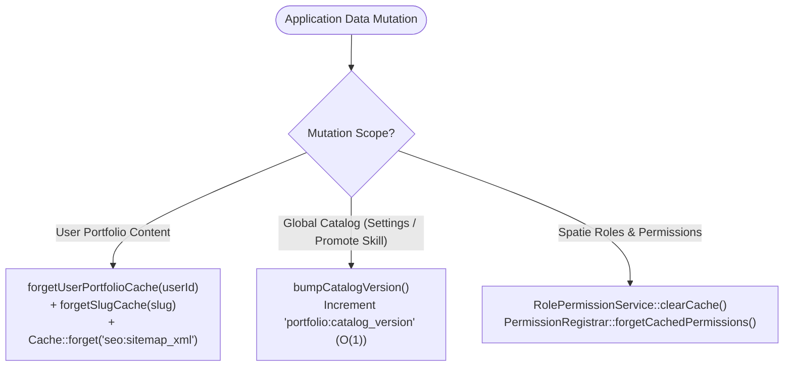

[← Back to Index](./README.md)

# Background System: Caching, Queued Mail, SSE Stream, Audit Log & Scheduler

This document details the background infrastructure powering caching performance, asynchronous mail delivery, real-time notifications, security headers, and automated database maintenance in ZeeFolio.

---

## 1. Versioned Portfolio & Sitemap Caching (`PortfolioService` & `SeoService`)

To serve public portfolio pages (`/{slug}`) with **0 database queries** on cache hits while preventing stale catalog data when global skills or categories change, `PortfolioService` implements **Versioned Cache Keys**:

### Core Cache Keys
| Cache Key | TTL | Purpose & Resolution |
| :--- | :--- | :--- |
| `portfolio:catalog_version` | `Forever` | Global catalog integer version (defaults to `1`). Incremented (`+1`) via `PortfolioService::bumpCatalogVersion()`. |
| `portfolio:v{version}:user:{userId}` | `3600s` (1 hr) | Full `PortfolioUser` graph including `home`, `userSkills.techStack.category`, active `projects`, `projects.techStacks`, `projects.images`, `contacts`, `experiences`, and hydrated `tech_stacks` + `selected_skill_categories`. |
| `portfolio:user_id_by_slug:{slug}` | `3600s` (1 hr) | Maps a portfolio `slug` (or fallback `users.username`) to the owner's `user_id`. |
| `portfolio:meta_by_user:{userId}` | `3600s` (1 hr) | Lightweight `{ slug, is_active }` metadata shared across Admin pages via `HandleInertiaRequests`. |
| `seo:sitemap_xml` | `3600s` (1 hr) | Cached XML string for `/sitemap.xml` (`SeoService::generateSitemapXml()`). |
| `portfolio_view_dedupe:{portfolioId}:{page}:{projectId}:{ipHash}` | `600s` (10 min) | Atomic deduplication lock in `PortfolioController::recordView()` preventing repeated reloads from inflating analytics. |
| `zeefolio_spatie_rbac_initialized_v2` | `Forever` | Flag confirming the 15 default permissions and 3 core Spatie roles have been seeded. |

### Two-Tier Cache Invalidation Strategy
1. **Per-User Invalidation (`PortfolioService::forgetUserPortfolioCache($userId)`):**
   - Triggered whenever a user updates their own content in [Home & Profile](./features/home-profile.md), [Projects](./features/projects.md), [Skills](./features/skills.md), [Experiences](./features/experiences.md), or [Contacts](./features/contacts.md).
   - Forgets `portfolio:v{version}:user:{userId}`, `portfolio:meta_by_user:{userId}`, `portfolio:user_id_by_slug:{slug}`, and `seo:sitemap_xml`.
2. **Global Catalog `O(1)` Invalidation (`PortfolioService::bumpCatalogVersion()`):**
   - Triggered whenever an Admin updates global defaults in [Platform Settings](./features/platform-settings.md) or promotes a member's custom skill in [Members](./features/members.md#promoting-member-custom-skills-to-global-catalog).
   - Increments `portfolio:catalog_version` (`v1` → `v2`), causing all user portfolios to transparently read from the new version namespace without calling `Cache::flush()` (preserving active sessions and rate-limiters).

---

## 2. Database Queue & Asynchronous Mail Delivery

Both application Mailable classes implement `Illuminate\Contracts\Queue\ShouldQueue` so SMTP network round-trips never block user HTTP requests:

| Mailable Class | Triggered By | Retry & Backoff Policy | Blade View |
| :--- | :--- | :--- | :--- |
| **`App\Mail\SendMailToMe`** | Public contact form `POST /messageMe` or `POST /{slug}/messageMe` in [Public Portfolio](./features/public-portfolio.md#public-contact-form-submission) | `$tries = 3`, `$backoff = [10, 30, 60]` (seconds) | `resources/views/emails/contact.blade.php` |
| **`App\Mail\VerifyEmailLink`** | *Verify Email* action `POST /admin/account/email/verification-notification` in [Account Settings](./features/account-settings.md#signed-email-verification-workflow) | `$tries = 3`, `$backoff = [10, 30, 60]` (seconds) | `resources/views/emails/verify.blade.php` |

---

## 3. Audit Logging & Notification Auto-Dispatch (`LogService`)

Every significant state mutation is recorded through `App\Services\LogService` (`infoLog`, `adminLog`, `warningLog`, `errorLog`):

1. **Zero-Latency Location Resolution (`resolveClientLocation`):**
   - Local/private IPs (`127.0.0.1`, `::1`, RFC 1918 ranges) resolve to `'Local'`.
   - Requests from trusted proxies (`TRUSTED_PROXIES`) inspect edge country headers (`CF-IPCountry`, `CloudFront-Viewer-Country`, `X-Vercel-IP-Country`, `X-Country-Code`), falling back to `'Unknown'` without making external GeoIP HTTP calls.
2. **Dual Audit Persistence:**
   - Writes structured entries to Laravel's application log (`storage/logs/laravel.log`).
   - Inserts a database record into [`logs`](./01-database-erd.md#logs) displayed in [Activity Logs](./features/activity-logs.md).
3. **Automatic `user_notifications` Dispatch:**
   - When `module` belongs to `NOTIFIABLE_MODULES` (`Skills`, `Portfolio`, `Users`, `Account`, `Roles`, `Permissions`, `Settings`), `LogService` automatically inserts a record into [`user_notifications`](./01-database-erd.md#user-notifications) with a resolved contextual `action_url`.
   - Supports cross-user notification targeting via `metadata['notify_user_id']` (e.g., notifying a member when an Admin promotes their custom skill, or notifying a portfolio owner when a visitor submits a public contact message).

---

## 4. Real-Time Notification Streaming (Server-Sent Events)

The [Notifications](./features/notifications.md) module streams live updates via `NotificationStreamController@index` (`GET /admin/notifications/stream`) using Laravel 13's `response()->eventStream()`:

1. **Immediate Session Lock Release:** Calls `$request->session()->save()` before opening the stream so concurrent Inertia requests from the same user are never blocked by PHP session locking.
2. **Server Environment Adaptation (`PHP_SAPI === 'cli-server'`):**
   - On multi-worker servers (PHP-FPM / FrankenPHP / Octane), the stream polls every **2 seconds** for up to **25 seconds** (`STREAM_DURATION_SECONDS`) with a **10-second** `heartbeat`, ending with a `cycle-end` event (`reconnect_in_ms: 3000`).
   - On single-worker `php artisan serve` (`cli-server`), it performs a single non-blocking flush and instructs the client to reconnect in `4000ms`.
3. **Persistent Frontend Connection:** Because all 12 Admin pages use `AdminLayout` as an Inertia Persistent Layout, the browser's `EventSource` remains open across page navigations.

---

## 5. Automated Daily Model Pruning (`routes/console.php`)

Laravel's scheduler executes `Schedule::command('model:prune')->daily()` to enforce retention limits across high-volume tables:

| Eloquent Model | Database Table | Retention Period | Pruning Query (`prunable()`) |
| :--- | :--- | :--- | :--- |
| `App\Models\UserNotification` | `user_notifications` | **90 Days** | `withTrashed()->where('created_at', '<=', now()->subDays(90))` |
| `App\Models\Log` | `logs` | **180 Days** | `where('created_at', '<=', now()->subDays(180))` |
| `App\Models\PortfolioView` | `portfolio_views` | **366 Days** | `where('viewed_at', '<=', now()->subDays(366))` |

---

## 6. Middleware Pipeline: Security Headers, Indexing Guard & Error Handling

1. **`SecurityHeadersMiddleware` (Global Web):** Attaches `X-Content-Type-Options: nosniff`, `X-Frame-Options: SAMEORIGIN`, `Referrer-Policy: strict-origin-when-cross-origin`, `Permissions-Policy: camera=(), microphone=(), geolocation=()`, and `Strict-Transport-Security` over HTTPS.
2. **`PreventIndexing` (`/admin/*`):** Attaches `X-Robots-Tag: noindex, nofollow, noarchive` to all `/admin/*` responses so search crawlers never index internal dashboard routes.
3. **`HandleInertiaRequests` (Global Web):**
   - Intercepts authenticated users with `status === 'banned'`, force-logging them out and redirecting to `/admin/login`.
   - Shares `auth.user` (including `role_names`, `permission_names`, `portfolio_slug`, `portfolio_is_active`), `flash` (`id`, `success`, `error`), and the latest 15 `notifications` for the `TopBar` popover.
4. **Inertia Custom Error Rendering (`bootstrap/app.php`):** Renders HTTP `403`, `404`, `419`, and non-local `500` responses through `resources/js/Pages/Error.jsx`.
