# ZeeFolio Architecture & Business Process Documentation

**ZeeFolio** is a *Multi-User Developer Portfolio & Content Management System* built with **Laravel 13 + Inertia.js (React 18) + Tailwind CSS + Spatie Laravel Permission**. Every registered user receives an isolated portfolio workspace (`/{slug}`), complete with time-series visitor analytics, project & showcase gallery management, a skill proficiency matrix, career experience timelines, contact channels, and a multi-role administration panel powered by **Server-Sent Events (SSE)** real-time notifications.

---

## 1. Core Foundation & Infrastructure Documents

| Document | Description |
| :--- | :--- |
| [**`01-database-erd.md`**](./01-database-erd.md) | Core database entities, column schemas, Eloquent relationships, Spatie RBAC tables, performance indexes, and a Mermaid `erDiagram`. |
| [**`02-background-system.md`**](./02-background-system.md) | Background system architecture: *Versioned Portfolio & Sitemap Caching* (`O(1)` catalog invalidation), *Database Queue Mail*, *SSE EventStream*, *LogService & Notification Dispatch*, and *Daily Model Pruning*. |

---

## 2. Actors, Roles & 15 RBAC Permissions Matrix (`v2`)

Access control is powered by **Spatie Laravel Permission** (`guard: web`), automatically bootstrapped by `RolePermissionService::ensureBootstrapped()` (cached under `zeefolio_spatie_rbac_initialized_v2`). See [Roles & Permissions](./features/roles-and-permissions.md) for full details.

| Role | Default Access Scope |
| :--- | :--- |
| **Guest (Public Visitor)** | Views active public portfolios (`/{slug}`, `/{slug}/projects`, `/{slug}/projects/{projectSlug}`), submits contact messages (`POST /{slug}/messageMe`), accesses `/sitemap.xml`, and visits `/admin/login` and `/admin/register`. |
| **Member (`member`)** | Granted all **6 `Portfolio` permissions**: `dashboard.view`, `home.manage`, `projects.manage`, `skills.manage`, `experiences.manage`, `contacts.manage`, plus access to `/admin/account` and `/admin/notifications`. |
| **Admin (`admin`)** | Granted **13 permissions** (all 6 `Portfolio` permissions + 7 `Administration` permissions: `members.view`, `members.create`, `members.edit`, `members.delete`, `skills.promote`, `logs.view`, `settings.manage`). Can only modify or delete `member`-level accounts. |
| **Super Admin (`superadmin`)** | Bypasses all permission gates via `Gate::before` in `AppServiceProvider` and holds all **15 permissions** (including `roles.manage` & `permissions.manage`). Exclusively authorized to change user roles and manage Admin/Super Admin accounts. |
| **Custom Role** | Custom roles created by Super Admin via [Roles & Permissions](./features/roles-and-permissions.md) with tailored permission sets. |

---

## 3. Feature & Module Map (`docs/features/`)

### A. Authentication, Overview & Personal Account
| Feature Module | Primary Routes | Permission | Business Process Summary |
| :--- | :--- | :--- | :--- |
| [**Authentication & Sessions (`auth.md`)**](./features/auth.md) | `/admin/login`, `/admin/register`, `/admin/logout` | `guest` / `auth` | Web session login, user registration with automatic default portfolio initialization, logout, and forced session termination for `banned` accounts. |
| [**Dashboard & View Analytics (`dashboard-analytics.md`)**](./features/dashboard-analytics.md) | `/admin/dashboard` | `dashboard.view` | Portfolio KPI summary, time-series visitor analytics chart (`1h` to `1y`), publication status card, recent projects, and recent activity logs. |
| [**Notifications & Real-Time SSE (`notifications.md`)**](./features/notifications.md) | `/admin/notifications`, `/admin/notifications/stream` | `auth` | User notification inbox, real-time SSE streaming in `TopBar` & notifications page, mark as read, popup dismissal, and soft-deletion. |
| [**Account Settings (`account-settings.md`)**](./features/account-settings.md) | `/admin/account/*`, `/verify-email/{id}/{hash}` | `auth` / `signed` | Profile & avatar updates, temporary signed email verification links, password rotation (*logout other devices*), and self-service account deletion. |

### B. Portfolio Content Management (`Portfolio Content`)
| Feature Module | Primary Routes | Permission | Business Process Summary |
| :--- | :--- | :--- | :--- |
| [**Home & Profile (`home-profile.md`)**](./features/home-profile.md) | `/admin/home` | `home.manage` | Hero identity, bio (min. 50 chars required for SEO indexing), passions, social links, photo/logo/CV uploads, custom URL slug, and `Active`/`Draft` status toggle. |
| [**Projects & Showcase (`projects.md`)**](./features/projects.md) | `/admin/projects/*` | `projects.manage` | Portfolio project CRUD, multi-image showcase gallery (with `SEC-01` path-ownership verification), featured toggle, and per-user custom project categories. |
| [**Skills & Display Categories (`skills.md`)**](./features/skills.md) | `/admin/skills/*` | `skills.manage` | Picking global default skills or creating custom skills (`TechStack`), proficiency level (`1–5`) updates, selecting 1–4 featured skill categories, and custom skill categories. |
| [**Experiences (`experiences.md`)**](./features/experiences.md) | `/admin/experiences/*` | `experiences.manage` | Career/work experience CRUD, linking active user skills, and automatic chronological `sort_order` re-indexing by `start_date`. |
| [**Contacts (`contacts.md`)**](./features/contacts.md) | `/admin/contacts` | `contacts.manage` | Configuring public contact form recipient email, phone number, and physical/location address. |

### C. Platform Administration & Access Control (`Administration`)
| Feature Module | Primary Routes | Permission | Business Process Summary |
| :--- | :--- | :--- | :--- |
| [**Members & Accounts (`members.md`)**](./features/members.md) | `/admin/members/*` | `members.view`, `members.create`, `members.edit`, `members.delete`, `skills.promote` | Master-Detail account directory, account creation, role assignment & account suspend/ban (active session revocation), member portfolio preview, and promoting custom skills to the global catalog. |
| [**Roles & Permissions (`roles-and-permissions.md`)**](./features/roles-and-permissions.md) | `/admin/roles/*`, `/admin/permissions/*` | `roles.manage`, `permissions.manage` | Interactive permission assignment matrix per role, custom role CRUD (with automatic user reassignment to `member` on role deletion), and custom permission CRUD. |
| [**Platform Settings (`platform-settings.md`)**](./features/platform-settings.md) | `/admin/settings/*` | `settings.manage` | Global catalog management: *Default Skills* (`TechStack`), *Default Skill Categories* (`TechStackCategory`), and *Default Project Categories* (`ProjectCategory`) with `O(1)` catalog version bumping. |
| [**Activity Logs (`activity-logs.md`)**](./features/activity-logs.md) | `/admin/logs` | `logs.view` | System audit trail table (`info`, `admin`, `warning`, `error`), interactive KPI filter cards, `300ms` debounced search, and IP/location tracking. |

### D. Public Portfolio & Technical SEO
| Feature Module | Primary Routes | Permission | Business Process Summary |
| :--- | :--- | :--- | :--- |
| [**Public Portfolio, Contact Mail & SEO (`public-portfolio.md`)**](./features/public-portfolio.md) | `/{slug}`, `/{slug}/projects`, `/{slug}/projects/{projectSlug}`, `POST /{slug}/messageMe`, `/sitemap.xml` | Public (`guest` / `auth`) | Public portfolio rendering, project archive & detail views, `301` canonical/legacy redirects, 10-minute deduplicated view tracking, queued contact emails, hybrid SSR/client SEO & JSON-LD, and dynamic XML sitemap. |

---

## 4. End-to-End System Architecture Flowchart

```mermaid
flowchart TD
    Visitor(["Public Visitor / Recruiter"])
    Member(["Member / Portfolio Owner"])
    Admin(["Admin / Super Admin"])

    subgraph PublicLayer["Public Portfolio & SEO Layer"]
        PubPage["Public Portfolio & Projects<br/>(features/public-portfolio.md)"]
        Sitemap["Dynamic XML Sitemap & JSON-LD<br/>(features/public-portfolio.md#technical-seo-json-ld--dynamic-xml-sitemap)"]
    end

    subgraph AuthLayer["Authentication & Session Layer"]
        AuthFlow["Login / Register / Ban Guard<br/>(features/auth.md)"]
        AccFlow["Account Settings & Email Verify<br/>(features/account-settings.md)"]
    end

    subgraph ContentLayer["Portfolio Content Management"]
        DashFlow["Dashboard & View Analytics<br/>(features/dashboard-analytics.md)"]
        HomeFlow["Home & Profile<br/>(features/home-profile.md)"]
        ProjFlow["Projects & Showcases<br/>(features/projects.md)"]
        SkillFlow["Skills & Categories<br/>(features/skills.md)"]
        ExpFlow["Experiences<br/>(features/experiences.md)"]
        ContFlow["Contacts<br/>(features/contacts.md)"]
    end

    subgraph AdminLayer["Platform Administration & RBAC"]
        MemFlow["Members & Skill Promotion<br/>(features/members.md)"]
        RbacFlow["Roles & Permissions Matrix<br/>(features/roles-and-permissions.md)"]
        SetFlow["Platform Settings (Global Catalog)<br/>(features/platform-settings.md)"]
        LogFlow["Activity Logs Audit Trail<br/>(features/activity-logs.md)"]
        NotifFlow["Notifications & SSE Stream<br/>(features/notifications.md)"]
    end

    subgraph BgLayer["Background & Persistence Layer"]
        DbErd[("Database & Eloquent Models<br/>(01-database-erd.md)")]
        BgSys["Versioned Cache, Queue Mail, SSE & Prune<br/>(02-background-system.md)"]
    end

    Visitor -->|"GET /{slug} & /projects"| PubPage
    Visitor -->|"GET /sitemap.xml"| Sitemap
    Visitor -->|"POST /{slug}/messageMe"| PubPage

    Member & Admin -->|"Login / Register"| AuthFlow
    AuthFlow -->|"Init PortfolioUser + Home + Contact"| DbErd
    AuthFlow -->|"Redirect Intended"| DashFlow
    Member & Admin -->|"Manage Profile & Verify Email"| AccFlow

    Member & Admin -->|"Manage Portfolio Content"| HomeFlow & ProjFlow & SkillFlow & ExpFlow & ContFlow
    HomeFlow & ProjFlow & SkillFlow & ExpFlow & ContFlow -->|"Invalidate User Cache & Sitemap"| BgSys
    BgSys -->|"Serve Cached Portfolio"| PubPage

    PubPage -->|"Record Deduplicated PortfolioView"| DbErd
    DbErd -->|"Time-Series Aggregation"| DashFlow
    PubPage -->|"Enqueue SendMailToMe & Dispatch Notif"| BgSys

    Admin -->|"Manage Members, Roles & Global Catalog"| MemFlow & RbacFlow & SetFlow
    MemFlow & SetFlow -->|"bumpCatalogVersion() O(1)"| BgSys
    Admin -->|"Audit System Activity"| LogFlow

    HomeFlow & ProjFlow & SkillFlow & ExpFlow & ContFlow & MemFlow & RbacFlow & SetFlow & AccFlow -->|"LogService::infoLog / adminLog"| LogFlow
    LogFlow -->|"Auto-Dispatch Notification"| NotifFlow
    BgSys -->|"EventSource Stream"| NotifFlow
```

