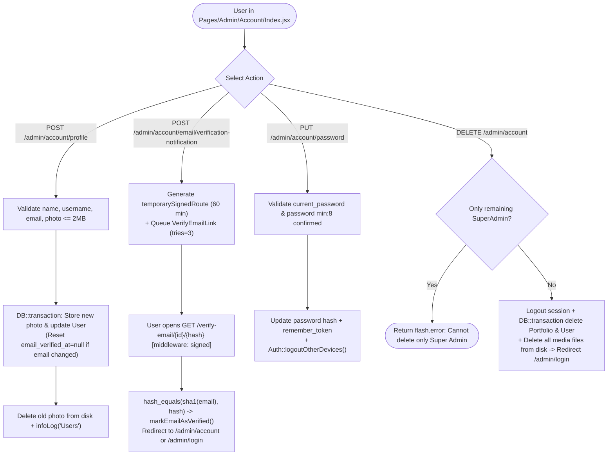

[← Back to Index](../README.md)

# Feature: Account Settings & Email Verification

## Overview & Actors
- **Business Goal:** Enable every authenticated user to manage their personal account credentials and profile identity, including name, username, email address, avatar photo, signed email verification, password rotation, and self-service account deletion.
- **Actors / Roles:** All authenticated users (`member`, `admin`, `superadmin`, or custom role). The signed email verification callback (`/verify-email/{id}/{hash}`) can be opened by either an authenticated or guest browser session as long as the cryptographic URL signature is valid (`middleware: signed`).
- **Related Entities:** [`users`](../01-database-erd.md#users), [`portfolio_users`](../01-database-erd.md#portfolio-users), [`logs`](../01-database-erd.md#logs), `jobs` ([Background System](../02-background-system.md#queued-mail)).

## Feature Interconnections
- **Prerequisites (Upstream):**
  - User is authenticated via [Authentication](./auth.md).
- **Triggers / Leads To (Downstream):**
  - Clicking *Verify Email* queues `App\Mail\VerifyEmailLink` via [Database Queue Mail](../02-background-system.md#queued-mail).
  - Updating the password rotates `remember_token` and invalidates sessions on other devices (`Auth::logoutOtherDevices()`).
  - Self-deleting the account (*Delete Account*) purges all portfolio records ([Home](./home-profile.md), [Projects](./projects.md), [Skills](./skills.md), [Experiences](./experiences.md), [Contacts](./contacts.md)) along with their files on disk, invalidates the session, and redirects to [Authentication](./auth.md).
  - Every action records an audit entry in [Activity Logs](./activity-logs.md) and dispatches a live notification to [Notifications & SSE](./notifications.md).

---

## End-to-End Business Process Flows

### 1. Updating Account Profile & Avatar Photo
- **Entry Point:** `ProfileInfoForm.jsx` in `Pages/Admin/Account/Index.jsx` → `POST /admin/account/profile` (`Admin\AccountController@updateProfile`, middleware `auth`)
- **Flow Steps:**
  1. **Input & Validation:**
     - `name` (`required|string|max:255`)
     - `username` (`required|string|max:60|alpha_dash|unique:users,username,ignore:id`)
     - `email` (`required|string|email|max:255|unique:users,email,ignore:id`)
     - `photo` (`nullable|image|mimes:jpg,jpeg,png,webp|max:2048`)
     - `remove_photo` (`nullable|boolean`)
  2. **Database Transaction & Avatar File Cleanup:**
     - Inside `DB::beginTransaction()`, stores any new `photo` under `users/photos` on the `public` disk (or clears `photo_path` if `remove_photo` is true) and marks the previous file path for post-commit deletion.
     - **Automatic Email Verification Reset:** If `email` changed (`$validated['email'] !== $user->email`), resets `email_verified_at = null` so the new address must be verified.
     - After `DB::commit()`, deletes the replaced photo from the `public` disk (or deletes the newly uploaded photo if the transaction rolled back).
  3. **Side Effects:** Logs `infoLog('Users', 'Updated account profile...')` to [Activity Logs](./activity-logs.md) and redirects `back()` with `flash.success`.

### 2. Signed Email Verification Workflow (`Signed URL` & Queued Mail)
- **Entry Points:**
  - **Send Verification Link:** *Verify Email* button in `ProfileInfoForm.jsx` → `POST /admin/account/email/verification-notification` (`AccountController@sendVerification`, middleware `auth`, `throttle:6,1`)
  - **Click Verification Link:** Email link → `GET /verify-email/{id}/{hash}` (`AccountController@verifyEmail`, middleware `signed`)
- **Flow Steps:**
  1. **Generating & Queuing the Verification Link (`sendVerification`):**
     - If `$user->hasVerifiedEmail()` is already `true`, immediately returns `flash.success: "Your email address is already verified."`.
     - Generates a 60-minute temporary signed URL via `URL::temporarySignedRoute('verification.verify', now()->addMinutes(60), ['id' => $user->id, 'hash' => sha1($user->email)])`.
     - Queues `VerifyEmailLink` to the `jobs` table ([Background System](../02-background-system.md#queued-mail)) and logs `infoLog('Auth', ...)`.
  2. **Verifying the Link (`verifyEmail`):**
     - The `signed` middleware verifies the HMAC signature and expiration timestamp (aborting with HTTP 403 if expired or tampered).
     - Verifies `hash_equals(sha1($user->email), $hash)` (aborting with HTTP 403 if the user's email changed after the link was issued).
     - Calls `$user->markEmailAsVerified()` inside a DB transaction.
     - **Contextual Redirect:** Redirects authenticated users to `/admin/account` (`admin.account.index`) and guest sessions to `/admin/login` (`admin.login`) with `flash.success: "Email verified successfully!"`.

### 3. Rotating Account Password
- **Entry Point:** `UpdatePasswordForm.jsx` → `PUT /admin/account/password` (`Admin\AccountController@updatePassword`, middleware `auth`)
- **Flow Steps:**
  1. Validates `current_password` (`required|current_password`) and `password` (`required|confirmed|min:8`).
  2. Updates `password` (Bcrypt hash) and rotates `remember_token` (`Str::random(60)`).
  3. Calls `Auth::logoutOtherDevices($validated['password'])` to invalidate sessions on other devices, logs `infoLog('Users', 'Updated account password')`, and redirects `back()` with `flash.success`.

### 4. Self-Service Account Deletion (`Delete Account`)
- **Entry Point:** `DeleteAccountSection.jsx` (`<AdminModal role="alertdialog">`) → `DELETE /admin/account` (`Admin\AccountController@destroy`, middleware `auth`)
- **Flow Steps:**
  1. **Password Check & Last Super Admin Guard:**
     - Validates `password` (`required|current_password`).
     - If the user is a `Super Admin` and the total number of `superadmin` accounts is `<= 1`, blocks deletion with `flash.error: "Cannot delete the only Super Admin account."` and logs `warningLog('Users', ...)`.
  2. **Transactional Cleanup:**
     - Collects the user's avatar `photo_path` and all portfolio media paths (`collectPortfolioFilePaths`).
     - Logs out the current web session, invalidates the session, and inside `DB::beginTransaction()` deletes the portfolio record, flushes slug/portfolio caches, and deletes the `User` row.
     - After `DB::commit()`, deletes all physical avatar, CV, project cover, and showcase files from the `public` disk, then redirects to `/admin/login`.

---

## Flowchart

