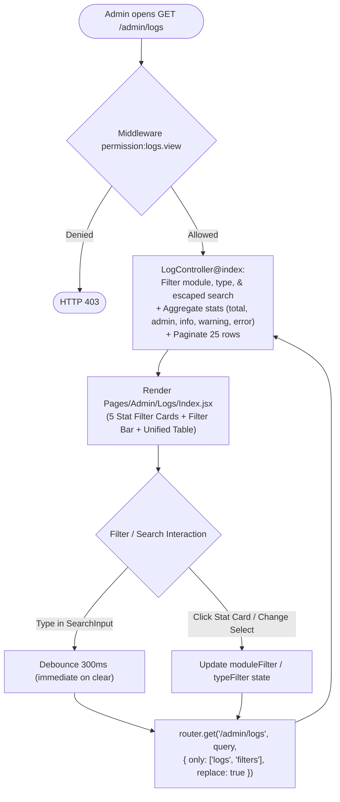

[← Back to Index](../README.md)

# Feature: System & Activity Logs (`Audit Trail`)

## Overview & Actors
- **Business Goal:** Provide a unified audit trail table to monitor user actions, administrative operations, security warnings (*failed logins*, *forced ban logouts*), and system errors complete with timestamp, actor, module, message, IP address, and location.
- **Actors / Roles:** Authenticated users with the `logs.view` permission (granted by default to `admin` and `superadmin`).
- **Related Entities:** [`logs`](../01-database-erd.md#logs), [`users`](../01-database-erd.md#users).

## Feature Interconnections
- **Prerequisites (Upstream):**
  - User is authenticated via [Authentication](./auth.md) and holds `logs.view` from [Roles & Permissions](./roles-and-permissions.md).
  - Log entries are written in real time by `LogService` whenever mutations occur in [Authentication](./auth.md), [Home & Profile](./home-profile.md), [Projects](./projects.md), [Skills](./skills.md), [Experiences](./experiences.md), [Contacts](./contacts.md), [Members](./members.md), [Roles & Permissions](./roles-and-permissions.md), [Platform Settings](./platform-settings.md), or [Account Settings](./account-settings.md).
- **Triggers / Leads To (Downstream):**
  - When `LogService` records an entry for a module in `NOTIFIABLE_MODULES`, it automatically dispatches an in-app notification to [Notifications & SSE](./notifications.md) ([Background System](../02-background-system.md#audit-and-notification-dispatch)).
  - `logs` records older than **180 days** are automatically purged by [Daily Model Pruning](../02-background-system.md#daily-pruning).

---

## End-to-End Business Process Flows

### 1. Recording Audit Logs (`LogService::createLog`)
- **Entry Point:** Invoked internally by Controllers and Middleware via `LogService::infoLog()`, `adminLog()`, `warningLog()`, or `errorLog()`.
- **Flow Steps:**
  1. **Request Metadata Resolution (`getMetadata`):** Captures `ip_address`, truncates `user_agent` to 255 characters, and resolves `location` (`Local`, 2-letter ISO country code from trusted proxy headers, or `Unknown`).
  2. **Dual Persistence:** Writes the log entry to Laravel's standard log channel (`storage/logs/laravel.log`) and inserts a record into [`logs`](../01-database-erd.md#logs) (`user_id`, `type`, `module`, `message`, `ip_address`, `location`, `user_agent`).
  3. **Notification Trigger:** If `module` is in `['Skills', 'Portfolio', 'Users', 'Account', 'Roles', 'Permissions', 'Settings']`, calls `dispatchNotification()` to insert a row into [`user_notifications`](../01-database-erd.md#user-notifications).

### 2. Browsing, Interactive KPI Cards & Debounced Search
- **Entry Point:** `GET /admin/logs?search={q}&module={mod}&type={type}&page={n}` (`Admin\LogController@index`, middleware `auth`, `permission:logs.view`) → `Pages/Admin/Logs/Index.jsx`
- **Flow Steps:**
  1. **Query Sanitization & Filtering:**
     - Truncates `search` to 100 characters and escapes SQL wildcard characters (`addcslashes($search, '%_\\')`).
     - Filters `Log::with('user:id,name,username,email,role')->latest('id')` by `module`, `type` (`admin`, `info`, `warning`, `error`), and multi-column search (`message`, `module`, `ip_address`, `location`, numeric `id`/`user_id`, or `user.name`/`username`/`email`).
  2. **Aggregate Statistics & Pagination:**
     - Fetches distinct `modules` for the *Section* filter dropdown.
     - Computes aggregate counts (`total`, `admin`, `info`, `warning`, `error`) in a single `SUM(CASE WHEN ...)` query.
     - Paginates results at **25 rows per page** (`paginate(25)->withQueryString()`).
  3. **Frontend Interactions (`Pages/Admin/Logs/Index.jsx`):**
     - **5 Interactive KPI Filter Cards (`Total`, `Admin`, `Normal`, `Warnings`, `Errors`):** Clicking any card filters the table by `type` (clicking the active card resets the filter to `all`).
     - **Debounced Search (`300ms`):** Typing in `<SearchInput />` debounces requests by `300ms` (or fires immediately when cleared) using an Inertia Partial Reload: `router.get(route("admin.logs.index"), query, { only: ["logs", "filters"], preserveState: true, preserveScroll: true, replace: true })`.
     - **Unified Horizontal-Scroll Data Table:** Renders a structured audit table (`min-w-[680px]`, `tabular-nums`, mobile `Swipe ↔` cue) with columns for `Time` (date & `HH:mm:ss`), `User` (`ID: #` + name & email, or `Deleted User #id` / `Guest / System`), `Section / Type`, `Activity` (message + `user_agent`), and `Location & IP`.

---

## Flowchart

