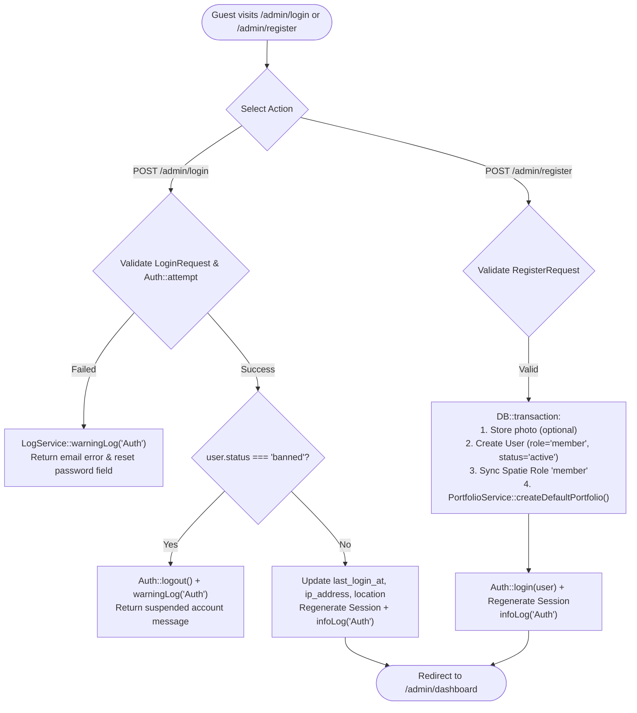

[← Back to Index](../README.md)

# Feature: Authentication & Session Management (`Auth`)

## Overview & Actors
- **Business Goal:** Manage user entry into the ZeeFolio Admin panel through web session login, self-service registration with automatic default portfolio provisioning, session logout, and immediate forced logout for suspended (`banned`) accounts.
- **Actors / Roles:** `Guest` (Login & Register), `Authenticated User` (`member`, `admin`, `superadmin`, or custom role for Logout).
- **Related Entities:** [`users`](../01-database-erd.md#users), [`portfolio_users`](../01-database-erd.md#portfolio-users), [`home`](../01-database-erd.md#home), [`contacts`](../01-database-erd.md#contacts), [`roles` & `permissions`](../01-database-erd.md#spatie-rbac), [`logs`](../01-database-erd.md#logs).

## Feature Interconnections
- **Prerequisites (Upstream):**
  - Visiting root `/` (`GET /` redirects guests to `/admin/login` and authenticated users to [Dashboard & View Analytics](./dashboard-analytics.md)).
  - Account suspension (`status = banned`) can be applied by an Admin in [Members & Accounts](./members.md#updating-accounts-changing-roles--suspendban-session-revocation).
- **Triggers / Leads To (Downstream):**
  - Upon successful login or registration, the user is redirected to [Dashboard & View Analytics](./dashboard-analytics.md).
  - Registration automatically provisions starter records for [Home & Profile](./home-profile.md) and [Contacts](./contacts.md), making the user's [Public Portfolio](./public-portfolio.md) immediately available at `/{slug}`.
  - Every login, failed login attempt, registration, and logout is recorded in [Activity Logs](./activity-logs.md).

---

## End-to-End Business Process Flows

### 1. Web Session Login
- **Entry Point:** `Pages/Admin/Auth/Login.jsx` → `POST /admin/login` (`Admin\AuthController@login`, middleware `guest`, `throttle:10,1`)
- **Flow Steps:**
  1. **Input & Validation (`LoginRequest`):** Validates `email` (`required|email`), `password` (`required|string`), and `remember` (`boolean`). The email is normalized to lowercase (`Str::lower(trim())`).
  2. **Business Logic (`AuthService::attemptLogin`):**
     - Attempts authentication via `Auth::guard('web')->attempt($credentials, $remember)`.
     - Checks if the authenticated user has `status === 'banned'`. If banned, immediately logs out the guard and throws `AuthenticationException('Your account has been suspended.')`.
  3. **Database Mutation:** Updates `last_login_at = now()`, `ip_address`, and `location` (via `LogService::resolveClientLocation()`) on [`users`](../01-database-erd.md#users).
  4. **Side Effects:** Regenerates the session ID (`$request->session()->regenerate()`) to prevent session fixation and writes an `infoLog('Auth', ...)` entry to [Activity Logs](./activity-logs.md).
  5. **Output / Redirect:** Redirects to `intended(route('admin.dashboard'))` ([Dashboard & View Analytics](./dashboard-analytics.md)).
- **Edge Cases & Error Handling:**
  - Invalid credentials or suspended accounts trigger `warningLog('Auth', ...)` in [Activity Logs](./activity-logs.md), return validation errors on `email`, and reset the `password` field on the client (`onError: () => reset("password")`).
  - More than 10 login attempts per minute from the same IP are blocked by `throttle:10,1` (HTTP 429).

### 2. User Registration & Automatic Portfolio Provisioning
- **Entry Point:** `Pages/Admin/Auth/Register.jsx` → `POST /admin/register` (`Admin\AuthController@register`, middleware `guest`, `throttle:10,1`)
- **Flow Steps:**
  1. **Input & Validation (`RegisterRequest`):** Validates `name` (`required|string|max:255`), `username` (`nullable|string|max:60|alpha_dash|unique:users,username`), `email` (`required|email|max:255|unique:users,email`), `password` (`required|confirmed|min:8`), and `photo` (`nullable|image|mimes:jpg,jpeg,png,webp|max:2048`).
  2. **Business Logic (`AuthService::register`):**
     - If `username` is omitted, derives a unique slug from `name` (appending a 4-character random suffix on collision).
     - All self-registered accounts are strictly assigned the `member` role (`User::ROLE_MEMBER`, `SEC-04`).
  3. **Database Mutation (Inside `DB::transaction`):**
     - Stores the uploaded profile photo (if provided) on the `public` disk under `users/photos`.
     - Creates the [`users`](../01-database-erd.md#users) record (`role = 'member'`, `status = 'active'`).
     - Calls `RolePermissionService::ensureBootstrapped()` and syncs the Spatie `member` role ([Roles & Permissions](./roles-and-permissions.md)).
     - Calls `PortfolioService::createDefaultPortfolio($user)`, creating a [`portfolio_users`](../01-database-erd.md#portfolio-users) record (`is_active = true`, unique `slug` checked against `RESERVED_SLUGS`), a default [`home`](../01-database-erd.md#home) record, and a default [`contacts`](../01-database-erd.md#contacts) record.
  4. **Side Effects:** Clears user portfolio and sitemap caches via [Versioned Caching](../02-background-system.md#versioned-caching), logs the user into the `web` guard, regenerates the session ID, and records `infoLog('Auth', 'Success: New admin user registered')` in [Activity Logs](./activity-logs.md).
  5. **Output / Redirect:** Redirects to `route('admin.dashboard')` ([Dashboard & View Analytics](./dashboard-analytics.md)).
- **Edge Cases & Error Handling:**
  - If any database operation fails during registration, the transaction rolls back and any newly uploaded photo is deleted from disk (`Storage::disk('public')->delete($photoPath)`).

### 3. Session Logout & Forced Ban Logout Guard
- **Entry Points:**
  - **Manual Logout:** *Sign Out* button in `TopBar.jsx` → `POST /admin/logout` (`Admin\AuthController@logout`, middleware `auth`).
  - **Forced Ban Logout:** Any authenticated web request processed by `HandleInertiaRequests::handle()`.
- **Flow Steps:**
  1. **Manual Logout:** Logs `infoLog('Auth', 'Success: Admin user logged out')`, calls `Auth::guard('web')->logout()`, invalidates the session, regenerates the CSRF token, and redirects to `/admin/login`.
  2. **Forced Ban Logout (`SEC-03`):** If an active user's status is changed to `banned` by an Admin in [Members & Accounts](./members.md#updating-accounts-changing-roles--suspendban-session-revocation), `HandleInertiaRequests` intercepts their very next request, logs `warningLog('Security', ...)`, terminates their session, and redirects to `/admin/login` with a suspension error banner.

---

## Flowchart

