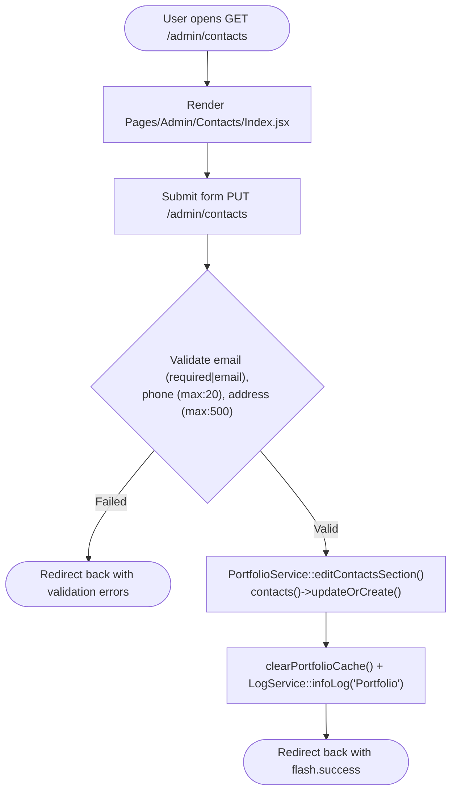

[← Back to Index](../README.md)

# Feature: Contact Info Management

## Overview & Actors
- **Business Goal:** Manage the portfolio owner's public contact channels (recipient email address for public contact messages, phone/WhatsApp number, and physical/location address) displayed in the contact section of the public portfolio.
- **Actors / Roles:** Authenticated users with the `contacts.manage` permission (granted by default to `member`, `admin`, and `superadmin`).
- **Related Entities:** [`contacts`](../01-database-erd.md#contacts), [`portfolio_users`](../01-database-erd.md#portfolio-users), [`logs`](../01-database-erd.md#logs).

## Feature Interconnections
- **Prerequisites (Upstream):**
  - User is authenticated via [Authentication](./auth.md) and holds `contacts.manage`.
  - A starter `contacts` row is provisioned automatically with the user's account email during registration in [Authentication](./auth.md#2-user-registration--automatic-portfolio-provisioning) or account creation in [Members & Accounts](./members.md#2-creating-a-new-member-account).
- **Triggers / Leads To (Downstream):**
  - `contacts.email` serves as the primary recipient address when visitors submit messages via the public contact form in [Public Portfolio](./public-portfolio.md#public-contact-form-submission) (`POST /{slug}/messageMe`).
  - Displayed in the *Profile Summary* card on [Dashboard & View Analytics](./dashboard-analytics.md).
  - Updating contact details invalidates the user's portfolio cache ([Background System](../02-background-system.md#versioned-caching)), records an audit entry in [Activity Logs](./activity-logs.md), and dispatches a live notification to [Notifications & SSE](./notifications.md).

---

## End-to-End Business Process Flows

### 1. Viewing & Updating Portfolio Contact Information
- **Entry Points:**
  - **Read:** `GET /admin/contacts` (`Admin\ContactController@index`, middleware `auth`, `permission:contacts.manage`) → `Pages/Admin/Contacts/Index.jsx`
  - **Update:** `Pages/Admin/Contacts/Index.jsx` → `PUT /admin/contacts` (`Admin\ContactController@update`)
- **Flow Steps:**
  1. **Read Data:** Fetches the [`contacts`](../01-database-erd.md#contacts) record belonging to the user's portfolio and renders `Pages/Admin/Contacts/Index.jsx`.
  2. **Input & Validation (`PUT /admin/contacts`):**
     - `email` (`required|email|max:255`)
     - `phone` (`nullable|string|max:20`)
     - `address` (`nullable|string|max:500`)
  3. **Database Mutation (`PortfolioService::editContactsSection`):**
     - Executes `$portfolio->contacts()->updateOrCreate(['portfolio_user_id' => $portfolio->id], ...)` on [`contacts`](../01-database-erd.md#contacts).
  4. **Side Effects:**
     - Calls `clearPortfolioCache($user->id)` to flush the user's portfolio cache, Inertia metadata cache, and XML sitemap cache ([Background System](../02-background-system.md#versioned-caching)).
     - Logs `infoLog('Portfolio', 'Updated contact information')` to [Activity Logs](./activity-logs.md), automatically dispatching a notification to [Notifications & SSE](./notifications.md).
  5. **Output / Redirect:** Redirects `back()` with `flash.success: "Contact information updated successfully."`.

---

## Flowchart

