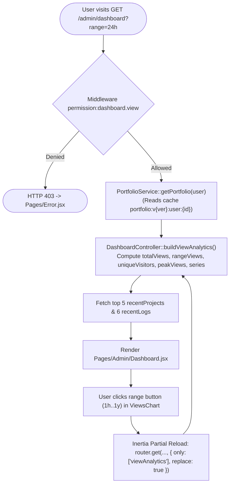

[← Back to Index](../README.md)

# Feature: Dashboard & View Analytics

## Overview & Actors
- **Business Goal:** Provide an executive summary of the user's portfolio performance in a single view, combining content KPIs, an interactive time-series visitor analytics chart (`ViewsChart`), portfolio publication status, recent projects, and recent activity logs.
- **Actors / Roles:** Authenticated users with the `dashboard.view` permission (granted by default to `member`, `admin`, and `superadmin`).
- **Related Entities:** [`portfolio_users`](../01-database-erd.md#portfolio-users), [`portfolio_views`](../01-database-erd.md#portfolio-views), [`projects`](../01-database-erd.md#projects), [`user_skills`](../01-database-erd.md#user-skills), [`experiences`](../01-database-erd.md#experiences), [`logs`](../01-database-erd.md#logs).

## Feature Interconnections
- **Prerequisites (Upstream):**
  - User is authenticated via [Authentication](./auth.md) and holds `dashboard.view` from [Roles & Permissions](./roles-and-permissions.md).
  - Visitor traffic events are recorded when public visitors browse [Public Portfolio](./public-portfolio.md#deduplicated-visitor-view-tracking).
- **Triggers / Leads To (Downstream):**
  - KPI cards and quick links navigate to [Projects & Showcase](./projects.md), [Skills](./skills.md), [Experiences](./experiences.md), [Home & Profile](./home-profile.md), [Contacts](./contacts.md), [Account Settings](./account-settings.md), [Activity Logs](./activity-logs.md), and live previews on [Public Portfolio](./public-portfolio.md).

---

## End-to-End Business Process Flows

### 1. Dashboard Overview & Time-Series Analytics Aggregation
- **Entry Point:** `GET /admin` (redirect) or `GET /admin/dashboard?range={range}` (`Admin\DashboardController@index`, middleware `auth`, `permission:dashboard.view`) → `Pages/Admin/Dashboard.jsx`
- **Flow Steps:**
  1. **Query Parameter Validation:** Reads the `range` query parameter and validates it against `VIEW_RANGES` (`1h`, `5h`, `24h`, `1w`, `1m`, `3m`, `6m`, `1y`), defaulting to `'24h'`.
  2. **Cached Portfolio Lookup (`PortfolioService::getPortfolio`):**
     - Loads the user's `PortfolioUser` graph from [Versioned Caching](../02-background-system.md#versioned-caching) (`portfolio:v{ver}:user:{id}`).
     - Computes KPI counts: active `projects`, `featuredProjects`, `skills`, `experiences`, user `logs`, and all-time `views`.
  3. **Time-Series Bucket Aggregation (`buildViewAnalytics` & `createBuckets`):**
     - Generates contiguous time buckets using `CarbonImmutable` based on the selected range:
       - `1h`: 12 buckets @ 5 minutes
       - `5h`: 15 buckets @ 20 minutes
       - `24h`: 24 buckets @ 1 hour
       - `1w`: 7 buckets @ 1 day
       - `1m`: 30 buckets @ 1 day
       - `3m`: 13 buckets @ 1 week
       - `6m`: 26 buckets @ 1 week
       - `1y`: 12 buckets @ 1 month
     - Queries [`portfolio_views`](../01-database-erd.md#portfolio-views) for `COUNT(*) as range_views` and `COUNT(DISTINCT ip_hash) as unique_visitors` since the start of the first bucket (`viewed_at >= $startAt`), mapping each timestamp into its bucket to compute `series` and `peakViews`.
  4. **Supporting Data:** Loads the top 5 projects (`recentProjects` ordered by `sort_order`) and the user's 6 most recent activity logs (`recentLogs`).
  5. **Frontend Rendering (`Pages/Admin/Dashboard.jsx`):**
     - `DashboardStatsGrid.jsx`: Renders 6 KPI cards; the `Activity Logs` card only renders a clickable link to [Activity Logs](./activity-logs.md) if the user holds the `logs.view` permission (`hasUserPermission(user, "logs.view")`).
     - `ViewsChart.jsx`: Renders the interactive SVG area chart. Switching time ranges (`1h`..`1y`) triggers an Inertia Partial Reload via `router.get(route("admin.dashboard"), { range }, { preserveState: true, preserveScroll: true, replace: true, only: ["viewAnalytics"] })`.
     - `ProfileSummaryCard.jsx` & `RecentProjectsCard.jsx`: Display `Active`/`Draft` portfolio status, shortcuts to [Home & Profile](./home-profile.md), [Contacts](./contacts.md), and [Account Settings](./account-settings.md), and links to project detail pages on [Public Portfolio](./public-portfolio.md).
- **Edge Cases & Error Handling:**
  - If a user does not yet have a `PortfolioUser` record (`$portfolioUserId === null`), `buildViewAnalytics` returns a zero-filled `series` array so `ViewsChart` renders cleanly.
  - Raw `portfolio_views` older than 366 days are automatically pruned by [Daily Model Pruning](../02-background-system.md#daily-pruning).

---

## Flowchart

