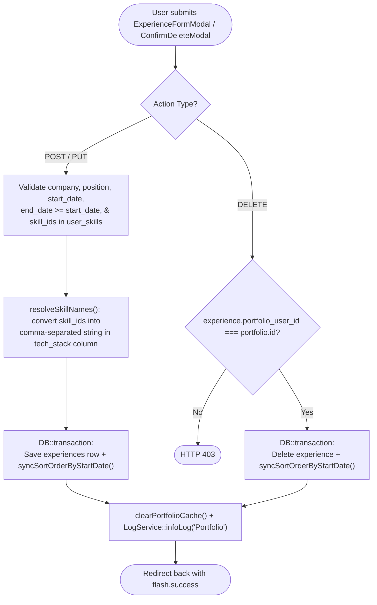

[← Back to Index](../README.md)

# Feature: Career & Work Experiences Management

## Overview & Actors
- **Business Goal:** Manage the portfolio owner's career, internship, or organizational experience timeline, including date ranges, role descriptions, linked active skills, and automatic chronological ordering.
- **Actors / Roles:** Authenticated users with the `experiences.manage` permission (granted by default to `member`, `admin`, and `superadmin`).
- **Related Entities:** [`experiences`](../01-database-erd.md#experiences), [`user_skills`](../01-database-erd.md#user-skills), [`tech_stacks`](../01-database-erd.md#tech-stacks), [`portfolio_users`](../01-database-erd.md#portfolio-users).

## Feature Interconnections
- **Prerequisites (Upstream):**
  - User is authenticated via [Authentication](./auth.md) and holds `experiences.manage`.
  - Selectable skill chips (`skills`) in the experience modal are populated from the user's active skills in [Skills](./skills.md).
- **Triggers / Leads To (Downstream):**
  - If the user has no active skills when opening `ExperienceFormModal.jsx`, a shortcut button directs them to [Skills](./skills.md).
  - When the portfolio is loaded by [Public Portfolio](./public-portfolio.md), `PortfolioService::hydrateExperienceTechStacks()` resolves the comma-separated skill names on each experience back to their Devicon icons from `tech_stacks`.
  - Every mutation invalidates the user's portfolio cache ([Background System](../02-background-system.md#versioned-caching)), records an audit entry in [Activity Logs](./activity-logs.md), and dispatches a live notification to [Notifications & SSE](./notifications.md).

---

## End-to-End Business Process Flows

### 1. Listing Experiences & Active Skill Options
- **Entry Point:** `GET /admin/experiences` (`Admin\ExperienceController@index`, middleware `auth`, `permission:experiences.manage`) → `Pages/Admin/Experiences/Index.jsx`
- **Flow Steps:**
  1. Loads all experiences belonging to the user's portfolio (`$portfolio->experiences()->get()`), ordered newest-first (`orderByDesc('start_date')->orderByDesc('id')`).
  2. Calls `formatSkillOptions($portfolio)` to fetch the user's `userSkills()->with('techStack.category')`, deduplicate by `TechStack` ID, and sort alphabetically (`SORT_NATURAL | SORT_FLAG_CASE`).
  3. On the frontend (`ExperienceCardItem.jsx`), `start_date` and `end_date` (`null` rendered as `"Present"`) are formatted via `formatMonthYear()` in `Utils/dateHelpers.js` using `timeZone: "UTC"` to prevent negative timezone offsets from shifting months backward.

### 2. Creating, Updating & Deleting Experiences
- **Entry Points:**
  - **Create:** `ExperienceFormModal.jsx` → `POST /admin/experiences` (`Admin\ExperienceController@store`)
  - **Update:** `ExperienceFormModal.jsx` → `PUT /admin/experiences/{experience}` (`Admin\ExperienceController@update`)
  - **Delete:** `ConfirmDeleteModal.jsx` → `DELETE /admin/experiences/{experience}` (`Admin\ExperienceController@destroy`)
- **Flow Steps:**
  1. **Ownership Verification:** On `update` and `destroy`, enforces `$experience->portfolio_user_id === $portfolio->id` (`abort_if(..., 403)`).
  2. **Input & Validation (`validateExperiencePayload`):**
     - `company` (`required|string|max:255`)
     - `position` (`required|string|max:255`)
     - `start_date` (`required|date`)
     - `end_date` (`nullable|date|after_or_equal:start_date` — also constrained by `min={data.start_date}` in `ExperienceFormModal.jsx`)
     - `description` (`required|string`)
     - `skill_ids` (`nullable|array`), where each `skill_ids.*` must exist in [`user_skills`](../01-database-erd.md#user-skills) for `$portfolio->id`.
  3. **Skill Name Resolution & Chronological Re-indexing (`saveAndReindexExperiences`):**
     - `resolveSkillNames()` converts the selected `skill_ids` into a comma-separated string of technology names (e.g., `"Laravel, React, Tailwind CSS"`) stored in `experiences.tech_stack`.
     - Inside `DB::transaction()`, executes the write operation (`create` / `update` / `delete`) and immediately runs `syncSortOrderByStartDate($portfolio)` to re-index `sort_order` (`0, 1, 2, ...`) ordered by `start_date DESC, id DESC`.
  4. **Side Effects & Output:**
     - Calls `clearPortfolioCache($request)` ([Background System](../02-background-system.md#versioned-caching)).
     - Logs `infoLog('Portfolio', ...)` to [Activity Logs](./activity-logs.md) and dispatches a notification to [Notifications & SSE](./notifications.md).
     - Redirects `back()` with a `flash.success` message.

---

## Flowchart

