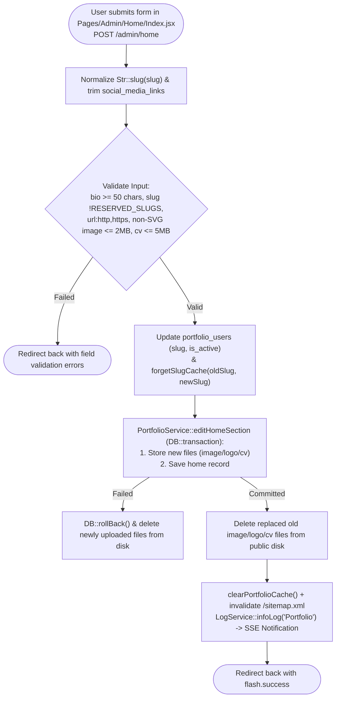

[← Back to Index](../README.md)

# Feature: Home & Profile Management

## Overview & Actors
- **Business Goal:** Manage the primary Hero & Bio identity of the user's portfolio, including public visibility (`Active` vs `Draft`), custom URL slug (`/{slug}`), profile photo, CV/Resume document, role/interest tags (*passions*), bio description (minimum 50 characters required for SEO indexability), and social media links.
- **Actors / Roles:** Authenticated users with the `home.manage` permission (granted by default to `member`, `admin`, and `superadmin`).
- **Related Entities:** [`portfolio_users`](../01-database-erd.md#portfolio-users), [`home`](../01-database-erd.md#home), [`logs`](../01-database-erd.md#logs), [`user_notifications`](../01-database-erd.md#user-notifications).

## Feature Interconnections
- **Prerequisites (Upstream):**
  - User is authenticated via [Authentication](./auth.md) and has a `PortfolioUser` record (provisioned automatically on registration or lazily via the `ResolvesAdminPortfolio` trait).
- **Triggers / Leads To (Downstream):**
  - Updating `is_active`, `slug`, or `description` (bio >= 50 chars) directly controls whether the portfolio is publicly accessible and eligible for `/sitemap.xml` indexing in [Public Portfolio & SEO](./public-portfolio.md#technical-seo-json-ld--dynamic-xml-sitemap).
  - Invalidates the user's portfolio and sitemap caches in [Background System](../02-background-system.md#versioned-caching), records an audit entry in [Activity Logs](./activity-logs.md), and dispatches a live notification to [Notifications & SSE](./notifications.md).

---

## End-to-End Business Process Flows

### 1. Viewing the Home & Profile Editor
- **Entry Point:** `GET /admin/home` (`Admin\HomeController@index`, middleware `auth`, `permission:home.manage`) → `Pages/Admin/Home/Index.jsx`
- **Flow Steps:**
  1. **Portfolio Resolution:** Calls `$this->resolvePortfolio($request, $this->portfolioService)` to load the user's `PortfolioUser` record (or provision a default one if missing).
  2. **Data Loading:** Fetches the [`home`](../01-database-erd.md#home) record along with `portfolioMeta` (`slug`, `is_active`, `theme`).
  3. **Frontend Rendering:** Renders `Pages/Admin/Home/Index.jsx`, split into `QuickBioSidebar.jsx` (`Active`/`Draft` switch, custom URL slug, profile photo upload, CV upload) and `HeroContentForm.jsx` (greeting, display name, bio with 50-character minimum counter, passions tag builder, and GitHub/LinkedIn/Instagram/Website URLs).

### 2. Updating Home Content, Media Assets, Slug & Publication Status
- **Entry Point:** `Pages/Admin/Home/Index.jsx` → `POST /admin/home` (`Admin\HomeController@update`, middleware `auth`, `permission:home.manage`)
- **Flow Steps:**
  1. **Input Normalization & Validation:**
     - Normalizes `slug` via `Str::slug()` and trims whitespace from `social_media_links` entries.
     - Validates:
       - `greeting` (`required|string|max:255`) & `name` (`required|string|max:255`)
       - `slug` (`sometimes|required|string|max:100|alpha_dash`, excluded from `PortfolioUser::RESERVED_SLUGS`, and unique in `portfolio_users` ignoring the current portfolio ID)
       - `description` (`required|string|min:50|max:2000` — enforcing `SeoService::MIN_DESCRIPTION_LENGTH`)
       - `passions` (`nullable|array`, each item `string|max:100`)
       - `social_media_links.github|linkedin|instagram|website` (`nullable|url:http,https|max:255` — blocking dangerous URI schemes such as `javascript:` per `SEC-07`)
       - `is_active` (`sometimes|boolean`)
       - `image` & `logo` (`nullable|image|mimes:jpeg,png,jpg,webp|max:2048` — disallowing SVG uploads per `SEC-06`)
       - `cv` (`nullable|file|mimes:pdf,doc,docx|max:5120`)
  2. **Portfolio Metadata Update (`portfolio_users`):**
     - If `is_active` or `slug` changed, updates [`portfolio_users`](../01-database-erd.md#portfolio-users) and flushes both the old slug (`$oldSlug`) and new slug caches (`forgetSlugCache`).
  3. **Transactional Content & File Update (`PortfolioService::editHomeSection`):**
     - Inside `DB::beginTransaction()`, updates [`home`](../01-database-erd.md#home) fields and stores any newly uploaded files (`logo` in `portfolios/logos`, `image` in `portfolios/images`, `cv` in `portfolios/cvs` on the `public` disk).
     - After `DB::commit()` succeeds, deletes replaced old files from storage (`$disk->delete($oldFile)`).
  4. **Side Effects:**
     - Calls `clearPortfolioCache`, invalidating the user's portfolio cache, Inertia metadata cache, and `/sitemap.xml` cache ([Background System](../02-background-system.md#versioned-caching)).
     - Logs `infoLog('Portfolio', "Updated home section (slug: {$portfolio->slug})")` to [Activity Logs](./activity-logs.md), automatically dispatching a notification to [Notifications & SSE](./notifications.md).
  5. **Output / Redirect:** Redirects `back()` with `flash.success: "Home section updated successfully."` and clears staged file inputs (`image`, `cv`) and preview blob URLs on the frontend.
- **Edge Cases & Error Handling:**
  - If the database transaction fails after new files are written to disk, the `catch` block executes `DB::rollBack()` and deletes all newly uploaded files (`$newFiles`) so no orphaned files remain while preserving the previous files.

---

## Flowchart

