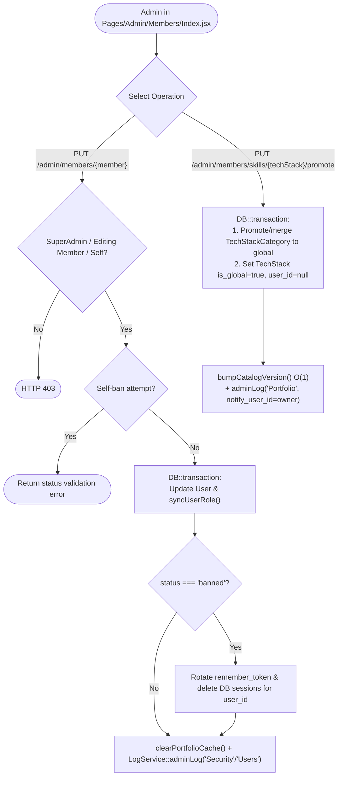

[← Back to Index](../README.md)

# Feature: Members, Accounts & Skill Promotion

## Overview & Actors
- **Business Goal:** Provide a centralized directory for administrators to inspect user accounts and their portfolio contents, create new accounts, manage role assignments, suspend access (*suspend/ban*), delete accounts with full storage cleanup, and promote member custom skills to the global platform catalog.
- **Actors / Roles:**
  - `members.view`: View account directory, inspect portfolio tabs, and preview member portfolios.
  - `members.create`: Create new member accounts.
  - `members.edit`: Edit account profiles and status (`Admin` users can only edit `member` accounts or their own profile; only `Super Admin` can change user roles or edit other `Admin`/`Super Admin` accounts).
  - `members.delete`: Delete accounts (`Admin` users can only delete `member` accounts; users cannot delete their own account from this page).
  - `skills.promote`: Promote a member's custom skill to the global default catalog.
- **Related Entities:** [`users`](../01-database-erd.md#users), [`portfolio_users`](../01-database-erd.md#portfolio-users), [`tech_stacks`](../01-database-erd.md#tech-stacks), [`tech_stack_categories`](../01-database-erd.md#tech-stack-categories), [`roles`](../01-database-erd.md#spatie-rbac), `sessions`.

## Feature Interconnections
- **Prerequisites (Upstream):**
  - User is authenticated via [Authentication](./auth.md) and holds at least `members.view` from [Roles & Permissions](./roles-and-permissions.md).
  - Custom skills listed in the *Skills* tab originate from custom skills created by members in [Skills](./skills.md).
- **Triggers / Leads To (Downstream):**
  - Setting an account's status to `banned` immediately purges active rows from `sessions`, triggers a forced logout in [Authentication](./auth.md#3-session-logout--forced-ban-logout-guard), and excludes the user's portfolio from `/sitemap.xml` in [Public Portfolio & SEO](./public-portfolio.md#technical-seo-json-ld--dynamic-xml-sitemap).
  - Promoting a custom skill moves it into the global catalog in [Platform Settings](./platform-settings.md), increments the catalog cache version (`bumpCatalogVersion()`) in [Background System](../02-background-system.md#versioned-caching), and sends a real-time notification to the skill's creator via [Notifications & SSE](./notifications.md).
  - Every administrative action writes an `admin` log under the `Users`, `Security`, or `Portfolio` module in [Activity Logs](./activity-logs.md).

---

## End-to-End Business Process Flows

### 1. Member Directory, Interactive KPI Filters & Master-Detail Inspection
- **Entry Point:** `GET /admin/members` (`Admin\MemberPortfolioController@index`, middleware `auth`, `permission:members.view`) → `Pages/Admin/Members/Index.jsx`
- **Flow Steps:**
  1. Ensures Spatie RBAC is bootstrapped (`RolePermissionService::ensureBootstrapped()`).
  2. Loads all `User` records with `roles`, `portfolioUser.home`, `portfolioUser.contacts`, `portfolioUser.projects.techStacks`, `portfolioUser.experiences`, `portfolioUser.userSkills.techStack.category`, and groups custom `TechStack` rows by `user_id` without executing runtime dummy seeders (`SEC-02`).
  3. Computes per-member UI authorization flags (`can_edit`, `can_change_role`, `can_delete`) based on the actor's role hierarchy relative to the target member.
  4. On the frontend (`Pages/Admin/Members/Index.jsx`), the UI follows a **Master-Detail** layout:
     - `MemberStatsGrid.jsx`: 4 interactive KPI cards (`Total Accounts`, `Super Admins`, `Admins`, `Members`) that filter the account list when clicked.
     - `MemberListCard.jsx`: Filterable account list with role pills and `<SearchInput />`.
     - `MemberDetailPanel.jsx`: Displays the selected member across 4 modular sub-tabs (`MemberAccountTab.jsx`, `MemberSkillsTab.jsx`, `MemberProjectsTab.jsx`, `MemberProfileTab.jsx`).

### 2. Creating a New Member Account
- **Entry Point:** `MemberFormModal.jsx` → `POST /admin/members` (`Admin\MemberPortfolioController@store`, middleware `permission:members.create`)
- **Flow Steps:**
  1. **Role Restriction (`allowedRoles`):** If the creator is a `Super Admin`, any registered Spatie role can be assigned; otherwise (`Admin`), `allowedRoles` is restricted to `['member']`.
  2. **Input Validation:** Validates `name` (`required|max:255`), `username` (`required|max:100|alpha_dash|unique:users,username`), `email` (`required|email|unique:users,email`), `password` (`required|min:8`), `role` (`Rule::in($allowedRoles)`), and `status` (`active|dnd|banned`).
  3. **Database Transaction:** Creates the `User` record, calls `$user->syncUserRole($role)`, and provisions a starter portfolio via `PortfolioService::createDefaultPortfolio($user)`.
  4. **Audit Logging:** Records `adminLog('Users', "Created account @{$member->username} with role {$member->role}")` in [Activity Logs](./activity-logs.md).

### 3. Updating Accounts, Changing Roles & Suspend/Ban (`Session Revocation`)
- **Entry Point:** `MemberFormModal.jsx` → `PUT /admin/members/{member}` (`Admin\MemberPortfolioController@update`, middleware `permission:members.edit`)
- **Flow Steps:**
  1. **Actor Hierarchy Guards:**
     - If the actor is not a `Super Admin`, is not editing their own account, and the target is not a `member`, aborts with `403 ('Admins can only modify member accounts.')`.
     - Users cannot change their own role and cannot suspend their own active account (`$actor->id === $member->id && $status === 'banned'` returns a validation error on `status`).
  2. **Database Mutation & Active Session Revocation (`SEC-03`):**
     - Inside `DB::transaction()`, updates profile fields (plus hashed password if provided) and calls `$member->syncUserRole($role)`.
     - **If `status === 'banned'`:** Rotates `remember_token` (`Str::random(60)`) and immediately deletes all active sessions for the user from the `sessions` table (`DB::table('sessions')->where('user_id', $member->id)->delete()`).
  3. **Side Effects & Security Auditing:**
     - If the user's role changed, flushes Spatie permission cache (`RolePermissionService::clearCache()`).
     - Clears the member's portfolio cache (`forgetUserPortfolioCache($member->id)`).
     - Writes dedicated `adminLog('Security', ...)` entries for `BANNED`, `UNBANNED`, or role changes, followed by `adminLog('Users', ...)` in [Activity Logs](./activity-logs.md).

### 4. Deleting a Member Account, Portfolio & Storage Assets
- **Entry Point:** `ConfirmDeleteModal.jsx` → `DELETE /admin/members/{member}` (`Admin\MemberPortfolioController@destroy`, middleware `permission:members.delete`)
- **Flow Steps:**
  1. **Safety Guards:** Prevents self-deletion (`403`), prevents `Admin` users from deleting other `Admin`/`Super Admin` accounts (`403`), and blocks deleting the last remaining `Super Admin` account (`422`).
  2. **Asset Path Collection & Transaction:** Collects the account's `photo_path` and all portfolio media paths (`collectPortfolioFilePaths`: hero photo, logo, CV, project covers, and showcase screenshots).
  3. Deletes the portfolio record, active `sessions`, and the `User` row inside a DB transaction, then removes all collected files from the `public` disk after commit.

### 5. Portfolio Preview & Promoting Member Custom Skills to Global Catalog
- **Entry Points:**
  - **Preview:** `GET /admin/members/{member}/preview` (`MemberPortfolioController@preview`, `permission:members.view`) → redirects to `route('portfolio.index', ['slug' => $portfolio->slug])` on [Public Portfolio](./public-portfolio.md).
  - **Promote Skill:** *Make Default* button in `MemberSkillsTab.jsx` → `PUT /admin/members/skills/{techStack}/promote` (`MemberPortfolioController@promoteSkill`, `permission:skills.promote`).
- **Skill Promotion Steps:**
  1. Inspects the custom skill's `TechStackCategory`. If the category is also custom (`!is_global`), checks whether a global category with the same name already exists (case-insensitive): if found, re-points `category_id` to the existing global category; otherwise promotes the custom category to global (`is_global = true`, `user_id = null`).
  2. Updates the `TechStack` to global (`is_global = true`, `user_id = null`).
  3. Clears the original owner's portfolio cache and calls `PortfolioService::bumpCatalogVersion()` (`O(1)` global cache invalidation in [Background System](../02-background-system.md#versioned-caching)).
  4. Logs `adminLog('Portfolio', ...)` with `notify_user_id = $originalUserId`, dispatching a notification to the member who created the skill.

---

## Flowchart

