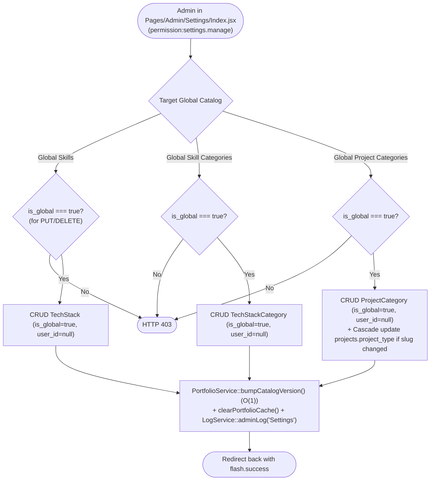

[← Back to Index](../README.md)

# Feature: Platform Settings (Global Default Catalogs)

## Overview & Actors
- **Business Goal:** Manage the platform-wide master catalogs (*shared defaults*) available to all ZeeFolio users: **Default Skills** (global `TechStack`), **Default Skill Categories** (global `TechStackCategory`), and **Default Project Categories** (global `ProjectCategory`).
- **Actors / Roles:** Authenticated users with the `settings.manage` permission (granted by default to `admin` and `superadmin`).
- **Related Entities:** [`tech_stacks`](../01-database-erd.md#tech-stacks), [`tech_stack_categories`](../01-database-erd.md#tech-stack-categories), [`project_categories`](../01-database-erd.md#project-categories), [`projects`](../01-database-erd.md#projects).

## Feature Interconnections
- **Prerequisites (Upstream):**
  - User is authenticated via [Authentication](./auth.md) and holds `settings.manage` from [Roles & Permissions](./roles-and-permissions.md).
  - The global default skill catalog can also grow when an Admin promotes a member's custom skill in [Members & Accounts](./members.md#promoting-member-custom-skills-to-global-catalog).
- **Triggers / Leads To (Downstream):**
  - All global items managed here appear as default options in [Skills](./skills.md) and [Projects & Showcase](./projects.md) for every user on the platform.
  - Every mutation calls `PortfolioService::bumpCatalogVersion()` ([Background System](../02-background-system.md#versioned-caching)) to invalidate all cached user portfolios in `O(1)`, immediately reflecting skill name, Devicon icon, or category updates across all [Public Portfolio](./public-portfolio.md) pages.
  - Records an `admin` log under the `Settings` module in [Activity Logs](./activity-logs.md) and dispatches a live notification to [Notifications & SSE](./notifications.md).

---

## End-to-End Business Process Flows

### 1. Viewing Global Catalogs & Interactive Filters
- **Entry Point:** `GET /admin/settings` (`Admin\SettingController@index`, middleware `auth`, `permission:settings.manage`) → `Pages/Admin/Settings/Index.jsx`
- **Flow Steps:**
  1. Loads all global `TechStack` records (`where('is_global', true)->with('category')->orderBy('name')`).
  2. Loads all global `TechStackCategory` records with `global_skills_count`.
  3. Loads all global `ProjectCategory` records and computes `projects_count` by matching `LOWER(projects.project_type)` against each category's `slug`.
  4. On the frontend (`Pages/Admin/Settings/Index.jsx`), the 3 summary stat buttons (`Skills`, `Skill Groups`, `Project Groups`) and the category rows in `SkillCategoriesCard.jsx` act as quick filters and section jumpers (on mobile `< lg`, selecting a skill category automatically switches the active view to the `Default Skills` list).

### 2. Global Default Skills CRUD
- **Entry Points:** `GlobalSkillModal.jsx` & `GlobalSkillsList.jsx` →
  - **Create:** `POST /admin/settings/global-skills` (`SettingController@storeGlobalSkill`)
  - **Update:** `PUT /admin/settings/global-skills/{techStack}` (`SettingController@updateGlobalSkill`)
  - **Delete:** `DELETE /admin/settings/global-skills/{techStack}` (`SettingController@destroyGlobalSkill`)
- **Flow Steps:**
  1. **Global Scope Guard (`SEC-05`):** On `updateGlobalSkill` and `destroyGlobalSkill`, verifies `$techStack->is_global === true` (`abort(403)` if attempting to modify a member's private custom skill via settings endpoints).
  2. **Input Validation:** Validates `name` (`required|string|max:100`), `icon` (`nullable|string|max:255` Devicon class with live preview in `GlobalSkillModal.jsx`), and `category_id` (`nullable|exists:tech_stack_categories,id`).
  3. **Persistence & Global Cache Invalidation:** Saves the record with `is_global = true` and `user_id = null`, then calls `bumpCatalogVersion()`, `clearPortfolioCache()`, and `adminLog('Settings', ...)`.

### 3. Global Default Skill Categories CRUD
- **Entry Points:** `SkillCategoriesCard.jsx` (`CategoryManagerList.jsx`) →
  - **Create:** `POST /admin/settings/categories` (`SettingController@storeCategory`)
  - **Update:** `PUT /admin/settings/categories/{category}` (`SettingController@updateCategory`)
  - **Delete:** `DELETE /admin/settings/categories/{category}` (`SettingController@destroyCategory`)
- **Flow Steps:**
  1. **Scope Guard & Validation:** Enforces `$category->is_global === true` (`403` otherwise) and validates `name` (`required|string|max:50`, unique among global `tech_stack_categories`).
  2. **Persistence & Side Effects:** Creates, renames, or deletes the global `TechStackCategory` (`is_global = true`, `user_id = null`), followed by `bumpCatalogVersion()` and `adminLog('Settings', ...)`.

### 4. Global Default Project Categories CRUD
- **Entry Points:** `ProjectCategoriesCard.jsx` (`CategoryManagerList.jsx`) →
  - **Create:** `POST /admin/settings/project-categories` (`SettingController@storeProjectCategory`)
  - **Update:** `PUT /admin/settings/project-categories/{projectCategory}` (`SettingController@updateProjectCategory`)
  - **Delete:** `DELETE /admin/settings/project-categories/{projectCategory}` (`SettingController@destroyProjectCategory`)
- **Flow Steps:**
  1. **Scope Guard & Validation:** Enforces `$projectCategory->is_global === true` (`403` otherwise) and validates `name` (`required|string|max:50`, unique among global `project_categories`).
  2. **Cascading Project Slug Sync on Rename:** When renaming a global project category (`updateProjectCategory`), computes `$newSlug = Str::slug($name)` and if it differs from `$oldSlug`, updates all matching projects (`Project::where('project_type', $oldSlug)->update(['project_type' => $newSlug])`).
  3. **Global Cache Invalidation:** Calls `bumpCatalogVersion()` and logs `adminLog('Settings', ...)`.

---

## Flowchart

