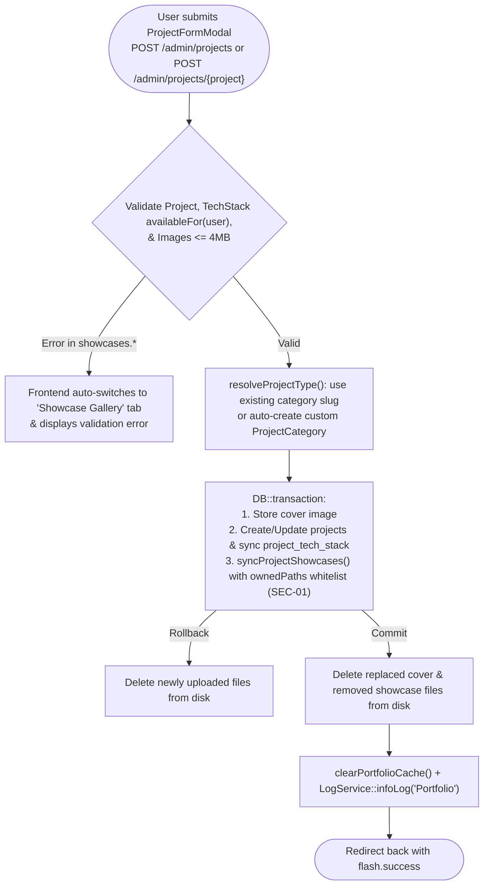

[← Back to Index](../README.md)

# Feature: Projects, Showcase Gallery & Custom Categories

## Overview & Actors
- **Business Goal:** Manage the user's portfolio projects, including cover images, live demo/source URLs, technology associations (`TechStack`), multi-section screenshot galleries (*showcases*), featured (`is_featured`) and visibility (`is_active`) flags, and per-user custom project categories.
- **Actors / Roles:** Authenticated users with the `projects.manage` permission (granted by default to `member`, `admin`, and `superadmin`).
- **Related Entities:** [`projects`](../01-database-erd.md#projects), [`project_images`](../01-database-erd.md#project-images), [`project_categories`](../01-database-erd.md#project-categories), [`tech_stacks`](../01-database-erd.md#tech-stacks), [`portfolio_users`](../01-database-erd.md#portfolio-users).

## Feature Interconnections
- **Prerequisites (Upstream):**
  - User is authenticated via [Authentication](./auth.md) and holds `projects.manage`.
  - Selectable technologies (`techStacks`) combine global defaults from [Platform Settings](./platform-settings.md) and the user's custom skills from [Skills](./skills.md).
  - Selectable project categories (`projectCategories`) combine global categories from [Platform Settings](./platform-settings.md#global-default-project-categories-crud) and the user's custom project categories.
- **Triggers / Leads To (Downstream):**
  - Active projects (`is_active = true`) are displayed on `/{slug}`, `/{slug}/projects`, and `/{slug}/projects/{projectSlug}` in [Public Portfolio](./public-portfolio.md), as well as in the *Recent Projects* card on [Dashboard & View Analytics](./dashboard-analytics.md).
  - Every project or category mutation invalidates the user's portfolio cache ([Background System](../02-background-system.md#versioned-caching)), records an audit entry in [Activity Logs](./activity-logs.md), and dispatches a live notification to [Notifications & SSE](./notifications.md).

---

## End-to-End Business Process Flows

### 1. Listing & Filtering Projects
- **Entry Point:** `GET /admin/projects` (`Admin\ProjectController@index`, middleware `auth`, `permission:projects.manage`) → `Pages/Admin/Projects/Index.jsx`
- **Flow Steps:**
  1. Loads all projects belonging to the user's portfolio with eager-loaded `techStacks` and `images` (`orderBy('sort_order')->orderByDesc('id')`).
  2. Loads `TechStack::availableFor($user)` and `ProjectCategory::availableFor($user)`.
  3. On the frontend (`Pages/Admin/Projects/Index.jsx`), users can filter projects by category tab (case-insensitive), search by title/description/tech stack, or open the modal directly to the *Showcase Gallery* tab from any project card.

### 2. Creating & Updating Projects with Showcase Galleries (``)
- **Entry Points:**
  - **Create:** `ProjectFormModal.jsx` → `POST /admin/projects` (`Admin\ProjectController@store`)
  - **Update:** `ProjectFormModal.jsx` → `POST /admin/projects/{project}` (`Admin\ProjectController@update`, supporting `FormData` uploads)
- **Flow Steps:**
  1. **Ownership & Validation:**
     - On update, verifies `$project->portfolio_user_id === $portfolio->id` (HTTP 403 otherwise).
     - Validates `title` (`required|max:255`), `slug` (`nullable|alpha_dash|unique:projects,slug`), `project_type`, `custom_project_type` (`nullable|max:50`), `description` (`required`), `demo_url` & `source_url` (`nullable|url:http,https`), `sort_order` (`integer|min:0`), `is_featured` & `is_active` (`boolean`), `image` (`nullable|image|mimes:jpeg,png,jpg,webp|max:4096`), `tech_stack_ids.*` (restricted to global or self-owned `TechStack` IDs per `SEC-05`), and `showcases.*.title`, `showcases.*.description`, `showcases.*.existing_images.*`, and `showcases.*.new_images.*` (`image|max:4096`).
  2. **Category & Unique Slug Resolution:**
     - If `__custom__` is selected with a `custom_project_type`, `resolveProjectType()` finds or creates a custom `ProjectCategory` (`is_global = false`, `user_id = $user->id`) and assigns its `slug`.
     - Generates a globally unique `slug` (appending a 4–5 character random suffix on collision).
  3. **Transactional Persistence & Showcase Path Whitelisting (`SEC-01`):**
     - Inside `DB::beginTransaction()`, stores the new cover image (if uploaded), creates/updates the [`projects`](../01-database-erd.md#projects) row, and syncs the `project_tech_stack` pivot table with `sort_order`.
     - **`syncProjectShowcases()` (`SEC-01` Security Guard):** Collects all image paths currently owned by the project's existing showcase records (`$ownedPaths`). Submitted `existing_images` are intersected with `$ownedPaths` (`array_intersect($requestedExisting, $ownedPaths)`), preventing attackers from injecting arbitrary file paths belonging to other users to trigger deletion.
     - Stores newly uploaded showcase screenshots under `portfolios/projects`, creates/updates [`project_images`](../01-database-erd.md#project-images) rows, and queues removed screenshot paths in `$oldFilesToDelete`.
  4. **Post-Commit Storage Cleanup & Side Effects:**
     - After `DB::commit()`, deletes replaced cover images and removed showcase screenshots from the `public` disk.
     - Invalidates the user's portfolio cache ([Background System](../02-background-system.md#versioned-caching)) and writes `infoLog('Portfolio', ...)` to [Activity Logs](./activity-logs.md).
- **Edge Cases & Error Handling:**
  - If validation fails on a `showcases.*` field while the user is viewing the *General Info* tab in `ProjectFormModal.jsx`, the `onError` handler in `Projects/Index.jsx` automatically switches the active modal tab to `"showcase"`.
  - If the database transaction rolls back, all newly uploaded files (`$newFiles`) are immediately deleted from disk.

### 3. Deleting a Project
- **Entry Point:** `ConfirmDeleteModal.jsx` → `DELETE /admin/projects/{project}` (`Admin\ProjectController@destroy`)
- **Flow Steps:**
  1. Verifies project ownership (`$project->portfolio_user_id === $portfolio->id`).
  2. Collects the cover `image_path` and all paths inside `images` (`project_images`).
  3. Deletes `project_images`, detaches `techStacks()`, and deletes the `projects` row inside a DB transaction, then removes all associated image files from the `public` disk.

### 4. Per-User Custom Project Categories
- **Entry Points:** `CustomCategoryModal.jsx` (`CategoryManagerList.jsx`) →
  - `POST /admin/projects/categories` (`ProjectController@storeCategory`)
  - `PUT /admin/projects/categories/{projectCategory}` (`ProjectController@updateCategory`)
  - `DELETE /admin/projects/categories/{projectCategory}` (`ProjectController@destroyCategory`)
- **Flow Steps:**
  1. **Add Category:** Validates `name` (`required|string|max:50`), checks case-insensitive uniqueness against `ProjectCategory::availableFor($user)`, and creates a `ProjectCategory` with `is_global = false` and `user_id = $user->id`.
  2. **Rename Category:** Ensures the category is non-global and owned by the user (`!$projectCategory->is_global && $projectCategory->user_id === $user->id`, HTTP 403 otherwise). If the slug changes, cascades the new slug across the user's projects (`where('project_type', $oldSlug)->update(['project_type' => $newSlug])`).
  3. **Delete Category:** Deletes the user-owned custom category after confirmation via `ConfirmDeleteModal`.

---

## Flowchart

