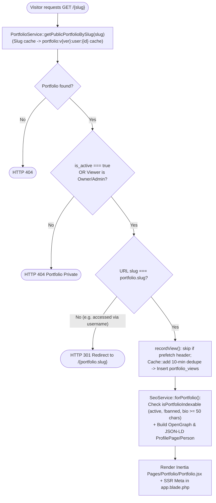

[← Back to Index](../README.md)

# Feature: Public Portfolio, Projects Archive, Contact Mail & Technical SEO

## Overview & Actors
- **Business Goal:** Serve multi-user public portfolio pages (`/{slug}`), full project archives (`/{slug}/projects`), project detail & showcase galleries (`/{slug}/projects/{projectSlug}`), deduplicated visitor view tracking, public contact form email delivery, and hybrid technical SEO (OpenGraph, Twitter Card, JSON-LD `ProfilePage`/`Person`, and `/sitemap.xml`).
- **Actors / Roles:**
  - `Guest / Public Visitor`: Accesses any portfolio where `is_active = true`.
  - `Owner / Admin / Super Admin`: Can preview portfolios even when `is_active = false` (`Draft` mode).
- **Related Entities:** [`portfolio_users`](../01-database-erd.md#portfolio-users), [`home`](../01-database-erd.md#home), [`projects`](../01-database-erd.md#projects), [`project_images`](../01-database-erd.md#project-images), [`user_skills`](../01-database-erd.md#user-skills), [`experiences`](../01-database-erd.md#experiences), [`contacts`](../01-database-erd.md#contacts), [`portfolio_views`](../01-database-erd.md#portfolio-views), [`user_notifications`](../01-database-erd.md#user-notifications).

## Feature Interconnections
- **Prerequisites (Upstream):**
  - Portfolio content is configured by the owner in [Home & Profile](./home-profile.md), [Projects & Showcase](./projects.md), [Skills](./skills.md), [Experiences](./experiences.md), and [Contacts](./contacts.md).
  - Portfolio data is served from [Versioned Caching](../02-background-system.md#versioned-caching) (`PortfolioService::getPublicPortfolioBySlug`).
- **Triggers / Leads To (Downstream):**
  - Each page visit records a deduplicated event in `portfolio_views`, powering `ViewsChart` in [Dashboard & View Analytics](./dashboard-analytics.md).
  - Submitting the public contact form queues `SendMailToMe` via [Database Queue Mail](../02-background-system.md#queued-mail) and dispatches a real-time notification to the portfolio owner in [Notifications & SSE](./notifications.md).

---

## End-to-End Business Process Flows

### 1. Public Portfolio Resolution, Draft Guard & Canonical 301 Redirects
- **Entry Points:**
  - **Main Portfolio:** `GET /{slug}` (`Portfolio\PortfolioController@index`) → `Pages/Portfolio/Portfolio.jsx`
  - **Projects Archive:** `GET /{slug}/projects` (`PortfolioController@listProject`) → `Pages/Portfolio/Projects/ListProject.jsx`
  - **Project Detail:** `GET /{slug}/projects/{projectSlug}` (`PortfolioController@getProjectBySlug`) → `Pages/Portfolio/Projects/DetailProject.jsx`
  - **Legacy Redirects:** `GET /projects`, `GET /projects/{projectSlug}`, `GET /me/*`, `GET /v2/*`
- **Flow Steps:**
  1. **Reserved Slug Regex Guard:** Route `/{slug}` is constrained by `^(?!admin|api|storage|sanctum|up|_boost|verify-email|messageMe|projects|me|v2|sitemap|sitemap.xml)[a-zA-Z0-9-_]+$` (`PortfolioUser::RESERVED_SLUGS`).
  2. **Cached Slug Resolution (`getPublicPortfolioBySlug`):**
     - Resolves `user_id` from cache key `portfolio:user_id_by_slug:{slug}` (matching `portfolio_users.slug` first, then falling back to `users.username`), and loads the full portfolio from `portfolio:v{ver}:user:{userId}`. Aborts with HTTP 404 if not found.
  3. **Draft Visibility Guard (`resolveVisiblePortfolio`):**
     - When `$portfolio->is_active === false`, access is allowed only if the authenticated viewer is the portfolio owner (`$viewer->id === $portfolio->user_id`) or an `Admin`/`Super Admin` (`$viewer->isAdminOrAbove()`). All other visitors receive HTTP 404 (`This portfolio is currently private.`).
  4. **Canonical 301 Redirect:**
     - If a visitor accesses the portfolio via `users.username` when it differs from `portfolio_users.slug`, or visits legacy routes (`/me`, `/v2`, `/projects`), the controller returns an **HTTP 301 Moved Permanently** redirect to the canonical `/{portfolio->slug}` URL.
  5. **Active Project Enforcement (`SEC-13`):** Only projects with `is_active = true` are included in public queries; requesting an inactive project's detail URL aborts with HTTP 404.

### 2. Deduplicated Visitor View Tracking (`recordView`)
- **Entry Point:** Invoked automatically inside `PortfolioController@index` (`page = 'home'`), `listProject` (`page = 'projects'`), and `getProjectBySlug` (`page = 'project'`, `project_id = $project->id`).
- **Flow Steps (`PERF-03`):**
  1. **Skip Prefetch Requests:** Ignores requests carrying `Purpose`, `Sec-Purpose`, `X-Purpose`, or `X-Moz` headers containing `'prefetch'`.
  2. **IP Hashing & 10-Minute Atomic Deduplication:**
     - Computes an anonymized hash `$ipHash = hash('sha256', $ip . '|' . config('app.key'))`.
     - Attempts an atomic cache lock `Cache::add("portfolio_view_dedupe:{$portfolioId}:{$page}:{$projectId}:{$ipHash}", 1, now()->addMinutes(10))`.
     - If the key already exists (`Cache::add` returns `false`), no row is written. Otherwise, inserts a new event into [`portfolio_views`](../01-database-erd.md#portfolio-views).

### 3. Public Contact Form Submission (`sendMessage`)
- **Entry Point:** Contact form in `Pages/Portfolio/Portfolio.jsx` → `POST /{slug}/messageMe` or `POST /messageMe` (`Portfolio\PortfolioController@sendMessage`, middleware `throttle:5,1`)
- **Flow Steps:**
  1. **Rate Limiting & Validation (`SEC-10`):** Limited to 5 submissions per minute per IP (`throttle:5,1`). Validates `name` (`required|string|max:255`), `email` (`required|email|max:255`), `message` (`required|string|max:5000`), and `portfolio_slug` (`nullable|string|max:100`).
  2. **Recipient Email Resolution:** Resolves the recipient address from `portfolio->contacts->email` ([Contacts](./contacts.md)), falling back to `portfolio->user->email`, then `config('mail.to.address')`.
  3. **Queued Mail & Live Notification Dispatch (`PERF-11`):**
     - Calls `Mail::to($recipientEmail)->send(new SendMailToMe(...))`, which queues the email job in `jobs` via `ShouldQueue` ([Background System](../02-background-system.md#queued-mail)).
     - Calls `LogService::dispatchNotification()` targeting `portfolio->user_id` (`module: 'Portfolio'`, `title: 'New Contact Message'`, `actionUrl: '/admin/contacts'`), delivering an immediate real-time SSE notification to the portfolio owner ([Notifications & SSE](./notifications.md)).
  4. **Output:** Redirects `back()` with `flash.success: "Message sent successfully!"`.

### 4. Technical SEO, JSON-LD & Dynamic XML Sitemap (`SeoService`)
- **Entry Points:**
  - **SSR Meta & JSON-LD:** `SeoService::forPortfolio()`, `forProjectsArchive()`, `forProjectDetail()` → rendered server-side in `resources/views/app.blade.php` and synchronized client-side by `Components/SEO/SeoHead.jsx`.
  - **XML Sitemap:** `GET /sitemap.xml` (`PortfolioController@sitemap` → `SeoService::generateSitemapXml()`)
- **Flow Steps & SEO Business Rules:**
  1. **Portfolio Indexability Rules (`isPortfolioIndexable`):**
     - A portfolio receives `robots: "index, follow, max-image-preview:large, max-snippet:-1"` and is included in `/sitemap.xml` if and only if **all three conditions** hold:
       1. `$portfolio->is_active === true` (and not being viewed in draft preview mode).
       2. The owner's account is not suspended (`$portfolio->user?->status !== 'banned'`).
       3. The bio (`home.description`) is not the default placeholder and is **at least 50 characters long** (`SeoService::MIN_DESCRIPTION_LENGTH`).
     - Otherwise, the portfolio receives `robots: "noindex, nofollow"`. Sub-pages (`/{slug}/projects` and `/{slug}/projects/{projectSlug}`) use `robots: "noindex, follow"` so search engines consolidate ranking signals onto the canonical `/{slug}` landing page.
  2. **Hardened JSON-LD Graph:** `forPortfolio()` builds a schema.org `@graph` (`ProfilePage` + `Person` with `knowsAbout` skills and `sameAs` social links) serialized in `app.blade.php` using `JSON_UNESCAPED_SLASHES | JSON_UNESCAPED_UNICODE | JSON_HEX_TAG | JSON_HEX_AMP` to prevent `</script>` breakout.
  3. **Cached XML Sitemap (`/sitemap.xml`):**
     - `generateSitemapXml()` caches the XML output under `seo:sitemap_xml` (1-hour TTL), iterating active portfolios via `chunkById(200)` and filtering through `isPortfolioIndexable()`.

---

## Flowchart

