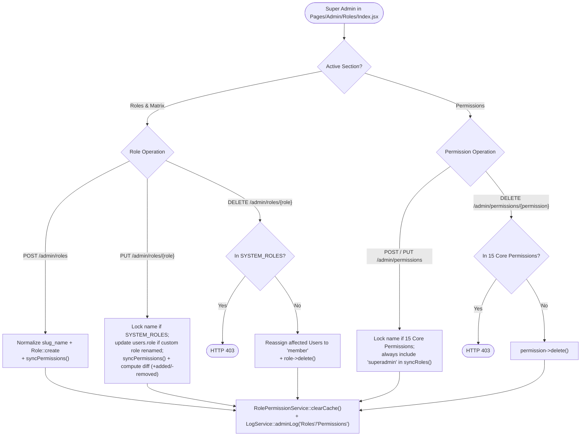

[← Back to Index](../README.md)

# Feature: Roles & Permissions Management (Spatie RBAC)

## Overview & Actors
- **Business Goal:** Manage Role-Based Access Control (RBAC) powered by Spatie Laravel Permission, including automatic bootstrapping of the 3 core roles and 15 default permissions, an interactive permission assignment matrix per role, and CRUD operations for custom roles and custom permissions.
- **Actors / Roles:**
  - `roles.manage` or `permissions.manage`: View `/admin/roles`.
  - `roles.manage`: Create custom roles, update role permission matrices, and delete custom roles.
  - `permissions.manage`: Create, update, and delete custom permissions.
  - *(Granted by default exclusively to `superadmin`).*
- **Related Entities:** [`roles`, `permissions`, `role_has_permissions`, `model_has_roles`](../01-database-erd.md#spatie-rbac), [`users`](../01-database-erd.md#users).

## Feature Interconnections
- **Prerequisites (Upstream):**
  - User is authenticated via [Authentication](./auth.md) and passes `Gate::before` in `AppServiceProvider` or holds `roles.manage` / `permissions.manage`.
- **Triggers / Leads To (Downstream):**
  - Every role or permission mutation calls `RolePermissionService::clearCache()`, immediately updating route authorization (`permission:...`) and sidebar navigation visibility (`Sidebar.jsx`) across all modules ([Dashboard](./dashboard-analytics.md), [Home](./home-profile.md), [Projects](./projects.md), [Skills](./skills.md), [Experiences](./experiences.md), [Contacts](./contacts.md), [Members](./members.md), [Platform Settings](./platform-settings.md), [Activity Logs](./activity-logs.md)).
  - Deleting a custom role automatically reassigns all affected users back to the default `member` role ([Members & Accounts](./members.md)).
  - All mutations record an `admin` log under the `Roles` or `Permissions` module in [Activity Logs](./activity-logs.md) and dispatch a live notification to [Notifications & SSE](./notifications.md).

---

## End-to-End Business Process Flows

### 1. Automatic RBAC Bootstrapping & `Gate::before` Evaluation
- **Entry Points:** `AppServiceProvider::boot()` & `HandleInertiaRequests::share()` → `RolePermissionService::ensureBootstrapped()`
- **Flow Steps:**
  1. **Super Admin Gate Bypass (`Gate::before`):** If `$user->role === 'superadmin'` or `$user->isSuperAdmin()`, the Gate returns `true` for all permission checks.
  2. **Idempotent Bootstrap (`zeefolio_spatie_rbac_initialized_v2`):**
     - When cache key `zeefolio_spatie_rbac_initialized_v2` is absent, `RolePermissionService::bootstrap()` upserts the **15 default permissions** (`6 Portfolio`, `7 Administration`, `2 Access Control`) and ensures the 3 core roles (`superadmin`, `admin`, `member`) exist.
     - Syncs all permissions to `superadmin`, 13 default permissions to `admin` (if newly initialized), and 6 `Portfolio` permissions to `member` (if newly initialized), then synchronizes every `User` row with its Spatie role.

### 2. Interactive Role Matrix & Custom Role CRUD
- **Entry Points:**
  - **View:** `GET /admin/roles` (`Admin\RolePermissionController@index`) → `Pages/Admin/Roles/Index.jsx` (`RolesMatrixSection.jsx`)
  - **Create:** `RoleFormModal.jsx` → `POST /admin/roles` (`RolePermissionController@storeRole`, `permission:roles.manage`)
  - **Update Matrix / Role:** `RolesMatrixSection.jsx` / `RoleFormModal.jsx` → `PUT /admin/roles/{role}` (`RolePermissionController@updateRole`, `permission:roles.manage`)
  - **Delete:** `ConfirmDeleteModal.jsx` → `DELETE /admin/roles/{role}` (`RolePermissionController@destroyRole`, `permission:roles.manage`)
- **Flow Steps:**
  1. **Create Custom Role:**
     - When opening `RoleFormModal` (`openCreateRole`), the frontend filters the 6 default `Portfolio` permissions against live `permissions` from the database.
     - The backend normalizes the role name via `Str::slug($name, '_')`, validates uniqueness for `guard_name = 'web'`, creates the `Role`, and runs `$role->syncPermissions($permissions)`.
  2. **Update Role & Interactive Permission Matrix:**
     - In `RolesMatrixSection.jsx`, if the user has unsaved checkbox changes (`hasUnsavedChanges === true`) and clicks a different role, a confirmation prompt prevents accidental loss of changes.
     - On the backend, the 3 `SYSTEM_ROLES` (`superadmin`, `admin`, `member`) **cannot be renamed** (`$isSystem ? $role->name : $newName`). If a custom role is renamed, all users holding that role in `users` are updated (`User::where('role', $oldName)->update(['role' => $newName])`).
     - For `superadmin`, the backend always enforces synchronization of all existing permissions.
     - Computes the exact diff (`+added` and `-removed` permissions) and logs it via `LogService::adminLog('Roles', ...)`.
  3. **Delete Custom Role & Automatic User Reassignment:**
     - Blocks deletion of `SYSTEM_ROLES` (`superadmin`, `admin`, `member`) with `abort(403)`.
     - Before deleting a custom role, reassigns all `User` accounts holding that role back to `member` via `$affectedUser->syncUserRole('member')`.

### 3. Custom Permission CRUD
- **Entry Points:** `PermissionsCrudSection.jsx` & `PermissionFormModal.jsx` →
  - `POST /admin/permissions` (`RolePermissionController@storePermission`, `permission:permissions.manage`)
  - `PUT /admin/permissions/{permission}` (`RolePermissionController@updatePermission`, `permission:permissions.manage`)
  - `DELETE /admin/permissions/{permission}` (`RolePermissionController@destroyPermission`, `permission:permissions.manage`)
- **Flow Steps:**
  1. **Create Permission:** Validates `name` (`required|max:100|unique:permissions,name`), `group` (`nullable|max:50`, auto-inferred from the dot-prefix if blank), `description`, and `roles.*`. New permissions are **always** attached to `superadmin` in addition to any selected roles.
  2. **Update Permission:** If the permission is one of the **15 Core System Permissions** (`RolePermissionService::defaultPermissions()`), its `name` is locked against renaming while `group`, `description`, and assigned `roles` remain editable (always retaining `superadmin`).
  3. **Delete Permission:** Blocks deletion of the 15 Core System Permissions (`abort(403, 'Core system permissions cannot be deleted.')`). Deletes custom permissions and flushes the Spatie cache.

---

## Flowchart

