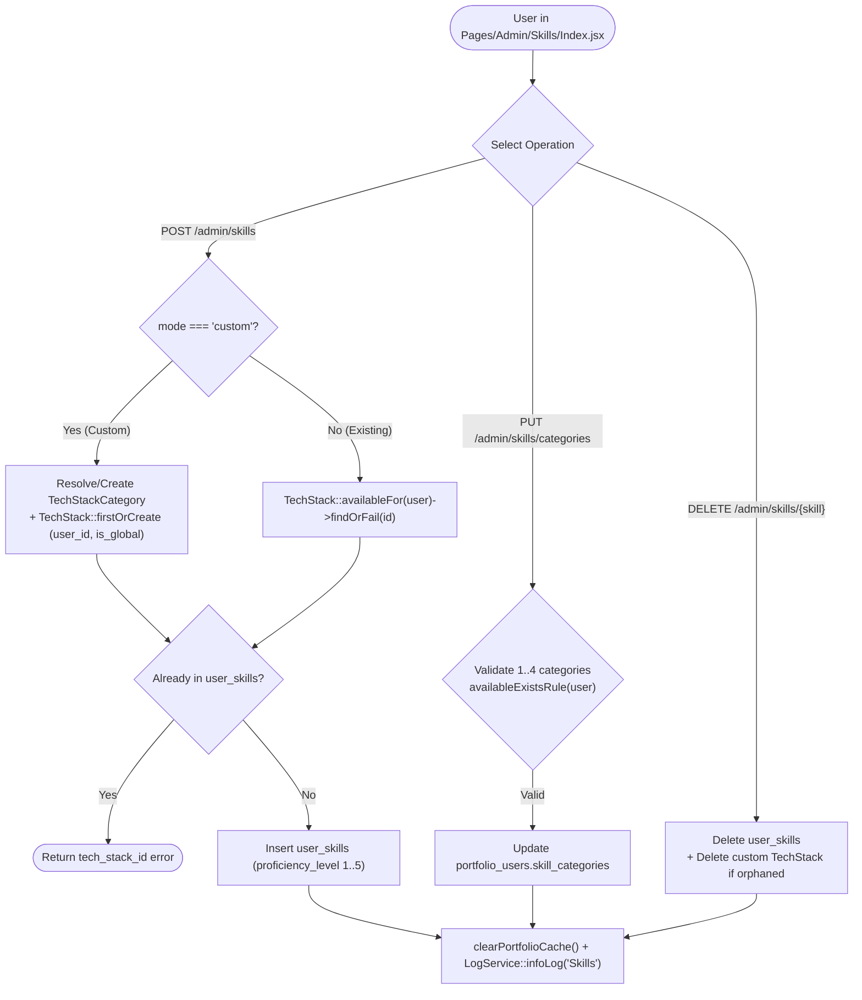

[← Back to Index](../README.md)

# Feature: Skills, Display Categories & Custom Skill Categories

## Overview & Actors
- **Business Goal:** Manage the user's active technical skills and proficiency levels (`1–5`), select 1 to 4 featured skill categories to display on the public portfolio, and manage per-user custom skill categories.
- **Actors / Roles:** Authenticated users with the `skills.manage` permission (granted by default to `member`, `admin`, and `superadmin`).
- **Related Entities:** [`user_skills`](../01-database-erd.md#user-skills), [`tech_stacks`](../01-database-erd.md#tech-stacks), [`tech_stack_categories`](../01-database-erd.md#tech-stack-categories), [`portfolio_users`](../01-database-erd.md#portfolio-users).

## Feature Interconnections
- **Prerequisites (Upstream):**
  - User is authenticated via [Authentication](./auth.md) and holds `skills.manage`.
  - Global default skills (`TechStack` with `is_global = true`) and global skill categories are managed in [Platform Settings](./platform-settings.md).
- **Triggers / Leads To (Downstream):**
  - Active skills in `user_skills` populate the selectable skill chips in [Experiences](./experiences.md).
  - Custom skills (`TechStack` with `is_global = false`) created by a user are immediately selectable in the user's [Projects & Showcase](./projects.md) and can be promoted to the global catalog by an Admin via [Members & Accounts](./members.md#promoting-member-custom-skills-to-global-catalog).
  - Active skills and the 1–4 chosen display categories (`portfolio_users.skill_categories`) are rendered on [Public Portfolio](./public-portfolio.md).

---

## End-to-End Business Process Flows

### 1. Listing Active Skills, Available Catalog & Display Categories
- **Entry Point:** `GET /admin/skills` (`Admin\SkillController@index`, middleware `auth`, `permission:skills.manage`) → `Pages/Admin/Skills/Index.jsx`
- **Flow Steps:**
  1. Loads the user's `userSkills` (`with('techStack.category')->orderByDesc('proficiency_level')`).
  2. Loads `TechStack::availableFor($user)` (global skills + user's own custom skills) and `TechStackCategory::availableFor($user)` (global categories + user's own custom categories).
  3. Resolves `selectedCategoryIds` (up to 4 category IDs) from `portfolio_users.skill_categories` intersected with valid categories; if empty, defaults to the first 3 categories present in the user's active skills.

### 2. Adding a Skill (Default Catalog Mode vs Custom Skill Mode)
- **Entry Point:** `SkillFormModal.jsx` (desktop sidebar card or mobile `<AdminModal mobileSheet>`) → `POST /admin/skills` (`Admin\SkillController@store`)
- **Flow Steps:**
  1. **`existing` Mode (Pick from Default Catalog):**
     - Validates `tech_stack_id` (`required|exists:tech_stacks,id`) and `proficiency_level` (`required|integer|min:1|max:5`).
     - Enforces `TechStack::availableFor($user)->findOrFail(...)` (`SEC-05`: prevents attaching another user's private custom tech stack).
  2. **`custom` Mode (Create Custom Skill):**
     - Validates `custom_name` (`required|string|max:100`), `icon` (`nullable|string|max:255` Devicon class), `category_id` (`nullable`, validated via `TechStackCategory::availableExistsRule($user)`), `custom_category` (`nullable|string|max:50`), `proficiency_level` (`1..5`), and `is_global` (`sometimes|boolean`).
     - Only `admin` or `superadmin` (`$user->isAdminOrAbove()`) can set `is_global = true`; for `member` accounts, custom skills are always created with `is_global = false` and `user_id = $user->id`.
     - If `custom_category` is provided, `TechStackCategory::findOrCreateForUser()` resolves or creates the category.
     - Calls `TechStack::firstOrCreate()` to persist the technology record.
  3. **Duplicate Check & Persistence:**
     - Checks if `tech_stack_id` already exists in `$portfolio->userSkills()`. If so, returns a validation error on `tech_stack_id`.
     - Inserts the new [`user_skills`](../01-database-erd.md#user-skills) row, clears the portfolio cache ([Background System](../02-background-system.md#versioned-caching)), and logs `infoLog('Skills', ...)` to [Activity Logs](./activity-logs.md).

### 3. Updating Proficiency Level & Removing a Skill
- **Entry Points:**
  - **Update Level:** Proficiency `<select>` in `SkillRowItem.jsx` → `PUT /admin/skills/{skill}` (`Admin\SkillController@update`)
  - **Delete Skill:** `ConfirmDeleteModal.jsx` → `DELETE /admin/skills/{skill}` (`Admin\SkillController@destroy`)
- **Flow Steps:**
  1. **Ownership Check:** Verifies `$skill->portfolio_user_id === $portfolio->id` (HTTP 403 otherwise).
  2. **Update Level:** The frontend guards against no-op requests (when the selected level equals the current level) and tracks per-row loading state (`updatingSkillId`). The backend validates `proficiency_level` (`integer|min:1|max:5`) and updates `user_skills`.
  3. **Delete Skill & Orphan Custom TechStack Cleanup:**
     - Deletes the `user_skills` record.
     - If the underlying `TechStack` is a **user-owned custom skill** (`!is_global && user_id === $user->id`) and is no longer referenced in `user_skills` or `project_tech_stack`, the custom `TechStack` record is automatically deleted.

### 4. Selecting 1–4 Portfolio Display Categories
- **Entry Point:** `SkillCategoryDisplayCard.jsx` → `PUT /admin/skills/categories` (`Admin\SkillController@updateCategories`)
- **Flow Steps:**
  1. **UI & Business Rule:** Users must select between **1 and 4** skill categories to feature on their public portfolio. Clicking a 5th category chip triggers an informative warning toast while keeping the chip `aria-disabled="true"`.
  2. **Validation & Persistence:** Validates `skill_categories` (`required|array|min:1|max:4`, distinct integers passing `TechStackCategory::availableExistsRule($user)`) and updates `portfolio_users.skill_categories`.

### 5. Per-User Custom Skill Categories
- **Entry Points:** `CustomCategoryModal.jsx` (`CategoryManagerList.jsx`) →
  - `POST /admin/skills/custom-categories` (`SkillController@storeCustomCategory`)
  - `PUT /admin/skills/custom-categories/{category}` (`SkillController@updateCustomCategory`)
  - `DELETE /admin/skills/custom-categories/{category}` (`SkillController@destroyCustomCategory`)
- **Flow Steps:**
  1. Validates `name` (`required|string|max:50`) and checks case-insensitive uniqueness against `TechStackCategory::availableFor($user)`.
  2. On `PUT` and `DELETE`, verifies `!$category->is_global && $category->user_id === $user->id` (HTTP 403 otherwise).
  3. When a custom category is deleted, automatically removes its ID from `portfolio_users.skill_categories` before deleting the `TechStackCategory` row.

---

## Flowchart

